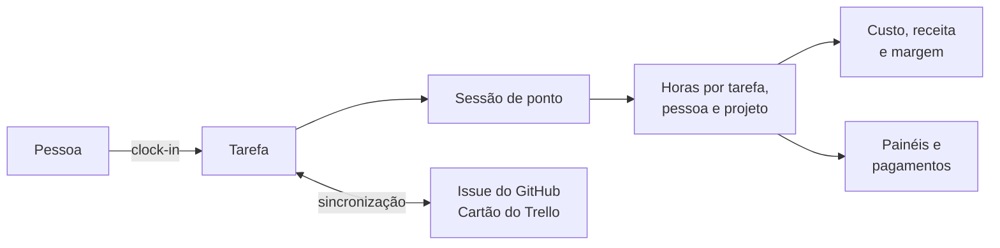

# Working Time Tracker

Ponto por tarefa para equipes que trabalham por projeto. Foi pensado para software houses e consultorias, que atendem
vários clientes e alocam as pessoas em um ou mais projetos, mas o modelo não depende disso.

A pessoa faz **clock-in** numa tarefa e **clock-out** quando para, e o sistema soma o tempo por tarefa, por pessoa e por
projeto e o transforma em custo, receita e margem. As tarefas podem andar sincronizadas com issues do GitHub e cartões
do Trello. É um único binário em Go que serve a API JSON e a interface web.



## Funcionalidades

- **Ponto por tarefa.** Clock-in e clock-out com cronômetro. Uma sessão pode ter várias tarefas, e cada pessoa tem no máximo uma sessão aberta.
- **Tarefas.** Status, prioridade, etiquetas, prazo e descrição em Markdown. O responsável é opcional: quem pega a tarefa ou bate o ponto nela vira o responsável.
- **Organização, projetos e times.** O projeto tem um cliente, ou é interno. A pessoa entra no projeto com o valor por hora dela, e os times só organizam quem está nele.
- **Quatro cargos.** Dono, admin, administrador de projeto e colaborador. O dinheiro (clientes, cobrança e pagamentos) é só do dono.
- **Dinheiro.** Valor pago por pessoa em cada projeto, valor cobrado do cliente, margem e regra de pagamento mensal ou quinzenal. Tudo é calculado a partir das sessões.
- **Painéis.** Cada pessoa tem o seu painel. A gestão tem a visão geral da organização e de cada projeto, além de saber quem está trabalhando agora e em quê.
- **Integrações.** Issues do GitHub e cartões do Trello sincronizados com as tarefas nos dois sentidos, e a mesma tarefa pode estar nas duas plataformas. O GitLab está "em breve".
- **Entrada e convites.** E-mail e senha, ou Google pelo Clerk. Os convites vão por link ou por e-mail.
- **Idiomas e países.** Português e inglês. Brasil e EUA, com CNPJ e EIN.
- **Ajuda pública** em `/help`, com o passo a passo do primeiro uso.

## Getting started

Pré-requisitos: **Go 1.26+** e **Docker**, ou um PostgreSQL 14+ seu.

```bash
cp .env.example .env    # troque INTEGRATION_ENCRYPTION_KEY por: openssl rand -hex 32
docker compose up -d    # Postgres com o banco de dev e o de testes
go run ./cmd/seed       # opcional: dados de demonstração (só num banco vazio)
go run ./cmd            # servidor; aplica as migrações ao subir
```

Abra **http://localhost:1243**. O seed cria a **Jatobá Software**, uma software house com doze pessoas, seis clientes e
oito projetos. A senha de todas as contas é `demo12345`:

| Cargo | E-mail |
|---|---|
| Dona | `ana@example.com` |
| Admin | `helena@example.com` |
| Colaborador | `bruno`, `carla`, `diego`, `elisa`, `fabio`, `gabriela`, `henrique`, `isabela`, `joao` ou `larissa`, seguidos de `@example.com` |

Sem o seed, clique em **Crie uma organização** na tela de login. A porta ocupada, as variáveis de ambiente e o que mais
o seed cria estão em [Instalação](_docs/getting-started/installation.md) e [Configuração](_docs/getting-started/configuration.md).

Os testes usam um PostgreSQL de verdade:

```bash
set -a && source .env && set +a && go test -p 1 ./...
```

## Documentação

| Área | Documento | O que tem |
|---|---|---|
| Começando | [Instalação](_docs/getting-started/installation.md) | Subir o sistema, o seed e os problemas comuns |
| | [Configuração](_docs/getting-started/configuration.md) | Todas as variáveis de ambiente |
| Produto | [Visão geral](_docs/product/overview.md) | Conceitos, organização, projetos e pessoas, tarefas, ponto e painéis |
| | [Dinheiro](_docs/product/money.md) | Clientes, valores por hora, margem e pagamentos |
| | [Permissões](_docs/product/permissions.md) | Os cargos, os grupos do projeto e o que cada um pode |
| Integrações | [Visão geral](_docs/integrations/overview.md) | O modelo comum, a sincronização e como criar um tipo novo |
| | [GitHub](_docs/integrations/github.md) · [Trello](_docs/integrations/trello.md) · [GitLab](_docs/integrations/gitlab.md) | Como conectar e as regras de cada plataforma |
| | [Clerk](_docs/integrations/clerk.md) | Entrar com o Google e convidar por e-mail |
| Arquitetura | [Visão geral](_docs/architecture/overview.md) | Pacotes, domínios e o caminho de uma requisição |
| | [Stack](_docs/architecture/stack.md) | Tecnologias e versões |
| | [Modelo de dados](_docs/architecture/data-model.md) | Entidades, relações e regras de exclusão |
| | [Segurança](_docs/architecture/security.md) | Sessões, senhas, tokens, isolamento entre organizações |
| | [Decisões](_docs/architecture/decisions.md) | As decisões de design e o porquê delas |
| Frontend | [Visão geral](_docs/frontend/overview.md) | Páginas do servidor com Alpine.js, sem build |
| | [Rotas](_docs/frontend/routes.md) | As páginas do navegador e quem abre cada uma |
| | [Padrões](_docs/frontend/patterns.md) | Navegação, modal, listas, formulários e as regras de interface |
| API | [Visão geral](_docs/api/overview.md) | Convenções, grupos de rotas e validação |
| | [Referência](_docs/api/reference.md) | Todas as rotas, com exemplos |
| | [Erros](_docs/api/errors.md) | Os códigos de erro (gerado por teste) |
| Desenvolvimento | [Testes e migrações](_docs/development/workflow.md) | Rodar a suíte e mudar o banco |
| | [Idiomas e países](_docs/development/i18n-and-countries.md) | Como os textos funcionam e como acrescentar um idioma ou um país |
| Histórico | [Sprints](_docs/history/sprints.md) | O que foi feito em cada sprint |
| | [Proposta inicial](_docs/history/initial-proposal.md) · [Refatoração domain-first](_docs/history/domain-first-refactor.md) | Documentos de quando o projeto começou |

## Stack

Go com Echo, PostgreSQL com Ent e migrações versionadas (goose), e HTML renderizado no servidor com Alpine.js
vendorizado. Tudo vai num binário só, com os templates e os arquivos estáticos embutidos. Detalhes em
[Stack](_docs/architecture/stack.md).
