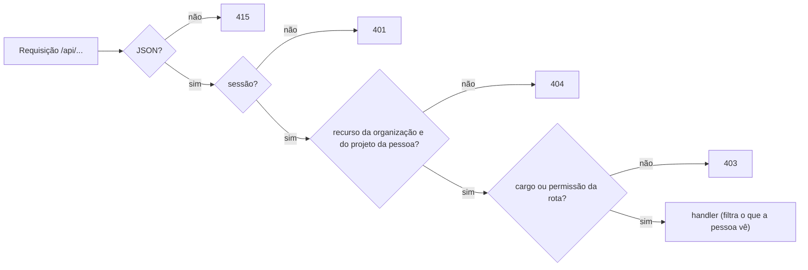

# API

A API JSON que a interface usa, e que qualquer cliente pode usar. Aqui estão as convenções e os grupos de rotas. Cada
rota, com corpo e resposta, está em [reference.md](reference.md), e cada código de erro, com o status e os textos, em
[errors.md](errors.md). A fonte das rotas é `internal/routes/routes.go`.

## Convenções

- **Tudo é JSON**, sob `/api`. `POST`, `PUT` e `PATCH` com um `Content-Type` que não seja `application/json` respondem
  `415`. Junto do cookie `SameSite=Lax`, isso impede que um formulário de outro site aja em nome de quem está logado.
- **Sessão por cookie.** O login e o signup devolvem o cookie `wtt_session` (HttpOnly, SameSite=Lax, 7 dias). Fora de
  `/api/auth/*` (as rotas públicas) e de `/healthcheck`, toda rota pede a sessão. As rotas do login pelo Clerk
  (`/api/auth/clerk/*`) recebem o token do Clerk em `Authorization: Bearer`. Ver [clerk.md](../integrations/clerk.md).
- **Limite de tentativas.** Signup, login, convites e as rotas do Clerk têm limite por IP (por padrão, 10 por minuto,
  com rajada de 10). Acima dele, `429`.
- **Erro é código, não texto.** Toda resposta de erro é
  `{"error": {"code": "dominio.motivo", "params": {...}}}`. Quem chama mostra o texto no idioma da pessoa. Um erro que a
  API não previu vira `500` `internal.server_error`, sem detalhe interno.
- **Corpo estrito.** Chave desconhecida é `400` `request.invalid_body`. Tipo errado devolve o mesmo código com
  `params.field`. Corpo acima de 1 MiB é `413` `request.body_too_large` (`internal/server/binder.go`).
- **`PATCH` parcial.** Campo omitido mantém o valor, e `null` apaga onde faz sentido (o prazo da tarefa).

## Status

| Status | Quando |
|---|---|
| `401` | Sem sessão, ou login recusado. A tela leva ao login |
| `403` | Logado, mas sem o cargo ou a permissão que a rota pede |
| `404` | O recurso não existe, é de outra organização ou é de um projeto em que a pessoa não está. A API não diferencia, para não revelar que existe |
| `409` | Conflito com o que já existe: e-mail em uso, cliente com projetos, etiqueta com o mesmo nome, tarefa que outra pessoa pegou antes, item já ligado, rodada de sincronização em andamento |
| `415` | Corpo que não é JSON |
| `429` | Limite de tentativas |

## O caminho de uma requisição

Cada rota com id passa por `RequireOrg`, que confere se o recurso é da organização de quem chama. Num recurso de
projeto, quem não é dono nem admin só passa se tem valor por hora no projeto, e as permissões dele ali ficam à mão das
etapas seguintes. Depois vem o que a rota pede: `admin`, `owner`, uma permissão da organização (`orgCan`) ou uma do
projeto (`can`). Por fim, alguns handlers filtram a resposta: o valor pago dos colegas, a cobrança e os pagamentos só vão
a quem pode vê-los. As regras estão em [permissions.md](../product/permissions.md).

## Grupos de rotas

| Grupo | Rotas | Acesso |
|---|---|---|
| Autenticação | `/api/auth/signup`, `login`, `invites/:token` (+ `accept`), `clerk/login`, `clerk/signup`, `clerk/join` | públicas, com limite de tentativas |
| Conta | `/api/auth/logout`, `me`, `password`, `onboarding/complete` | logado |
| Organização | `/api/orgs/:orgId` (`PATCH` e `DELETE` do dono) (+ `persons`, `projects`, `overview`, `working-now`, `me/overview`, `me/tasks`, `payments`, `invites`, `customers`) | membro; `overview` e `working-now` de admins; `payments` e `customers` do dono; `invites` com `people.manage`; criar projeto, admins |
| Convites | `/api/invites/:inviteId` (`DELETE`), `/api/projects/:projectId/invites` | `people.manage`; o do projeto, `collaborators.manage` para listar e também `rates.manage` para criar |
| Clientes | `/api/customers/:customerId` | dono |
| Pessoas | `/api/persons/:personId` (+ `role`, `weekly-hours`, `payment`, `allocations`, `payments`) | `role` do dono, `weekly-hours` com `people.manage`, `payment` do dono; o perfil, a própria pessoa ou um admin |
| Projetos | `/api/projects/:projectId` (+ `overview`, `billing`, `allocations`, `collaborators`, `members`, `teams`, `labels`, `tasks`, `work-sessions`, `integrations`, `invites`, `sync`) | quem está no projeto; cada mudança pede a sua permissão do projeto |
| Times | `/api/teams/:teamId` (+ `members`) | ler, quem está no projeto; mudar, `teams.manage` |
| Tarefas | `/api/tasks/:taskId` (+ `claim`, `attributes`, `link-external-item`, `external-details`, `sync`, `publish`) | quem está no projeto da tarefa |
| Ponto | `/api/projects/:projectId/work-sessions` (+ `clock-in`, `clock-out`, `total`, `:sessionId/tasks`), `/api/work-sessions/active` | quem está no projeto; cada um bate o próprio ponto, e o de outra pessoa só um admin registra |
| Integrações | `/api/integrations/:integrationId` (+ `repositories`, `sync`) | ler, quem está no projeto; o resto, `integrations.manage` |
| Permissões | `/api/permissions` | logado: o catálogo, para as telas |
| Saúde | `/healthcheck` | pública, fora do `/api` |

As rotas que começam a conexão com o GitHub e o Trello não são da API: são idas e voltas do navegador, em
[frontend/routes.md](../frontend/routes.md).

## Validação

Cada campo tem uma regra só, a mesma na tela e no servidor. Os tamanhos máximos estão em
`internal/validate/limits.go` (em caracteres, não em bytes), e a tela os recebe em `window.BOOT.limits`. O erro de
validação diz o campo em `params.field`, que é a chave JSON do corpo, e a tela mostra a mensagem embaixo do campo
certo. Os códigos genéricos são `request.field_required`, `request.field_too_long` (com `max`) e
`request.field_invalid`.

## Insomnia

A coleção está em `_test/insomnia-collection.json`. Importe, rode **Signup** ou **Login**, e o Insomnia guarda o cookie
de sessão para as outras chamadas. O fluxo sugerido e as variáveis de ambiente da coleção estão no fim de
[reference.md](reference.md).
