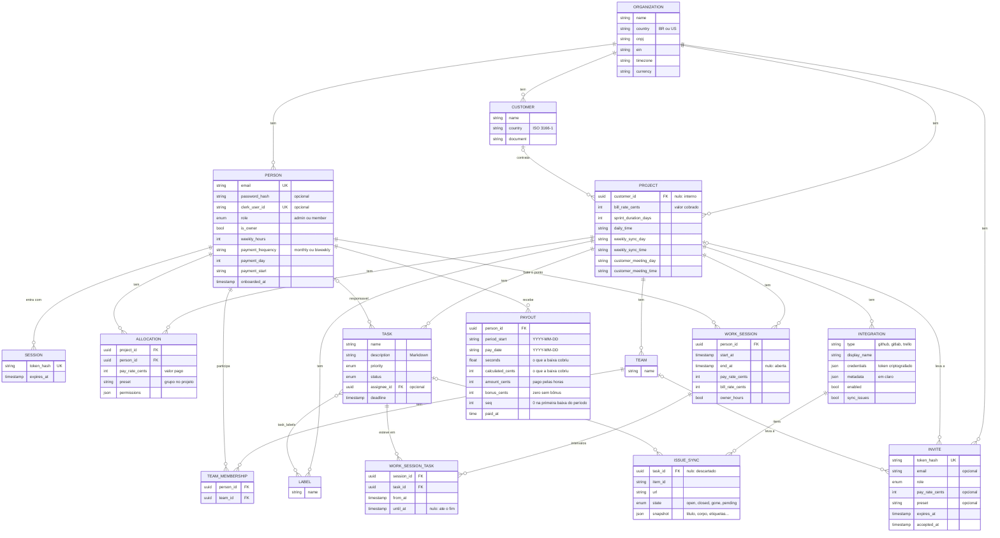

# Modelo de dados

As tabelas do banco, como elas se ligam e as regras que o modelo garante. A fonte é `ent/schema`; o banco muda só
por migrações (ver [workflow.md](../development/workflow.md)), e um teste falha se os dois divergem.

## Diagrama

Os campos abaixo são os que importam para entender o sistema; todas as tabelas têm `id` (UUID) e `created_at`.

`ISSUE_SYNC.snapshot` resume várias colunas (`title`, `body`, `labels`, `assignee_logins`, `mapped_login`,
`mapped_person_id`, `deadline`); ver a seção do vínculo abaixo.

## As entidades

| Tabela | O que é |
|---|---|
| `organizations` | A empresa. Perfil, dados jurídicos (o documento fiscal depende do `country`), regime, fuso e moeda |
| `persons` | Uma pessoa de **uma** organização. O e-mail é único no sistema todo. `role` é `admin` ou `member`; o dono é um admin com `is_owner` |
| `sessions` | A sessão de login (o cookie). Guarda só o sha256 do token |
| `invites` | Convite de uso único, com validade. Pode levar a pessoa a um projeto, com valor, time e grupo |
| `customers` | O cliente que contrata projetos. Tem país próprio, que decide como o documento é conferido |
| `projects` | O projeto. Com cliente, tem o valor cobrado por hora; sem cliente, é interno e não tem nenhum dos dois |
| `allocations` | A pessoa no projeto: o valor pago por hora e o grupo de permissões dela ali. Uma por pessoa e projeto |
| `teams`, `team_memberships` | Os times de um projeto e quem está em cada um |
| `labels`, `task_labels` | As etiquetas de um projeto e as de cada tarefa |
| `tasks` | A tarefa, com prioridade, status, responsável opcional e prazo |
| `work_sessions` | Uma sessão de ponto: de um projeto, de uma pessoa, com os valores por hora do momento em que abriu |
| `work_session_tasks` | Cada intervalo em que uma tarefa esteve numa sessão |
| `integrations` | A conexão de um projeto com uma plataforma: token criptografado e os campos da plataforma em `metadata` |
| `issue_syncs` | O vínculo de uma tarefa com um item da plataforma (issue, cartão) e o snapshot do último acordo entre os dois |

## Cargos e permissões no modelo

- O **cargo na organização** é `persons.role` (`admin` ou `member`) mais `persons.is_owner`. As permissões da
  organização **não são gravadas**: decorrem do cargo (`permission.OrgKeysFor`).
- O **dono** é um só por organização (índice único parcial `one_owner_per_organization` em
  `persons (organization_id) WHERE is_owner`). É quem criou a organização, e é sempre admin.
- O **cargo no projeto** é o grupo da alocação: `allocations.preset` (`member`, `manager`, `finance`, `admin`, ou
  `custom` quando alguém mexeu numa permissão avulsa) e a lista resolvida em `allocations.permissions`. O
  "administrador de projeto" é o grupo `manager`.

As regras de cada cargo estão em [permissions.md](../product/permissions.md).

## Regras

**Estar num projeto é ter valor por hora nele.** A alocação (`allocations`) é o que põe a pessoa no projeto, e o
valor é obrigatório nesse momento: ele libera o ponto e o acesso ao projeto. Só quem já tem a alocação entra num
time (`team.no_rate`), e estar num time é o que deixa alguém ser escolhido como responsável de uma tarefa. Tirar a
pessoa do projeto apaga a alocação e os times dela ali numa transação só, encerra a sessão que ela tinha aberta
naquele projeto e mantém as tarefas e as sessões. Não há como apagar só o valor.

Num banco de antes dessa regra pode haver alguém num time sem alocação. Essa linha não dá mais acesso ao projeto
nem faz a pessoa aparecer como colaboradora; para voltar, ela precisa de um valor.

**O dono não tem custo.** A alocação dele guarda sempre 0, e o ponto dele não exige alocação (o clock-in a cria).
As sessões dele gravam `pay_rate_cents = 0`, o valor cobrado do projeto e `owner_hours = true`: as horas dele valem
o valor cobrado, sem custo. Para todos os outros, o valor pago e o cobrado têm o piso de 10,00 por hora.

**A sessão congela os valores.** Ao abrir o ponto, a sessão copia o valor pago da alocação e o valor cobrado do
projeto. Mudar um valor só vale dali em diante. Quem não tem alocação no projeto não bate o ponto.

**Uma sessão aberta por pessoa.** O índice único parcial `one_active_session` em
`work_sessions (person_id) WHERE end_at IS NULL` garante isso no banco, mesmo com dois clock-ins ao mesmo tempo; o
service confere antes só para dar um erro melhor.

**A sessão tem tarefas ao longo do tempo.** Uma sessão é de um projeto e começa por uma tarefa dele. Outras entram
e saem depois, inclusive depois de a sessão terminar; cada passagem é uma linha de `work_session_tasks`, com
`until_at` nulo enquanto vai até o fim da sessão. Tarefas diferentes podem se sobrepor (trabalho em paralelo); a
mesma tarefa pode voltar, sem sobrepor o intervalo anterior. O tempo vale para a sessão e para cada tarefa: a
pessoa, o projeto e os valores contam a sessão uma vez só, e cada tarefa conta o tempo em que esteve nela.

**O vínculo com a plataforma mora só em `issue_syncs`.** Uma tarefa tem no máximo um item por integração (único em
`task_id, integration_id`), e um item serve a uma tarefa só (único em `integration_id, item_id`). O snapshot guarda
o último acordo entre a tarefa e o item, e é contra ele que a sincronização vê quem mudou o quê. `task_id` nulo é
um item **descartado** (a tarefa foi excluída ou desligada dele), que não volta a ser importado. `state` `pending` é
um vínculo feito à mão que a sincronização ainda não adotou; `gone` é o item que sumiu da plataforma. Ver
[integrations/overview.md](../integrations/overview.md).

**O responsável é opcional.** Uma tarefa sem responsável fica disponível; quem bate o ponto nela ou a pega passa a
ser o responsável, com um `UPDATE ... WHERE assignee_id IS NULL`, então de dois pedidos ao mesmo tempo só um ganha.
O prazo padrão de uma tarefa nova é de 7 dias; uma tarefa importada de uma plataforma pode nascer sem prazo.

**Os períodos de pagamento não são gravados, a baixa é.** Os períodos são calculados da regra da pessoa
(`payment_frequency`, `payment_day`, `payment_start`) e das sessões. `payouts` guarda só a baixa de um período: a primeira
cobre o período até ali e cada uma das seguintes, o restante que a pessoa registrou depois da anterior (índice único em
`person_id`, `period_start`, `pay_date` e `seq`, a posição da baixa no período), com o que ela cobriu e o que foi pago,
bônus incluído; sai junto com a pessoa. Ver [money.md](../product/money.md).

## Exclusões

| Excluir | O que acontece |
|---|---|
| Tarefa | Sai das sessões (os intervalos dela são apagados), mas as sessões e as horas ficam: uma sessão pode ficar sem tarefa. As etiquetas dela se soltam. Os itens das plataformas viram descartados (e, se pedido, são apagados ou arquivados lá) |
| Projeto | Apaga os times, as alocações, as etiquetas, as tarefas, as sessões e as integrações (com os vínculos). O convite que levava a ele continua valendo, só para a organização |
| Time | Apaga quem estava nele. O convite que levava a ele fica sem time |
| Integração | Apaga os vínculos dela |
| Cliente | Só sem projetos apontando para ele (`customer.has_projects`) |
| Organização | Só sem projetos (`organization.has_projects`). Apaga as pessoas, as sessões de login, os clientes e os convites |

Uma pessoa com tarefas não pode ser apagada do banco (a chave estrangeira recusa), e não há rota que apague uma
pessoa.

## Restos de modelos antigos

- `projects.github_repo_url` e `gitlab_repo_url` são de antes das integrações. O modelo ainda os lê e grava, mas a
  ligação com as plataformas é a tabela `integrations`.
- `integrations.sync_cursor` é de onde a próxima rodada incremental do GitHub pede as issues; não aparece na API.
