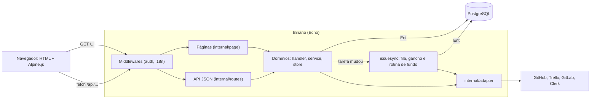
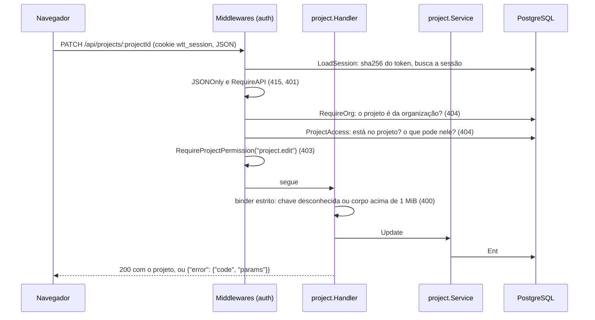

# Arquitetura: visão geral

Como o sistema está montado: um binário só, os domínios, as pastas, o que acontece ao subir o servidor e o caminho
de uma requisição até o banco. As tecnologias estão em [stack.md](stack.md), e o porquê de cada escolha, em
[decisions.md](decisions.md).

## Um binário

O servidor é um binário Go (Echo) que serve **três coisas** no mesmo endereço:

- a **API JSON** em `/api/*`, que é a fonte da verdade e serve também a clientes fora do navegador;
- as **páginas HTML**, renderizadas no servidor (`html/template`), que já sabem quem está logado e em que
  organização e projeto ele está. Os componentes Alpine.js de cada página buscam e mudam os dados pela API;
- os **arquivos estáticos** em `/static`, sem etapa de build.

Templates e estáticos ficam embutidos no binário (`web/embed.go`, `embed.FS`). Ao lado do servidor roda a
**sincronização das integrações** (`issuesync`), uma rotina de fundo que fala com o GitHub e o Trello.



## Domínios

O código é organizado **por domínio** (domain-first), não por camada. Cada pasta de `internal/domain` é um pacote
com o próprio modelo, as regras e as rotas:

| Arquivo | Papel |
|---|---|
| `model.go` | Os tipos do domínio, já no formato do JSON |
| `store.go` | Leitura e escrita no banco pelo cliente do Ent |
| `service.go` | As regras: validação, permissões que não cabem na rota, transações |
| `handler.go` | Lê o pedido, chama o service, responde com `apperr.Respond` em caso de erro |
| `errors.go` | Os códigos de erro do domínio (`apperr.New("dominio.motivo", status)`) |

Os domínios de cadastro seguem esse molde: `organization`, `customer`, `person`, `project`, `team` (com o
`membership_*` dos times), `allocation` (o valor por hora da pessoa no projeto), `task` (com as etiquetas e os
vínculos com itens externos), `work_session` (o ponto) e `integration`. Alguns são diferentes de propósito:

| Pacote | O que tem de diferente |
|---|---|
| `auth` | Signup, login, sessões, convites, o login pelo Clerk e **os middlewares** de acesso (`middleware.go`, `access.go`) |
| `collaborator` | Não tem tabela: junta o valor por hora e os times de quem está no projeto |
| `overview` | Não tem tabela nem store: lê os services dos outros domínios e monta as visões gerais (do projeto, da organização e o painel da pessoa) |
| `payment` | Não tem tabela: calcula os períodos de pagamento a partir das sessões e da regra de cada pessoa |
| `permission` | O catálogo de permissões e grupos (`catalog.go`) e a rota que o entrega à tela |
| `projectaccess` | Predicados do Ent que dizem quem está num projeto (`PersonIn`, `ProjectsOf`, `Has`, `ColleaguesOf`) |
| `projectinvite` | O convite que já leva a pessoa a um projeto, e quem a põe nele quando o convite é aceito (`Applier`) |
| `issuesync` | A sincronização com as plataformas: a regra de conflito (`merge.go`), a rodada (`run.go`), a fila e a rotina de fundo (`worker.go`), publicar, excluir e a postagem automática |

Quando um domínio precisa avisar outro que ele não pode importar, a dependência entra por uma função registrada no
`server.Build`, e não por import:

- `task.Store.SetChangeHook` e `SetCreateHook` avisam a sincronização que uma tarefa mudou ou nasceu;
  `task.Service.SetRemover` deixa a exclusão da tarefa apagar o item nas plataformas;
- `auth.Service.SetProjectApplier` põe no projeto quem aceitou um convite com projeto (o `auth` não importa
  `allocation` nem `team`);
- `person.Handler.SetScope` recebe do `auth` quem a pessoa logada pode ver (o `auth` importa `person`, então o
  contrário não pode).

## Pastas

```
cmd/
  main.go               o servidor: config, banco, migrações, server.Build e a rotina de sincronização
  seed/                 dados de demonstração
  migrate/              gera, confere e aplica as migrações
  fakegithub/           o GitHub falso dos testes, como servidor de desenvolvimento (painel em /_fake)
  faketrello/           o Trello falso dos testes, como servidor de desenvolvimento (painel em /_fake)
ent/
  schema/               o modelo do banco (Ent); o resto de ent/ é gerado com go generate ./ent
internal/
  adapter/              clientes do GitHub, GitLab, Trello e Clerk, o registro dos tipos e a criptografia do token
    clerkfake/          o Clerk falso dos testes
  apperr/               erro com código estável e a resposta de erro da API
  config/               variáveis de ambiente (lê o .env)
  country/              o cadastro dos países (documento fiscal, endereço, moeda e fuso)
  database/             conexão, migrations/ (SQL versionado) e quem as aplica
  domain/               os domínios (ver acima)
  i18n/                 catálogos YAML (locales/), escolha do idioma e o script dos textos
  page/                 handlers das páginas HTML
  routes/               rotas da API (routes.go), das páginas (pages.go) e o /healthcheck
  server/               server.Build, que monta tudo, e os testes do router de verdade
  template/             o renderer dos templates
  validate/             limites dos campos e validadores (CNPJ, EIN, e-mail, valor por hora, URL)
testutil/               banco de teste, sessões e as plataformas fake (GitHub, Trello, GitLab, Clerk)
web/                    templates e estáticos, embutidos no binário
docker-compose.yml      PostgreSQL de desenvolvimento e de testes
_docs/                  esta documentação
_test/                  a coleção do Insomnia
```

## Subir o servidor

`cmd/main.go` faz, em ordem:

1. `config.Load()` lê o ambiente (e o `.env`, se existir) e recusa combinações inválidas (por exemplo, só uma das
   chaves do Clerk). Ver [configuration.md](../getting-started/configuration.md).
2. `database.Open` conecta e `database.Migrate` aplica as migrações pendentes. Um banco com tabelas e sem histórico
   é recusado. Ver [workflow.md](../development/workflow.md).
3. Monta o OAuth do GitHub, a autorização do Trello e o Clerk a partir do ambiente. `GITHUB_API_URL` e
   `TRELLO_API_URL` trocam o endereço da API (para um servidor fake).
4. `server.Build` monta tudo: stores, services, handlers, os ganchos entre domínios, os middlewares, as rotas da API
   e das páginas. Devolve o `App`, com o servidor Echo e o `Syncer` da sincronização. Os testes usam `server.New`,
   que monta o mesmo servidor sem a rotina de fundo.
5. Sobe o servidor e, ao lado, `app.Sync.Run`. Ctrl+C ou SIGTERM param os dois, e o `main` espera a rodada em
   andamento terminar antes de fechar o banco.

A rotina de fundo acorda no menor intervalo de sincronização configurado e olha cada integração quando passou o
intervalo do tipo dela. O detalhe está em [integrations/overview.md](../integrations/overview.md).

## Caminho de uma requisição

Toda requisição passa pelos middlewares globais, na ordem: tirar a barra do fim (`RemoveTrailingSlash`), log,
`Recover`, **`LoadSession`** (lê o cookie `wtt_session` e põe a pessoa no contexto, sem bloquear nada) e o idioma
(`i18n`). Depois vêm os da rota:

| Middleware | Onde | O que faz |
|---|---|---|
| `JSONOnly` | Todo `/api` | `POST`, `PUT` e `PATCH` com `Content-Type` que não é JSON recebem `415` |
| `RequireAPI` / `RequirePage` | Rotas logadas | Sem pessoa no contexto: `401` na API; na página, vai para `/login?next=` |
| `RequireOrg(kind, param)` | Rota com id | O recurso precisa ser da organização de quem chama, senão `404`. Num recurso de projeto (projeto, time, tarefa, integração), quem não é dono precisa estar no projeto (`ProjectAccess`), senão `404`; o que a pessoa pode no projeto fica no contexto |
| `RequireOwner`, `RequireAdmin` | Rotas do cargo | `403` na API, `404` na página |
| `RequireOrgPermission(key)` | Permissão da organização | Lê as permissões que o cargo dá (`permission.OrgKeysFor`) |
| `RequireProjectPermission(keys...)` | Permissão do projeto | Lê o conjunto que o `RequireOrg` deixou no contexto: passa com qualquer uma das chaves |

O handler ainda pode esconder campos que a pessoa não pode ver (o valor cobrado, o valor pago dos colegas). As
regras de cada cargo estão em [permissions.md](../product/permissions.md).



As páginas fazem o mesmo caminho com as versões `*Page` dos middlewares (`RequireOrgPage`, `RequireOwnerPage`
e outras), que respondem com a página "Página não encontrada" em vez de JSON. Um `404` de rota que não existe também
vira essa página, menos em `/api` e `/static`.

## Erros

Os erros da API são códigos estáveis, sem mensagem: `{"error": {"code": "dominio.motivo", "params": {...}}}`. Cada
domínio declara os seus em `errors.go`, e `apperr.Respond` é o único jeito de responder com erro: um erro sem código
vira `internal.server_error` (`500`), com o detalhe só no log. A lista está em [api/errors.md](../api/errors.md).
