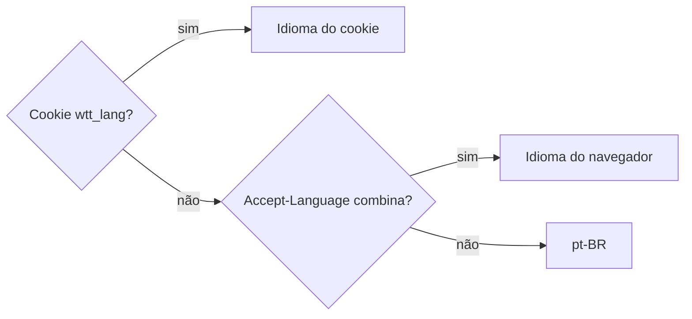
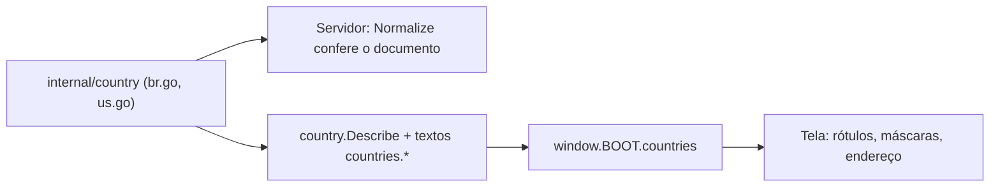

# Idiomas e países

Como a interface fala mais de um idioma e como os dados da organização e dos clientes mudam de um país para outro. Os
dois seguem a mesma ideia: o código só conhece chaves e códigos, e o que muda fica num cadastro só.

## Idiomas

A interface fala **português do Brasil** (o padrão) e **inglês**. Todo texto que a pessoa lê mora em dois arquivos
YAML, `internal/i18n/locales/pt-BR.yaml` e `en.yaml`; o código só conhece as chaves.

### Qual idioma vale

- O toggle é um link para `/lang/<código>?next=<página>`, que grava o cookie `wtt_lang` por um ano e volta. Funciona sem
  JavaScript e nas telas sem login.
- O idioma não fica na conta: é uma escolha do navegador.
- As respostas mandam `Vary: Cookie, Accept-Language`, para um cache no meio não servir o idioma de outra pessoa.

### No servidor

O [go-i18n v2](https://github.com/nicksnyder/go-i18n) lê os YAML (`internal/i18n`). Um catálogo com erro faz a subida
falhar.

- Nos templates: `{{.T "chave"}}`; dentro de `range` ou `with`, `{{$.T "chave"}}`; com valores,
  `{{.T "chave" "nome" .Nome}}`.
- O título da página, nos handlers em Go: `TitleKey: "titles.login"`.

### No navegador

O servidor entrega o mesmo YAML como `window.I18N`, em `/i18n/<idioma>.js` (com o hash na URL, para o cache), antes do
`app.js`.

- No JavaScript: `WTT.t('chave', { nome: valor })`.
- Nas expressões do Alpine: `$t('chave', { nome: valor })`.

**Dentro de uma expressão Alpine (`x-text`, `:title`, `:placeholder`) use sempre `$t`, nunca `{{.T}}`.** O
`html/template` só escapa HTML, e um apóstrofo de um texto em inglês ("Don't") quebraria a expressão JavaScript.

### Como escrever as chaves

- **Uma chave por frase inteira.** Nunca pedaços para juntar no código: a ordem das palavras muda de um idioma para
  outro.
- **Valores entram por placeholder:** `"Em andamento: {{.name}}"`.
- **Plural** com as formas `one` e `other` e o placeholder `{{.count}}`. No português o zero também é `one` (regra do
  CLDR), então "nenhuma pessoa" é uma chave à parte.
- **Enums continuam códigos.** Papel, moeda e regime são os códigos do backend; só o rótulo vem do YAML.
- **Nomes proibidos.** Não use como nome de chave `id`, `description`, `hash`, `zero`, `one`, `two`, `few`, `many`,
  `other`, `translation`, `leftdelim` nem `rightdelim`: o go-i18n os lê como partes de uma mensagem e recusa o arquivo.
  Use, por exemplo, `description_label`.

### Datas, horas, valores e erros

- **Datas, horas e números** seguem o idioma (`Intl` com `WTT.lang`): "R$ 20,50" em português e "R$20.50" em inglês. A
  **moeda** não muda com o idioma: é a da organização.
- **Campos de valor** mostram o separador do idioma e leem os dois jeitos de digitar ("20,5", "20.50", "1.234,56" e
  "1,234.56"). Com um separador só e três dígitos depois ("1.234"), vale o separador de milhar do idioma.
- **Erros da API** não trazem mensagem, só um código estável. O navegador procura `errors.<código>` no mesmo YAML
  (`WTT.errorText`), e `e.message` já chega no idioma da página. Ver [Códigos de erro](../api/errors.md).

### O que fica fora da tradução

Os dados de demonstração do seed e o que as pessoas digitam (nomes de projeto, de tarefa, de cliente) ficam como foram
escritos. Logs e comandos de linha de comando seguem em português.

### Adicionar um idioma

1. Crie `internal/i18n/locales/<código>.yaml` com as mesmas chaves.
2. Acrescente o código em `supported` (`internal/i18n/i18n.go`).
3. Acrescente `lang.<código>.short` e `lang.<código>.name` em todos os catálogos. Na chave, o código vai em minúsculas e
   com `_` no lugar do `-` (`pt-BR` vira `lang.pt_br`).

Os testes conferem o resto.

### Testes

- `internal/i18n`: todos os idiomas têm as mesmas chaves e os mesmos placeholders, e toda chave usada nos templates, no
  JavaScript e nos handlers de página existe em todos.
- `internal/server` (`i18n_test.go`): o idioma por cookie, por cabeçalho e pelo toggle, e nenhuma sobra de português
  nas páginas em inglês.
- `internal/server` (`errors_test.go`): todo código de erro tem texto em todos os idiomas, nenhum texto fica sem
  código, e nenhum texto usa placeholder que o código não declara.

## Países

O que muda de um país para outro nos dados da organização e dos clientes (o documento fiscal, os textos do endereço, a
moeda e o fuso de partida) está num cadastro só, `internal/country`. Nada disso é `if` espalhado: a validação do
servidor, os rótulos e as máscaras saem da mesma entrada.

Hoje o cadastro tem o **Brasil** (`BR`) e os **Estados Unidos** (`US`).

| País | Documento | Máscara | Moeda e fuso de partida |
|---|---|---|---|
| `BR` | CNPJ, inclusive o alfanumérico (`validate.CNPJ`) | `**.***.***/****-99` | BRL, `America/Sao_Paulo` |
| `US` | EIN (`validate.EIN`) | `99-9999999` | USD, `America/New_York` |

Nas máscaras, `9` é um dígito, `*` é um dígito ou uma letra, e o resto é literal.

### O que o país decide

- **Organização.** O país é um código do cadastro (`country.Parse` também entende as grafias antigas, de quando o campo
  era texto livre). Ele decide qual documento vale, os rótulos e as máscaras do endereço. O banco tem uma tabela só,
  com as colunas de todos os países, e as de outro país ficam vazias.
- **Ao criar a organização**, o país define a moeda e o fuso de partida, e o seletor já vem com o país do idioma da
  página (`country.ForLang`: pt sugere o Brasil, en sugere os EUA). Depois disso, trocar o país **não** muda a moeda nem
  o fuso, e também não apaga o documento do outro país: ele fica guardado e escondido na tela. Um campo de moeda ou de
  fuso esvaziado na edição volta ao do país.
- **Cliente.** O país do cliente pode ser qualquer código ISO 3166-1 (`internal/country/iso.go`, com os nomes vindos do
  navegador por `Intl.DisplayNames`) e começa no da organização. O documento é conferido pela regra do país dele; fora
  do cadastro é um texto livre de até 32 caracteres (`validate.GenericTaxID`). Trocar o país do cliente na API confere o
  documento guardado pela regra do país novo e recusa o que não serve.

O navegador recebe o cadastro em `window.BOOT.countries` (a lista, o rótulo genérico e os códigos ISO), com os textos já
no idioma da página. Ele só vai às páginas que o desenham: o cadastro, a volta do Clerk e as páginas da organização.

### Adicionar um país com documento fiscal próprio

1. **A entrada no cadastro.** Um arquivo em `internal/country`, como `br.go` e `us.go`, com `Code`, `Aliases` (grafias
   antigas, em minúsculas), `Langs` (os idiomas da interface que o sugerem), `Currency`, `Timezone` e o `LegalID`
   (`Field`, `Mask` e `Normalize`). Acrescente-o em `order` (`country.go`).
2. **O validador** do documento em `internal/validate`, como `CNPJ` e `EIN`, com os testes.
3. **Os textos** `countries.<código em minúsculas>.*` nos dois catálogos: `legal_id.label`, `legal_id.placeholder`,
   `address.line1_placeholder` e `address.line2_label`. `internal/country` confere que todo país tem todos os textos nos
   dois idiomas.
4. **Se o documento é uma coluna nova da organização:** o campo no `ent/schema/organization.go`, com a migração (ver
   [Fluxo de trabalho](workflow.md#migrações)); o campo em `Organization` e em `UpdateInput`; as linhas de
   `Store.Update` e `toDomainOrg` (`internal/domain/organization`); um erro `organization.invalid_<campo>` com os
   textos; e a linha em `legalIDRefs` (`organization/service.go`). `TestLegalIDRefs_CoverEveryCountry` falha enquanto
   essa linha faltar.

Um país que usa só o que já existe (um documento que cabe numa coluna existente, por exemplo) não pede migração.
