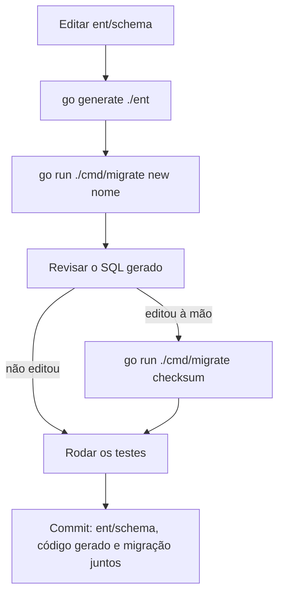

# Fluxo de trabalho

Como rodar os testes e como mudar o banco. Para subir o sistema, ver [Instalação](../getting-started/installation.md).

## Testes

Os testes usam um **PostgreSQL de verdade**, o banco `working_time_tracker_test` que o `docker compose` cria. O Go não
lê o `.env`, então carregue-o antes:

```bash
set -a && source .env && set +a && go test -p 1 ./...
```

- **Cada pacote recria o banco.** Antes de rodar, o pacote apaga o schema e aplica as migrações de novo
  (`testutil.Setup`). O banco não pede preparo, e os testes sempre veem o que os arquivos de migração produzem hoje.
- **Só num banco `_test`.** O `testutil` se recusa a apagar um banco cujo nome não termina em `_test`: um
  `TEST_DATABASE_URL` apontado para o lugar errado não custa os dados dele.
- **`-p 1` é obrigatório.** Todos os pacotes usam o mesmo banco e cada um o apaga ao começar. Em paralelo, quase todos
  falham ao mesmo tempo, e parece uma regressão que não existe.
- **Nenhum teste sai da máquina.** O transporte HTTP padrão dos testes recusa qualquer endereço que não seja local
  (`testutil.BlockExternalHTTP`): um teste que apontasse para o GitHub de verdade falha, em vez de escrever nas issues
  de alguém. As plataformas são fakes em `testutil`: o GitHub (`github.go`) e o Trello (`trello.go`), com estado, o
  GitLab (`platforms.go`) e a Backend API do Clerk (`clerkapi.go`).

A suíte inteira leva alguns minutos. Para achar as falhas numa saída longa, grave-a num arquivo e filtre:

```bash
set -a && source .env && set +a && go test -p 1 ./... > /tmp/wtt-test.log 2>&1; grep -E '^(--- FAIL|FAIL|ok )' /tmp/wtt-test.log
```

Um pacote só: `go test -p 1 ./internal/domain/task -run TestNome`.

### O que a suíte cobre

| Onde | O quê |
|---|---|
| `internal/domain/*` | O service e o handler de cada domínio, com o banco |
| `internal/server` | O servidor montado, como em produção: a tabela de rotas, a sessão, o isolamento entre organizações, a matriz dos quatro cargos contra as rotas e as páginas, quem vê o quê, as páginas de cada tela, a validação dos formulários, o idioma, o OAuth do GitHub e do Trello, o Clerk e a sincronização contra os fakes (uma segunda rodada sem diferença faz zero escritas na plataforma) |
| `internal/database` | As migrações: aplicar duas vezes não muda nada, o banco que elas produzem bate com o `ent/schema`, a recusa de banco sem histórico e de migração desconhecida, o `atlas.sum` em dia, as regras de chave estrangeira, uma sessão aberta por pessoa e um dono por organização |
| `cmd/migrate` | O gerador de migrações e o checksum |
| `internal/i18n` | Os idiomas têm as mesmas chaves e os mesmos placeholders, e toda chave usada existe |
| `internal/country` | Todo país do cadastro tem todos os textos e regras coerentes |
| `web` | O hash das bibliotecas vendorizadas, os limites dos formulários vindos do servidor, as cores de prioridade e status e o layout dos cartões |

### Arquivos gerados

Três coisas no repositório são geradas e vão no mesmo commit da mudança que as alterou:

| Arquivo | Como regerar |
|---|---|
| O código em `ent/` (menos `ent/schema`) | `go generate ./ent` |
| `internal/database/migrations/atlas.sum` | `go run ./cmd/migrate checksum` |
| [`_docs/api/errors.md`](../api/errors.md) | `UPDATE_ERROR_DOCS=1 go test ./internal/server -run ErrorCodesDoc` |

### Plataformas falsas para desenvolver

Os fakes do GitHub e do Trello também sobem como servidores, com um painel em `/_fake` para mexer nos itens como se
fosse outra pessoa: `go run ./cmd/fakegithub -addr :8091` e `go run ./cmd/faketrello -addr :8092`. Como apontar o
sistema para eles está em [GitHub](../integrations/github.md) e [Trello](../integrations/trello.md).

## Migrações

O schema do banco só muda por **arquivos SQL versionados** em `internal/database/migrations/`. O servidor e o seed
aplicam os pendentes ao iniciar, em ordem, cada arquivo numa transação e com uma trava para dois processos não migrarem
ao mesmo tempo. O que já rodou fica na tabela `goose_db_version`. Nada é calculado na hora: o que não está num arquivo
commitado não roda.

O `ent/schema` continua sendo a **fonte do modelo**, e os arquivos são gerados a partir dele:



| Comando | O que faz |
|---|---|
| `go run ./cmd/migrate new <nome>` | Gera um arquivo com a diferença entre o que as migrações produzem e o `ent/schema`. Cria um banco temporário no servidor do `DATABASE_URL`, aplica nele as migrações do mesmo jeito que o servidor e o apaga ao terminar, sem tocar no seu |
| `go run ./cmd/migrate checksum` | Recalcula o `atlas.sum` depois de uma edição à mão |
| `go run ./cmd/migrate status` | Lista as migrações e quais já foram aplicadas no banco do `DATABASE_URL` |
| `go run ./cmd/migrate up` | Aplica as pendentes sem subir o servidor |

### Revise sempre o arquivo gerado

O gerador compara schemas e não sabe o que há nas tabelas. Ele avisa quando a mudança mexe em dados, mas quem corrige é
você:

| O gerador escreve | O que fazer |
|---|---|
| Um rename de campo como `DROP COLUMN` + `ADD COLUMN` | Trocar por `ALTER TABLE ... RENAME COLUMN ...`, para não apagar os dados |
| Uma coluna `NOT NULL` nova sem default | Criar nullable, preencher com um `UPDATE` e só então `SET NOT NULL`, no mesmo arquivo |
| Um dado que muda de tabela | Escrever o `UPDATE` que leva o dado antes do `DROP` |
| Nada, para uma entidade que saiu do `ent/schema` | Escrever o `DROP TABLE`, se a tabela deve sair |

### Regras

- As migrações andam **só para frente**. Para desfazer uma mudança, escreva uma migração nova.
- **Não edite uma migração que já está na `main`.** Os bancos que já a aplicaram não rodam o arquivo de novo.
- O nome do arquivo começa pelo **timestamp** de quando foi gerado, e a ordem dos timestamps é a ordem de aplicação. A
  migração nova precisa ficar **depois da última** que existe: um banco que já aplicou uma versão maior recusa uma
  menor. Se a sua ficou antes (ao trazer a `main` para uma branch, por exemplo), apague o arquivo, rode `checksum` e
  gere de novo, ou renomeie-o para depois da última e rode `checksum`.
- Um comando com `;` no meio (função, bloco `DO`) fica entre `-- +goose StatementBegin` e `-- +goose StatementEnd`.
- Índice ou constraint criado à mão numa migração também precisa estar declarado no `ent/schema`.
  `TestMigrate_NoSchemaDrift` falha quando os dois divergem.

### Banco criado antes das migrações versionadas

Um banco criado pelo auto migrate antigo tem as tabelas, mas não tem histórico. O servidor se recusa a iniciar nele
(`database has tables but no migration history`), em vez de adivinhar em que estado ele está. O mesmo vale para um banco
com uma migração que o binário não conhece (`database has a migration this build does not know`). Recrie o banco e rode
o seed:

```bash
docker compose exec db psql -U wtt -d postgres \
  -c 'DROP DATABASE working_time_tracker' \
  -c 'CREATE DATABASE working_time_tracker OWNER wtt'
go run ./cmd/seed
```

Isso apaga os dados desse banco. Para mantê-los, guarde-os antes com `pg_dump --data-only`, recrie o banco, rode
`go run ./cmd/migrate up` no lugar do seed e restaure o dump. Só funciona se o banco antigo estava com o schema da
versão que introduziu as migrações.
