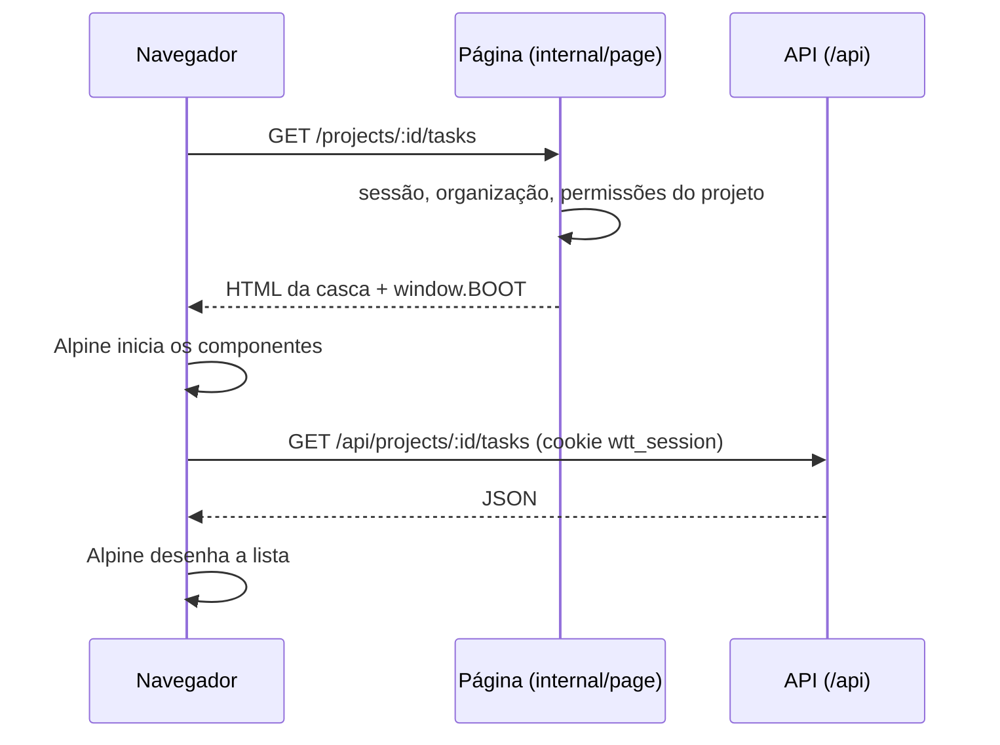

# Frontend

Como a interface web é feita: quem monta cada página, o que ela recebe do servidor, onde fica cada arquivo e as
bibliotecas que vêm de fora. As rotas estão em [routes.md](routes.md) e as convenções de tela em
[patterns.md](patterns.md).

## Casca no servidor, dados pela API

Cada página é uma **casca**. O servidor a renderiza com `html/template` já sabendo quem está logado, qual é a
organização, o projeto e o que a pessoa pode fazer nele. Depois, os componentes [Alpine.js](https://alpinejs.dev) buscam e
alteram os dados pela API JSON em `/api`. Não há SPA nem roteamento no navegador: trocar de tela é carregar outra página.



O caminho de uma página:

1. A rota está em `internal/routes/pages.go`, com os middlewares de acesso (login, organização, projeto, permissão).
2. O handler em `internal/page` preenche `page.Data` (título, item da barra, aba, script da página, `Props`) e chama
   `render`, que completa quem está logado, o idioma e as permissões.
3. O template `web/templates/pages/<nome>.gohtml` define o bloco `content`, que entra no layout `layouts/base.gohtml`.
4. O script `web/static/pages/<Script>.js` registra os componentes Alpine da página.

Sem sessão, a página leva ao login (`/login?next=…`). Uma chamada da API que responde `401` faz o mesmo pelo `api()`
do `app.js`. Uma rota GET que não existe, fora de `/api` e de `/static`, mostra a página "Página não encontrada".

## O que a casca entrega ao JavaScript

O layout põe `window.BOOT` antes de qualquer script, e o `app.js` o expõe como `WTT.boot`.

| Chave | O que é | Onde vem |
|---|---|---|
| `me` | quem está logado (`auth.Identity`) | todas as páginas |
| `lang` | `pt-BR` ou `en` | todas |
| `can` | as permissões que a pessoa tem na página: as do projeto da página e as da organização | todas |
| `limits` | os tamanhos máximos dos campos (`internal/validate/limits.go`) | todas |
| `project`, `person` | o projeto da página e a pessoa do perfil aberto | páginas de projeto e perfil de colaborador |
| `countries` | o cadastro de países, com os textos no idioma da página | páginas com o script `auth` ou `org` |
| `Props` de cada página | por exemplo `org`, `integration_types`, `task_id`, `emailInvites` e os dados do Clerk | a página que os define |

`can` serve só para **esconder** o que a pessoa não pode usar. Quem garante as permissões é a API.

## Sem etapa de build

O CSS e o JavaScript são servidos como estão. `web/embed.go` embute `templates/` e `static/` no binário (`embed.FS`), e
o servidor serve `static/` em `/static`. Os templates são lidos na subida (`internal/template/renderer.go`): cada página
vira um conjunto próprio, com os layouts, os partials e só ela. Por isso todas podem definir `content` sem colidir, e
um template com erro derruba a subida, não a primeira requisição. Os templates têm duas funções a mais: `dict`, para
passar vários argumentos a um partial, e `limit`, que devolve o tamanho máximo de um campo para o `maxlength`.

## Scripts

| Arquivo | Páginas |
|---|---|
| `static/app.js` | todas: `api()` sobre `fetch`, `ApiError`, o mixin `form()` (erro por campo), as regras de campo (`rules`), os formatadores (`fmt`), os stores do Alpine (`modal`, `toast`, `clock`, `presence`, `sessionView`) e os componentes comuns (`tip`, `sessionDock`, `userMenu`). Tudo fica em `window.WTT` |
| `static/pages/auth.js` | entrar, criar organização, convite e a volta do Clerk |
| `static/pages/org.js` | as páginas da organização e os perfis |
| `static/pages/payments.js` | Pagamentos |
| `static/pages/project.js` | as páginas do projeto, a Gestão e a página da tarefa |
| `static/pages/help.js` | a ajuda (marca a seção à vista no sumário) |
| `static/pages/trello_callback.js` | a volta do Trello, que lê o token do fragmento da URL |

## Textos

A tela não tem texto escrito no código: os templates usam `{{.T "chave"}}` e o JavaScript usa `WTT.t` ou `$t`, com os
catálogos YAML de `internal/i18n/locales`. As regras (e por que dentro de uma expressão Alpine vale sempre `$t`) estão
em [i18n-and-countries.md](../development/i18n-and-countries.md).

## Onde fica cada coisa

```
web/
  embed.go                     # embute templates/ e static/ no binário
  templates/
    layouts/base.gohtml        # o HTML base: ícones, window.BOOT, textos do idioma, app.css, app.js, o script da página e o Alpine
    partials/                  # barra superior, menu da conta, cabeçalho do projeto, modal, toasts, balão da sessão, ícone,
                               # rótulo e erro de campo, tabela e cartão de tarefa, modais compartilhados
    pages/*.gohtml             # uma casca por tela; cada uma define o bloco "content"
  static/
    app.css                    # estilos com tema claro e escuro, sem framework
    app.js                     # o que todas as páginas usam (ver acima)
    pages/*.js                 # os componentes Alpine de cada grupo de telas
    alpine.min.js              # vendorizado
    marked.min.js              # vendorizado: Markdown da descrição da tarefa
    purify.min.js              # vendorizado: sanitiza o HTML do Markdown
    clerk-pt-BR.js             # textos do Clerk em português
  *_test.go                    # testes das telas (hash dos vendorizados, formulários, cartões, cores)
internal/page/                 # handlers das páginas: auth.go, org.go, project.go, overview.go, help.go
internal/template/renderer.go  # um conjunto de templates por página, lido na subida
```

## Bibliotecas de fora

| Biblioteca | Versão | Como chega | Onde |
|---|---|---|---|
| Alpine.js | 3.14.8 | vendorizado (`dist/cdn.min.js` do pacote npm) | todas as páginas |
| marked | 18.1.0 | vendorizado (`lib/marked.umd.js`, sem a última linha) | só nas páginas que mostram Markdown (`project_tasks`, `task_detail`) |
| DOMPurify | 3.4.16 | vendorizado (`dist/purify.min.js`, sem a última linha) | junto do marked |
| Font Awesome Free | 7.3.1 | CSS do cdnjs com `integrity` (SRI) | todas as páginas |
| clerk-js | `@clerk/clerk-js@6` | do Frontend API do app do Clerk, só com o Clerk ligado | entrar, criar organização, convite e a volta do Clerk |
| Localização do Clerk | — | `static/clerk-pt-BR.js` (`@clerk/localizations`, MIT) | as mesmas, em português |

Sem acesso à CDN a interface funciona, só sem os ícones. As páginas internas não carregam o clerk-js.

**Atualizar um vendorizado.** Troque o arquivo em `web/static/` e o hash em `web/embed_test.go`
(`TestVendoredLibsArePristine`) no mesmo commit. O `marked.min.js` e o `purify.min.js` são os do pacote npm sem a
última linha, o comentário `sourceMappingURL`, porque o `.map` não é servido. O teste existe porque a cópia do Alpine já
esteve corrompida sem ninguém notar, e porque o DOMPurify é a única defesa contra XSS na descrição da tarefa.

**Atualizar o Font Awesome.** Mude a URL e o `integrity` em `layouts/base.gohtml` juntos. O hash vem de
`https://api.cdnjs.com/libraries/font-awesome/<versão>?fields=sri`.
