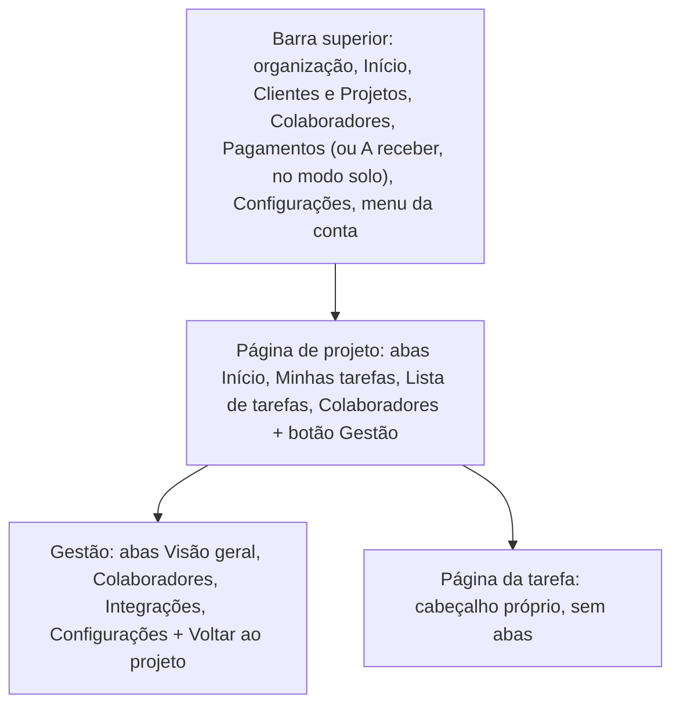

# Padrões de tela

As convenções que toda tela segue: a navegação, os componentes comuns (modal, dica, ícone, formulário) e as regras de
interface que valem para telas novas. Quem faz o quê fica em [permissions.md](../product/permissions.md). Aqui está só
como a tela mostra isso.

## Navegação



- **Barra superior** (`partials/topbar.gohtml`). O nome da organização e uma página por assunto. Cada item só aparece
  para quem pode abrir a página dele: Clientes e Projetos para todos, Colaboradores com `people.manage` e Pagamentos com
  `payments.manage`. No modo solo (`Me.OrganizationSolo`) somem Colaboradores e Pagamentos, que são de equipe, e entra A
  receber, com `receivables.manage`. Clientes e Projetos fica marcado também dentro de um projeto.
- **Menu de hambúrguer** (componente `mainNav`). Abaixo de 1024px os itens não cabem numa linha ao lado do nome e do
  menu da conta: a barra fica numa linha só, com o botão ☰ antes do nome, e os itens vão para um painel, cada um com o
  seu ícone (no computador o ícone não aparece). No celular o painel ocupa a largura toda, colado à barra; no tablet é
  um cartão de 280px embaixo do botão. Um véu escurece a página (e o balão das sessões) atrás dele. Fecha com Esc (o
  foco volta ao botão), com um toque ou o foco fora dele, ao voltar pelo histórico e quando a tela alarga.
- **Menu da conta** (`partials/user_menu.gohtml`). O avatar, o nome e o selo de dono ou admin abrem Perfil, Ajuda, o
  toggle de idioma (PT | EN) e Sair. Fecha com Esc, com um clique fora ou ao escolher. Sem login, o toggle fica no
  canto da tela.
- **Páginas da organização** não têm sub-abas: cada assunto é uma página, com o item dela na barra e o próprio
  cabeçalho.
- **Páginas de projeto** (`partials/project_head.gohtml`) têm duas barras de abas. A de todos tem Início, Minhas
  tarefas, Lista de tarefas e Colaboradores (só para ler; no modo solo não há esta aba). O botão **Gestão** aparece para quem tem alguma permissão do
  projeto e troca a barra pela da Gestão, que só mostra as abas que a pessoa abre (`Data.OpensTab`, lido de
  `page.ManagementTabs`, de onde as rotas também leem). A administração do projeto (pessoas, valores, times,
  integrações e os dados dele) só se edita lá: nas abas de todos ela aparece para ler. `Data.CanDo` é o `Can` que só
  vale dentro da Gestão.
- **Balão das sessões** (`partials/active_session.gohtml`). Com o ponto aberto, fica no canto de baixo à direita de
  todas as páginas de quem está logado, acima dos avisos e abaixo dos modais. É uma pilha de cartões, um por projeto
  com o ponto aberto (o nome do projeto e o cronômetro), um aberto por vez. Dentro de um projeto (`WTT.boot.project`)
  aparece só o cartão dele, com a linha "+N em outros projetos" que abre os outros. Quem lê a sessão de um projeto usa
  `$store.clock.sessionFor(projectId)`; `$store.clock.sessions` é a lista inteira.
- Ação que a pessoa não pode usar não aparece. A API continua sendo quem garante a permissão.

## Regras de interface

Valem para telas novas e para as que forem revistas.

- **Listas curtas.** Listas de pessoas mostram cinco por vez, com páginas. Projetos são seis por página e tarefas, dez.
  A página fica no endereço quando a lista é a tela principal (`?page=`, `?free_page=`). Uma lista longa é mais lenta
  de ler, e em projeto grande é mais rápido achar a pessoa pela página ou pelo time.
- **A linha inteira abre o item.** Uma tabela cuja linha leva a outra tela usa
  `<tr class="row-link" @click="if (!$event.target.closest('a, button')) location.href = …">`, com o cursor de mão e
  o hover. O nome fica em negrito, sem sublinhado, e continua num `<a>`, para o teclado e para abrir em outra aba. Não
  há botão "Detalhes", e uma dica curta acima da tabela avisa que a linha abre o item. Cartões clicáveis seguem o mesmo
  padrão (`.card-link`, fundo `--surface-hover`).
- **Nada de editar na linha.** Uma linha ou um cartão não tem campo editável nem ação destrutiva (mudar valor, tirar
  alguém do projeto, excluir). Ele abre um modal que reúne tudo daquele item, com rascunho e um Salvar. A exceção que
  ainda existe é a página Colaboradores da organização, com o botão de papel e o lápis na linha.
- **Cor com moderação.** O cartão é neutro (`--surface`), e a cor entra só num toque: a sigla em tom suave, os ícones e
  a borda no hover. Nada de faixa, fundo cheio ou chips coloridos em lista. `TestProjectCardsStayCalm`
  (`web/tones_test.go`) segura isso nos cartões de projeto.
- **Prioridade e status têm cor própria**, a mesma em todo lugar (selos, chips de filtro, selects dos modais), com um
  par para o tema claro e outro para o escuro. Prioridade: urgente vermelha, alta laranja, média verde, baixa azul e
  sem prioridade neutra, de borda tracejada. Status: backlog ardósia, em progresso turquesa, aguardando fechamento
  dourado e fechada roxa. Nenhuma cor se repete entre os dois grupos (`TestPriorityAndStatusHaveTheirOwnColors`). No
  filtro, o chip desmarcado usa o fundo suave e o marcado enche com a cor.
- **O botão de criar fica junto da lista que ele alimenta** (Novo projeto no bloco de projetos), não solto no
  cabeçalho da página. Um atalho de adicionar ao lado do "Ver …" é bem-vindo, e leva à página que já tem o modal, com
  `?add=1`, em vez de copiar o modal.
- **O que é de equipe não existe no modo solo.** Uma tela ou um link que só faz sentido com mais de uma pessoa leva a
  condição `not .Me.OrganizationSolo` no template (a barra superior, as abas, os textos com link) e, na rota da página, o
  middleware `RequireTeamPage`, que responde 404. Um link para uma página escondida é um bug. A varredura
  (`TestLinkSweep_*`) abre as páginas principais de uma organização solo e de uma com equipe, segue todo link interno
  e falha se algum dá 404, se a solo aponta para uma página de equipe ou se a com equipe aponta para o A receber.
  Um texto que fala de equipe ("o time", "alguém", "só admins veem") ganha uma chave irmã `<chave>_solo`, escolhida no
  template com `{{if .Me.OrganizationSolo}}`; dentro de um atributo do Alpine, cada ramo leva o seu `$t('...')`
  inteiro, para a conferência das chaves (`TestUsedKeysExist`) ler as duas, e nunca um `{{if}}` dentro de uma string
  passada ao `dict`, que o Go não avalia. Numa página pública, onde `.Me` pode ser nulo (a ajuda), a condição é `.Solo`.
  `internal/page/solo_screens_test.go` renderiza as telas para o dono de uma organização solo e de uma com equipe.
- **Sem ranking de pessoas por horas.** Nenhuma tela ordena, ranqueia ou põe barras proporcionais de horas entre
  pessoas. Somas (horas da equipe, receita, custo, margem) podem, porque não comparam ninguém. Horas não medem bem a
  contribuição, e a tela induziria essa leitura. O que se mostra da equipe é quem trabalha agora e em que tarefa. O
  bloco antigo está guardado sem uso em `partials/team_hours.gohtml` e `teamHours()` de `org.js`
  (`TestStoredTeamHoursStillMatchesTheScript`).

## Modal

Há um modal só, no layout base (`partials/modal.gohtml`), controlado por `Alpine.store('modal')`. A página entrega o
conteúdo e continua dona dele:

```html
<button type="button" class="btn" @click="$store.modal.open('customer', 'Novo cliente')">Novo cliente</button>

<template x-teleport="#modal-root">
  <form novalidate x-show="$store.modal.name === 'customer'" @submit.prevent="save()">
    <input x-model="draft.name" data-autofocus>
    ...
  </form>
</template>
```

- O conteúdo aparece dentro do modal, mas segue no escopo do componente da página (`x-model`, `save()`,
  `fieldErrors`). O `<template>` precisa de um único elemento raiz.
- `open(nome, título, guarda)` abre, prende o foco no modal (o resto da página fica `inert`) e foca o campo com
  `data-autofocus` que está à vista. `close()` fecha e devolve o foco a quem abriu.
- `dismiss()` é o fechamento pedido pela pessoa (Esc, clique no fundo, X, Cancelar) e respeita a **guarda**, uma
  função que devolve `false` enquanto o modal não pode fechar, por exemplo durante um salvamento.
- Para focar um campo que acabou de aparecer dentro do modal (o link do convite depois de gerado), dê ao bloco um
  `x-transition`. Sem transição, o `x-show` só mostra o elemento no ciclo seguinte, e o `$nextTick` chega antes de ele
  aceitar foco.
- O conteúdo dos modais maiores fica em partials: `person_edit_modal` (Editar colaborador), `session_modal` (a sessão,
  aberta de qualquer tela por `Alpine.store('sessionView')`), `task_fields` (Nova tarefa) e `project_form` (Novo
  projeto).

## Dica

Para explicar um número sem ocupar a tela, o bloco leva `x-data="tip"` e a classe `has-tip`, um botão `tip-btn` com o
ícone `circle-info`, `aria-label`, `aria-controls` e `@click="toggle()"`, e o texto num elemento `tip-pop` com
`x-ref="pop"` e `x-show="open"`. O balão abre abaixo do bloco, não passa da borda da fileira nem da tela e fecha com
Esc, com um clique fora ou quando a janela muda de tamanho.

## Ícones

`{{template "icon" "pen"}}` emite o ícone do Font Awesome com esse nome, sem o prefixo `fa-`. O ícone é decorativo
(`aria-hidden`): quem dá o nome da ação é o texto do botão. Um botão só de ícone leva a classe `btn-icon` e o nome da
ação em `aria-label` e em `title`. Num botão com texto dinâmico, ponha o texto num `<span x-text>`, porque um `x-text`
no botão apagaria o ícone.

## Formulários

Cada campo tem uma regra só, a mesma na tela e no servidor.

- Todo `<form>` tem `novalidate`: quem confere é a página, com as mensagens no idioma dela, e não o navegador
  (`TestTemplates_EveryFormIsCheckedByTheApp`).
- O componente usa o mixin `WTT.form()`. Antes de enviar, `check({campo: [valor, regra…]})` confere com as regras de
  `WTT.rules` (as mesmas do servidor), mostra todos os erros e foca o primeiro. Depois de enviar, o erro da API que
  traz `params.field` vai para o campo, e só o que não diz o campo fica no aviso do formulário.
- O campo leva `data-field="<nome na API>"` e `@input="clearField('<nome>')"`, e o partial
  `{{template "field_error" "<nome>"}}` mostra o erro embaixo dele.
- O rótulo vem do partial `field_label`. O campo opcional diz "(opcional)" no rótulo, nunca no placeholder, e o
  obrigatório não diz nada.
- Tamanhos máximos não se escrevem à mão: o `maxlength` vem de `{{limit "<nome>"}}` e o JavaScript lê `WTT.limits`,
  os dois de `internal/validate/limits.go`. A descrição da tarefa não tem `maxlength`, para não cortar em silêncio o
  que for colado: um contador mostra o tamanho e a regra avisa.
- Um campo por linha, com a dica dele embaixo, dentro do `.field`. Em pares, os rótulos com "(opcional)" quebram em
  alturas diferentes e os campos desalinham. A exceção é um par curto de rótulos iguais e sem dica, lado a lado num
  `.fields` (no cliente, País e documento, e E-mail e Telefone, os dois opcionais).
- Um formulário longo vira etapas no próprio modal (`.wizard-steps` em cima, Voltar e Próximo embaixo, as etapas todas
  no HTML e a que não está à vista só escondida), como o Nova tarefa e o cliente (Dados do cliente, Cobrança: o parcial
  `customer_fields`, o mesmo no modal de Clientes e Projetos e nas boas-vindas). Cada campo da API tem a etapa dele
  (`wizardStepOf` em `pages/project.js`, `customerStepOf` em `pages/org.js`): o erro da tela ou do servidor leva de
  volta à etapa do campo antes de pôr o erro embaixo dele, porque um campo escondido não recebe o erro nem o foco. Na
  edição do cliente o Salvar já está na primeira etapa.
- Nesses modais longos (o cliente e as boas-vindas), as etapas em cima e os botões embaixo ficam parados, cada um
  separado por uma linha, e só os campos rolam: `modal.gohtml` liga `.modal-body-fixed` pelo nome do modal, e o
  conteúdo é um `.modal-split` com `.modal-split-head`, `.modal-split-body` e `.modal-split-foot` (o aviso de erro do
  formulário fica no rodapé, sempre à vista). Um modal novo que precise disso entra na lista de nomes.
- Data é um campo de texto com a diretiva `x-date`, nunca `<input type="date">`: o navegador escreve o `type="date"`
  no formato do idioma dele, e não no da página (num Chrome em inglês, a tela em português pedia mês/dia/ano). O campo
  fica num `<span class="date-input">`, com o parcial `{{template "date_picker" .}}` logo depois dele (o botão que abre
  o calendário do navegador por um `type="date"` invisível), e mostra a data na ordem do idioma da página (dd/mm/aaaa
  em português, mm/dd/yyyy em inglês). O modelo guarda `aaaa-mm-dd`, como antes; a data pela metade ou impossível fica
  como texto, e `rules.date` a acusa. Num filtro, `x-date.complete` só põe no modelo a data completa ou o vazio. O
  `change` do campo só dispara com a data completa ou vazia (`TestTemplates_DatesFollowThePageLanguage`).
- O que é raro ou um ajuste fica num bloco recolhido no fim do grupo dele (`<details class="form-fold">`, como "Multa,
  juros e tolerância" na cobrança do cliente e "Avançado" na cobrança do projeto), aberto quando já tem valor e quando um campo dele erra (o
  componente abre o bloco e leva o foco ao campo, que fechado não o recebe).
- O `<select>` não usa a aparência do sistema (`appearance: none` em `app.css`): fica com a altura dos campos e uma
  seta própria em `currentColor`, igual no Chrome e no Safari. Uma regra que pinta um campo usa `background-color`, não
  o atalho `background`, que apagaria a seta. A lista que abre é sempre a do sistema.
