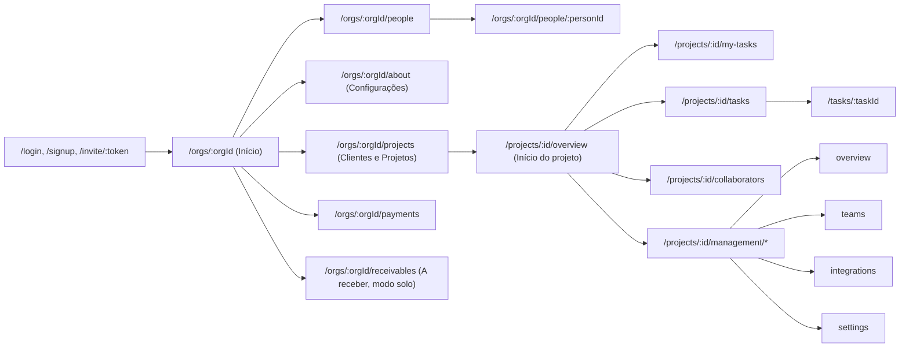

# Rotas do navegador

As páginas da interface, quem pode abrir cada uma e as regras que valem para todas. A fonte é
`internal/routes/pages.go`. As rotas da API estão em [api/reference.md](../api/reference.md), e quem é dono, admin,
administrador de projeto ou colaborador está em [permissions.md](../product/permissions.md).

## Mapa

## Regras gerais

- **Sem sessão**, qualquer página que não seja pública leva a `/login?next=<página>`, e a pessoa volta para ela depois
  de entrar. Quem já está logado e abre `/login`, `/signup`, `/invite/:token` ou `/auth/clerk/continue` vai para `/`.
- **Outra organização** ou recurso que a pessoa não alcança responde "Página não encontrada" (404), nunca 403: a página
  não revela que o recurso existe. O mesmo vale para quem não tem a permissão de uma página restrita.
- **Modo solo.** Numa organização no [modo solo](../product/overview.md#modo-solo) as páginas de equipe não existem para
  ninguém, nem para o dono: Colaboradores, o perfil de um colaborador, Pagamentos, a aba Colaboradores do projeto, a aba
  Colaboradores da Gestão e o caminho antigo `/projects/:id/teams` respondem "Página não encontrada" (404, pelo
  middleware `RequireTeamPage`), e a barra superior e as abas não apontam para elas. O A receber é o contrário: só abre
  no modo solo, e em qualquer outra organização responde 404. Desligar o modo traz as páginas de volta na mesma sessão.
- **Projeto.** Quem não é dono nem admin só abre as páginas dos projetos em que está, que são os projetos em que tem
  valor por hora. O dono e os admins estão em todos.
- **Públicas:** entrar, criar organização, o convite, a volta do Clerk, a ajuda, a troca de idioma e o script dos
  textos.
- **Caminhos antigos** continuam valendo e redirecionam: `/projects/:id/time-tracking` vai para o Início do projeto,
  e `/projects/:id/teams`, `/integrations` e `/settings` vão para a aba da Gestão, mantendo a query.

## Públicas

| Rota | Tela |
|---|---|
| `/login` | Entrar com o e-mail e a senha do sistema. Com o Clerk ligado, o Google aparece abaixo. `?out=1` é o login depois de sair: com o Clerk, desconecta dele também |
| `/signup` | Criar organização, em duas etapas (a organização, com a escolha de trabalhar sozinho, e o acesso) |
| `/invite/:token` | Aceitar um convite e criar a conta, com o e-mail travado no do convite. O ticket do Clerk na URL é ignorado |
| `/auth/clerk/continue` | A volta do Clerk: troca o token dele por uma sessão do sistema. Aceita `?next=` e `?invite=`. Sem o Clerk ligado, leva ao login. Ver [clerk.md](../integrations/clerk.md) |
| `/help` | A ajuda, numa página só. Logada, a pessoa a vê com a barra superior. `/ajuda` redireciona para cá |
| `/lang/:code` | Troca o idioma (`pt-BR` ou `en`): grava o cookie `wtt_lang` e volta para `?next=` |
| `/i18n/:idioma.js` | Os textos do idioma para o JavaScript (`window.I18N`). Com `?v=<hash>`, o cache é eterno |

## Conta e organização

| Rota | Tela | Quem abre |
|---|---|---|
| `/` | Leva à organização de quem está logado | logado |
| `/profile` | O seu perfil: jornada, regra de pagamento, horas e valores, histórico e próximos pagamentos. Editar perfil abre um modal. Embaixo, **Conector MCP**, com um **?** que abre a explicação num modal: primeiro a lista **Conectados**, com os apps do OAuth (Desconectar) e os tokens pessoais (Revogar) juntos; depois **Conectar**, com uma aba por jeito: **OAuth** (só com o OAuth ligado: um prompt para colar no Claude Code, que roda o `claude mcp add` e explica como autenticar, com Copiar prompt; o endereço do conector para o claude.ai fica no modal do **?**) ou **Token pessoal** (o Novo token num modal que mostra o token uma vez e o comando do Claude Code) | logado |
| `/oauth/authorize` | A tela de consentimento do OAuth do MCP: o Claude (claude.ai, Desktop, celular) ou o Claude Code pede para agir como a pessoa, e ela permite ou cancela. Sem a barra superior. Sem sessão, passa pelo login e volta com o pedido. Um app desconhecido ou um endereço de volta que não é dele mostra a página de erro. Só existe com o OAuth ligado. Ver [mcp.md](../api/mcp.md#oauth) | logado |
| `/orgs/:orgId` | O Início. Para todos, o painel da pessoa (horas de hoje e da semana, as suas tarefas, a semana dia a dia). Para os admins, também a visão geral da organização e a equipe; receita e margem só para o dono. No modo solo, a visão geral e a equipe dão lugar à tela inicial do solo | membro |
| `/orgs/:orgId/projects` | Clientes e Projetos: um grupo por cliente, em ordem de nome, com os projetos dele em cartões, e os projetos internos no fim. Quem não é admin vê só os projetos em que está, agrupados pelo cliente de cada um. O dono vê também os clientes sem projeto, com a cobrança no cabeçalho do grupo (o valor; no modo solo, também o modo), e tem o Novo cliente, os Detalhes (de onde saem Editar e Excluir) e o Novo projeto de cada grupo, que já vem com o cliente. O dono e os admins têm o Novo projeto (o admin só cria projeto interno). `?customer=id` abre os detalhes daquele cliente | membro |
| `/orgs/:orgId/about` | Configurações: o perfil da organização, para ler. O Editar só aparece para o dono | membro |
| `/orgs/:orgId/settings` | A edição da organização (inclusive "Trabalho sozinho(a)") e a exclusão dela | dono |
| `/orgs/:orgId/people` | Colaboradores: as pessoas, os papéis, a jornada, os convites pendentes e o Adicionar colaborador. `?add=1` abre já com o modal do convite. Não existe no modo solo | `people.manage` (dono e admin) |
| `/orgs/:orgId/people/:personId` | O perfil de um colaborador, com o Editar. Pagamentos e regra só para o dono. Não existe no modo solo | dono e admin |
| `/orgs/:orgId/customers` | Leva a Clientes e Projetos (303), com a consulta junto; para quem não é o dono, segue "Página não encontrada" | dono |
| `/orgs/:orgId/payments` | Pagamentos da equipe: os cartões (o que pagar, atrasados incluídos, o que fecha em 7 e 30 dias, as horas e quem está sem regra), Próximos pagamentos (com Dar baixa, o valor pelas horas e o bônus) e Pagos recentemente (com Desfazer). A linha leva ao perfil. Não existe no modo solo | dono |
| `/orgs/:orgId/receivables` | A receber: os cartões (a confirmar, em aberto, atrasado e recebido no mês) e as listas A confirmar, Em aberto e Recebidos, com os modais de confirmar e de receber. Só existe no modo solo | dono (`receivables.manage`) |

## Projeto

Todas pedem que a pessoa esteja no projeto.

| Rota | Tela |
|---|---|
| `/projects/:id` | Leva ao Início do projeto |
| `/projects/:id/overview` | Início do projeto, igual para todos: o painel do timer, as suas tarefas, o seu tempo de hoje e da semana e as suas sessões, com filtros e páginas |
| `/projects/:id/my-tasks` | Minhas tarefas: o painel do timer e as tarefas de que a pessoa é responsável, uma lista por status |
| `/projects/:id/tasks` | Lista de tarefas: as sem responsável e as de outras pessoas, cada lista com a sua paginação. A linha abre a tarefa |
| `/projects/:id/collaborators` | Colaboradores, só para ler: pessoas e times, sem valores nem ações. Para os admins, a coluna Agora. Não existe no modo solo |
| `/tasks/:taskId` | A página da tarefa, sem as abas do projeto: nome e descrição, detalhes, tempo registrado, um cartão por item externo, publicar nas integrações e excluir |

**A lista de tarefas guarda o estado na URL:** `?q=`, `?assignee=` (só para a lista Com responsável), `?due=`,
`?priority=`, `?status=`, `?label=` (os três últimos separados por vírgula) e `?free_page=` e `?taken_page=`.
Recarregar mantém a tela, o link pode ser compartilhado, e o Voltar da tarefa volta ao mesmo ponto da lista (a query fica
também no `sessionStorage`).

## Gestão do projeto

A Gestão é a área de quem cuida do projeto. O botão aparece para quem tem **alguma** permissão do projeto, e cada aba
pede a permissão do que mostra. Quem não tem recebe o 404. As permissões de cada aba ficam num lugar só,
`page.ManagementTabs`: a rota pede essas permissões, e a barra de abas (`Data.OpensTab`) só mostra a aba a quem a abre.

| Rota | Tela | Permissão |
|---|---|---|
| `/projects/:id/management` | Leva à primeira aba que a pessoa pode abrir | alguma do projeto |
| `/projects/:id/management/overview` | Visão geral: pessoas, times, tempo de projeto, integrações, atividade, tarefas atrasadas e as sessões de todos. A cobrança, a receita e a margem só com `billing.view` | alguma do projeto |
| `/projects/:id/management/teams` | Colaboradores em duas visões, Pessoas e Times (`?view=teams`), cinco por página, com os modais de adicionar pessoa, do colaborador e dos times. Não existe no modo solo | `collaborators.manage`, `teams.manage`, `rates.view` ou `rates.manage` |
| `/projects/:id/management/integrations` | Integrações: um cartão por integração e o modal de criar e editar. Na volta da conexão recebe `?github=<id>`, `?github_error=<código>`, `?trello=<id>` ou `?trello_error=<código>` | `integrations.manage` |
| `/projects/:id/management/settings` | Configurações do projeto, para ler, com o Editar projeto | `project.edit`, `billing.view` ou `billing.manage` |

## Conexão com as plataformas

Não são telas: são idas e voltas do navegador durante a autorização. O detalhe está em
[github.md](../integrations/github.md), [gitlab.md](../integrations/gitlab.md) e [trello.md](../integrations/trello.md).

| Rota | O que faz | Quem |
|---|---|---|
| `/projects/:id/management/integrations/github/connect` | Grava o cookie da conexão e leva ao GitHub. `?integration=<id>` reconecta | `integrations.manage` |
| `/integrations/github/callback` | A volta do GitHub: confere o cookie, o `state`, a pessoa e a permissão e guarda a integração | logado |
| `/projects/:id/management/integrations/gitlab/connect` | Grava o cookie da conexão e leva ao GitLab. `?integration=<id>` reconecta | `integrations.manage` |
| `/integrations/gitlab/callback` | A volta do GitLab: confere o cookie, o `state`, a pessoa e a permissão, troca o código pelo par de tokens e guarda a integração | logado |
| `/projects/:id/management/integrations/trello/connect` | Grava o cookie da conexão e leva à autorização do Trello. `?integration=<id>` reconecta | `integrations.manage` |
| `/integrations/trello/callback` | A volta do Trello, com o token no fragmento da URL: o script da página o lê e o entrega à rota abaixo | logado |
| `POST /integrations/trello/token` | Corpo `{state, token}`. Confere tudo de novo e responde `{"redirect": "…"}` | logado, JSON |
