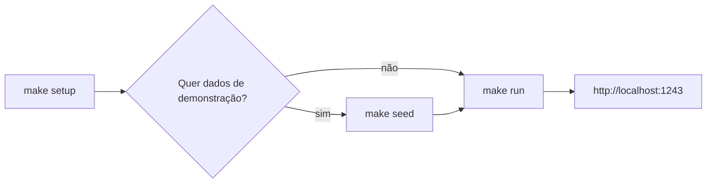

# Instalação

Como subir o Working Time Tracker na sua máquina, com ou sem os dados de demonstração. As variáveis de ambiente estão em
[Configuração](configuration.md).

## Pré-requisitos

- **Go 1.26.4** ou mais novo (a versão do `go.mod`).
- **Docker**, para o PostgreSQL do `docker-compose.yml`. Um PostgreSQL 14+ seu também serve: aponte o `DATABASE_URL`
  para ele.
- **make**, que já vem no macOS e no Linux, para os atalhos do [`Makefile`](../../Makefile). Sem ele, os comandos
  equivalentes estão logo abaixo e em [Comandos](../development/commands.md).
- **golangci-lint v2**, só para o `make check` e o `make lint` (`brew install golangci-lint`; os outros jeitos estão em
  [golangci-lint.run](https://golangci-lint.run/welcome/install/)).

## Passo a passo



```bash
# 1. Configuração e banco: cria o .env com uma INTEGRATION_ENCRYPTION_KEY nova e sobe o Postgres com o banco de
#    desenvolvimento e o de testes. Um .env que já existe não é tocado.
make setup

# 2. Dados de demonstração (opcional, só num banco vazio)
make seed

# 3. Servidor (ou make dev, que reinicia a cada mudança)
make run
```

Sem o `make`, os mesmos passos:

```bash
cp .env.example .env    # troque INTEGRATION_ENCRYPTION_KEY por uma chave sua: openssl rand -hex 32
docker compose up -d
go run ./cmd/seed
go run ./cmd
```

Abra **http://localhost:1243**. O servidor e o seed aplicam as migrações pendentes ao iniciar, então o banco não pede
preparo (ver [Fluxo de trabalho](../development/workflow.md#migrações)).

Sem o seed, clique em **Crie uma organização** na tela de login: quem cria a organização é o dono dela.

## Dados de demonstração

O seed (`cmd/seed`) só roda num banco **sem nenhuma organização** e cria duas, na mesma execução: a **Jatobá Software**,
uma software house, e a **Marina Duarte Design**, uma organização no [modo solo](../product/overview.md#modo-solo).

### Jatobá Software (com equipe)

| O quê | Como fica |
|---|---|
| Pessoas | Doze. Cada uma com jornada semanal (40 horas a maioria, 30 o Diego e a Gabriela, 20 a Elisa e o João; a Ana, dona, sem jornada) e regra de pagamento (mensal ou quinzenal; a dona não é paga) |
| Clientes | Seis: quatro do Brasil (um com o CNPJ alfanumérico e um sem documento), um dos EUA (com EIN) e um da Alemanha (documento em texto livre) |
| Projetos | Oito, um deles interno (o Site da Jatobá). Cada pessoa tem um valor por hora diferente em cada projeto, e a Migração do ERP cobra menos do que a maioria recebe, para a margem ficar negativa |
| Times | Vários por projeto. O App de Pedidos tem nove pessoas em quatro times (a lista de colaboradores passa de uma página); a Elisa está no Painel do Lojista sem time, e o João está sem time em três projetos |
| Tarefas | 62, com prioridade, os quatro status, etiquetas por assunto e prazos de ontem a um mês. Onze estão **sem responsável**, e 24 estão ligadas a itens do GitHub, do GitLab e do Trello |
| Sessões | Uma sequência fixa nos últimos 75 dias, seguindo a jornada de cada um; cerca de três em dez têm uma segunda tarefa em paralelo. O seed diz quantas criou ao terminar. O Bruno e a Carla ficam com o ponto **aberto**, até alguém parar |
| Integrações | Oito, de demonstração e **sem credencial**: aparecem nas telas, mas só falam com a plataforma depois que alguém reconecta ou informa um token |

### Marina Duarte Design (modo solo)

Uma freelancer que atende sozinha, como PJ, com **um ano de trabalho registrado**: as três janelas da tela inicial (este
mês, o mês passado e o ano) têm horas e dinheiro em qualquer dia em que o seed rode. Ela é a única pessoa da organização
(dona, sem convites e sem equipe), e a organização já vem marcada como **Trabalho sozinho(a)**:

| O quê | Como fica |
|---|---|
| Clientes | Cinco, todos do Brasil, quatro com CNPJ. Três **por hora**: a **Agência Pixel** (135,00, fecha no dia 25 e paga em 10 dias), o **Café Bambu** (120,00, fecha no fim do mês e paga em 15 dias) e a **Editora Ventania** (110,00, fecha no fim do mês e paga em 30 dias). Dois por **contrato mensal**: a **Clínica Aurora** (6.300,00 desde o começo do histórico, 5 dias para pagar, multa de 2%, juros de 1% ao mês e 3 dias de tolerância) e a **Escola Horizonte** (3.800,00, com o contrato **encerrado** há quatro meses e sem multa) |
| Projetos | Dez, que começam e terminam ao longo do ano: três já entregues (a campanha de redes sociais da Pixel, o agendamento online da Aurora e o portal da Escola Horizonte), a identidade visual da Pixel com um acréscimo de 15,00 por hora, o suporte da Aurora com um acréscimo de 400,00 por mês, e dois internos (Estudos e administração, e o portfólio), que só têm horas |
| Tarefas | 42, com prioridade, os quatro status e prazos de dez meses atrás a um mês à frente, todas da Marina. As dos projetos entregues estão fechadas, e o backlog fica sem horas |
| Sessões | Cerca de 540, do primeiro dia do mês de onze meses atrás até hoje, de uma sequência fixa à parte (a da software house não muda), com duas semanas de férias no meio. Terça e quinta têm suporte da Aurora, e quarta a Escola Horizonte enquanto o contrato durou, para os contratos mensais terem horas em todo mês. A Marina fica com o ponto **aberto** na identidade visual da Pixel, até alguém parar |
| Integrações | Duas, de demonstração e **sem credencial**: o GitHub na loja do Café Bambu e o Trello nas landing pages da Pixel, com tarefas ligadas a itens |
| A receber | Cerca de 36 recebíveis, com as notas fiscais em sequência, calculados a partir do dia em que o seed roda. Quase todos **recebidos**, alguns dias depois do vencimento: os seis primeiros meses da Aurora com a mensalidade de antes do reajuste anual, e o de quatro meses atrás com a **multa e os juros** que o sistema sugere. Em aberto: o mês corrente da Aurora, **confirmado adiantado**, e o último mês da Ventania, ainda no prazo. **Atrasado**: o penúltimo período fechado da Pixel. **Por confirmar**: o último período fechado da Pixel e o do Café Bambu |

O sorteio usa uma semente fixa: o mesmo seed dá sempre os mesmos dados, com as datas contadas a partir do dia em que
roda. Por isso `make demo` (que recria o banco a cada vez) mostra os recebíveis sempre em estados variados.

### Contas da demonstração

A senha de todas é `demo12345`.

| Cargo | Email |
|---|---|
| Dono | `ana@example.com` |
| Admin | `helena@example.com` |
| Administrador de projeto | `isabela@example.com` (App de Pedidos e Agendamento Online) e `carla@example.com` (Painel do Lojista) |
| Colaborador | `bruno`, `diego`, `elisa`, `fabio`, `gabriela`, `henrique`, `joao` ou `larissa`, seguidos de `@example.com` |
| Dona do modo solo (Marina Duarte Design) | `marina@example.com` |

A Marina é a única pessoa da organização dela, que não tem as telas de equipe. A Larissa tem também o grupo financeiro no Dashboard Financeiro, que só existe na API por enquanto. O que cada cargo
pode fazer está em [Permissões](../product/permissions.md).

## Problemas comuns

**A porta 5432 já está ocupada.** Ponha `POSTGRES_PORT=5433` no `.env` (o `docker compose` e o `make` leem dali),
ajuste a porta do `DATABASE_URL` e do `TEST_DATABASE_URL` e suba de novo:

```bash
make db-up
```

**O banco de testes não existe.** O `docker compose` só cria o `working_time_tracker_test` quando o volume do Postgres
nasce (o script em `docker/initdb`). Num volume antigo, `make db-up` cria o que falta. Sem o `make`:

```bash
docker compose exec db psql -U wtt -d postgres -c 'CREATE DATABASE working_time_tracker_test OWNER wtt'
```

**O servidor recusa iniciar com `database has tables but no migration history`.** O banco foi criado antes das
migrações versionadas. Ver [Banco criado antes das migrações versionadas](../development/workflow.md#banco-criado-antes-das-migrações-versionadas).

**O servidor recusa iniciar por causa de uma variável.** Uma variável com valor inválido derruba a subida de
propósito, com a mensagem do motivo. Confira em [Configuração](configuration.md).

## Gerar o binário

```bash
make build && ./wtt     # ou: go build -o wtt ./cmd && ./wtt
```

Os templates e os arquivos estáticos vão embutidos no binário (`embed.FS` em `web/embed.go`), então ele só precisa do
`.env` (ou das variáveis no ambiente) e do banco.
