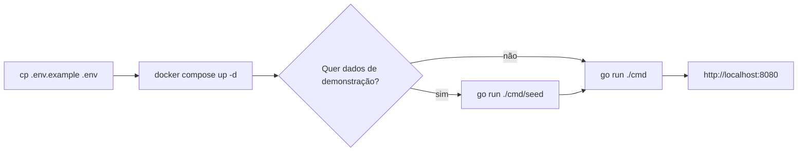

# Instalação

Como subir o Working Time Tracker na sua máquina, com ou sem os dados de demonstração. As variáveis de ambiente estão em
[Configuração](configuration.md).

## Pré-requisitos

- **Go 1.26.4** ou mais novo (a versão do `go.mod`).
- **Docker**, para o PostgreSQL do `docker-compose.yml`. Um PostgreSQL 14+ seu também serve: aponte o `DATABASE_URL`
  para ele.

## Passo a passo



```bash
# 1. Configuração: troque INTEGRATION_ENCRYPTION_KEY por uma chave sua (openssl rand -hex 32)
cp .env.example .env

# 2. Banco: sobe o Postgres com o banco de desenvolvimento e o de testes
docker compose up -d

# 3. Dados de demonstração (opcional, só num banco vazio)
go run ./cmd/seed

# 4. Servidor
go run ./cmd
```

Abra **http://localhost:8080**. O servidor e o seed aplicam as migrações pendentes ao iniciar, então o banco não pede
preparo (ver [Fluxo de trabalho](../development/workflow.md#migrações)).

Sem o seed, clique em **Crie uma organização** na tela de login: quem cria a organização é o dono dela.

## Dados de demonstração

O seed (`cmd/seed`) só roda num banco **sem nenhuma organização** e cria a **Jatobá Software**, uma software house:

| O quê | Como fica |
|---|---|
| Pessoas | Doze. Cada uma com jornada semanal (40 horas a maioria, 30 o Diego e a Gabriela, 20 a Elisa e o João; a Ana, dona, sem jornada) e regra de pagamento (mensal ou quinzenal; a dona não é paga) |
| Clientes | Seis: quatro do Brasil (um com o CNPJ alfanumérico e um sem documento), um dos EUA (com EIN) e um da Alemanha (documento em texto livre) |
| Projetos | Oito, um deles interno (o Site da Jatobá). Cada pessoa tem um valor por hora diferente em cada projeto, e a Migração do ERP cobra menos do que a maioria recebe, para a margem ficar negativa |
| Times | Vários por projeto. O App de Pedidos tem nove pessoas em quatro times (a lista de colaboradores passa de uma página); a Elisa está no Painel do Lojista sem time, e o João está sem time em três projetos |
| Tarefas | 62, com prioridade, os quatro status, etiquetas por assunto e prazos de ontem a um mês. Onze estão **sem responsável**, e 24 estão ligadas a itens do GitHub, do GitLab e do Trello |
| Sessões | Uma sequência fixa nos últimos 75 dias, seguindo a jornada de cada um; cerca de três em dez têm uma segunda tarefa em paralelo. O seed diz quantas criou ao terminar. O Bruno e a Carla ficam com o ponto **aberto**, até alguém parar |
| Integrações | Oito, de demonstração e **sem credencial**: aparecem nas telas, mas só falam com a plataforma depois que alguém reconecta ou informa um token |

O sorteio usa uma semente fixa: o mesmo seed dá sempre os mesmos dados, com as datas contadas a partir do dia em que
roda.

### Contas da demonstração

A senha de todas é `demo12345`.

| Cargo | Email |
|---|---|
| Dono | `ana@example.com` |
| Admin | `helena@example.com` |
| Administrador de projeto | `isabela@example.com` (App de Pedidos e Agendamento Online) e `carla@example.com` (Painel do Lojista) |
| Colaborador | `bruno`, `diego`, `elisa`, `fabio`, `gabriela`, `henrique`, `joao` ou `larissa`, seguidos de `@example.com` |

A Larissa tem também o grupo financeiro no Dashboard Financeiro, que só existe na API por enquanto. O que cada cargo
pode fazer está em [Permissões](../product/permissions.md).

## Problemas comuns

**A porta 5432 já está ocupada.** Suba o banco em outra porta e ajuste o `DATABASE_URL` e o `TEST_DATABASE_URL` no
`.env`:

```bash
POSTGRES_PORT=5433 docker compose up -d
```

**O banco de testes não existe.** O `docker compose` só cria o `working_time_tracker_test` quando o volume do Postgres
nasce (o script em `docker/initdb`). Num volume antigo, crie à mão:

```bash
docker compose exec db psql -U wtt -d postgres -c 'CREATE DATABASE working_time_tracker_test OWNER wtt'
```

**O servidor recusa iniciar com `database has tables but no migration history`.** O banco foi criado antes das
migrações versionadas. Ver [Banco criado antes das migrações versionadas](../development/workflow.md#banco-criado-antes-das-migrações-versionadas).

**O servidor recusa iniciar por causa de uma variável.** Uma variável com valor inválido derruba a subida de
propósito, com a mensagem do motivo. Confira em [Configuração](configuration.md).

## Gerar o binário

```bash
go build -o wtt ./cmd && ./wtt
```

Os templates e os arquivos estáticos vão embutidos no binário (`embed.FS` em `web/embed.go`), então ele só precisa do
`.env` (ou das variáveis no ambiente) e do banco.
