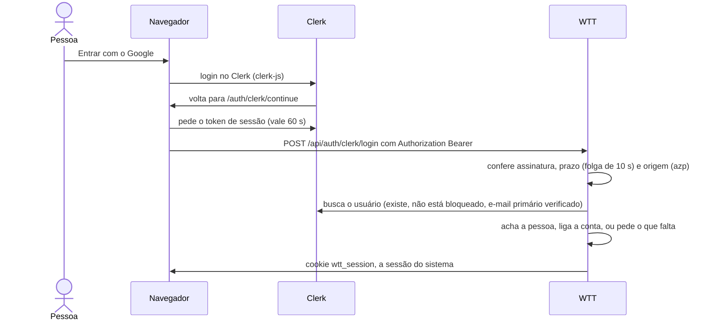

# Clerk

O login pelo Google, feito pelo [Clerk](https://clerk.com), e o convite por e-mail que sai por ele. Sem as chaves do
Clerk, nada disso aparece: o login é só por e-mail e senha do sistema, e o convite é só um link para copiar.

O Clerk só diz **quem a pessoa é**. As organizações, os papéis, os convites e a sessão continuam daqui, porque uma
pessoa pertence a uma organização só e o e-mail é único no sistema.

## Os dois jeitos de entrar

Com as chaves no `.env`, o login, o cadastro e a página do convite oferecem:

- o **e-mail e a senha do sistema**, em cima, que são o jeito principal;
- o **Google**, logo abaixo de um "ou". É o Clerk que faz o Google.

O e-mail e a senha do próprio Clerk não são oferecidos.

## Configurar

1. **Crie o app no Clerk.** Pode ser pelo painel ou pelo CLI: `npm install -g clerk`, `clerk auth login` e
   `clerk link --app <id>`. Copie a *Publishable key* e a *Secret key* para `CLERK_PUBLISHABLE_KEY` e
   `CLERK_SECRET_KEY` no `.env` (`clerk env pull --file <arquivo>` escreve as duas num arquivo à parte) e defina
   `PUBLIC_URL`.
2. **Deixe o app só com o Google**, em *User & authentication*:

   | Opção | Como fica | Por quê |
   |---|---|---|
   | Aba **Email**, bloco de baixo: **Sign-in with email** | Desligada | Ligada, o Clerk mostra o campo de e-mail e o "Continuar" junto do botão do Google |
   | Aba **Password** | Desligada | A senha é só a do sistema |
   | Aba **Email**, bloco de cima: **Sign-up with email**, **Require email address**, **Verify at sign-up** | Ligadas, não mexa | O sistema só confia em e-mail verificado, e é esse bloco que faz o Clerk guardar como principal, já verificado, o e-mail que o Google informa |
   | *Social connections* › **Google** | Ligado | É o login oferecido |
   | Cadastro | **Public** | Qualquer pessoa pode criar a própria organização |
   | *Organizations* do Clerk | Desligadas | As organizações são daqui |

   Num app de desenvolvimento o Google usa as credenciais compartilhadas do Clerk. Em produção é preciso cadastrar as
   do próprio projeto no Google.
3. **Reinicie o servidor.** O log mostra `clerk enabled=true`, o endereço do Frontend API, as origens aceitas e o modo
   do convite. Se o campo de e-mail do Clerk ainda aparece abaixo do Google, a opção **Sign-in with email** continua
   ligada.

A subida falha quando:

- só uma das duas chaves está no `.env`;
- uma chave não começa com `sk_` ou `pk_`;
- as chaves estão no `.env` sem `PUBLIC_URL`.

`CLERK_AUTHORIZED_PARTIES` lista as origens aceitas; o padrão é a origem do `PUBLIC_URL`. Quem sobe o sistema em duas
portas lista as duas. Ver [configuração](../getting-started/configuration.md).

## Como funciona

As páginas públicas carregam o clerk-js do Frontend API do app. Depois de entrar no Clerk, o navegador chega em
`/auth/clerk/continue`. Essa página pega o token de sessão do Clerk, que vale 60 segundos, e o manda ao servidor em
`Authorization: Bearer`. O servidor confere o token, busca o usuário no Clerk e abre a **sessão do sistema**, o cookie
de sempre. O resto da aplicação não sabe que o Clerk existe, e as páginas internas não carregam o clerk-js.



As rotas são `POST /api/auth/clerk/login`, `/signup` (cria a organização, com a pessoa como dona e sem senha) e
`/join` (aceita um convite pendente). As três levam o token no cabeçalho e têm o mesmo limite de tentativas do login.

| Situação | O que acontece |
|---|---|
| O usuário do Clerk já está ligado a uma pessoa | Entra |
| Há uma conta com o mesmo e-mail verificado, **sem senha** | É ligada e entra |
| Há uma conta com o mesmo e-mail, **com senha** | Pede a senha dela, uma vez, e só então liga. O cadastro por senha não verifica o e-mail: sem essa prova, quem cadastrou o e-mail de outra pessoa com uma senha dele ficaria com a conta |
| Não há conta | Mostra os convites pendentes para o e-mail, para a pessoa escolher, ou pede o nome da organização para criar a dela. Nada é aceito sozinho, porque entrar numa organização não se desfaz |
| A pessoa chegou pelo link de um convite (`invite_token`) | Entra direto na organização dele. Se o convite tem e-mail, o e-mail verificado do Clerk precisa ser o mesmo (`auth.invite_email_mismatch`) |
| Quem já é de uma organização chega com o convite de outra | Recusa (`auth.account_exists`): o e-mail é de uma conta só |
| A conta está ligada a outro usuário do Clerk que ainda existe | Recusa (`auth.clerk_account_linked`). Se esse usuário foi apagado, religa |
| O e-mail primário do Clerk não está verificado | Recusa (`auth.clerk_email_unverified`) |

## Convite por e-mail

Com o Clerk ligado, o convite com e-mail sai por ele. Isso vale para **Adicionar colaborador** e para o convite do
modal de pôr pessoa no projeto.

1. O servidor cria um convite do Clerk para o e-mail, com `redirect_url` no `/invite/<token>` do sistema, e só grava o
   convite daqui se o Clerk o aceitou. Se não aceitou, a tela mostra o erro (`auth.clerk_invite_failed` ou
   `auth.clerk_unavailable`), e nada fica gravado.
2. A pessoa abre o link da mensagem, e o Clerk a leva ao `/invite/<token>`. A página mostra o formulário do convite
   (nome, o e-mail travado no do convite e a senha **do sistema**) e, abaixo, o Google.
3. O `__clerk_ticket` que o Clerk acrescenta à URL **não é usado**. Ele sai da URL antes de o Clerk carregar, porque
   aproveitá-lo abriria um cadastro com o e-mail do próprio Clerk.
4. Pelo Google, a pessoa volta em `/auth/clerk/continue?invite=<token>` e entra com o papel do convite, desde que o
   e-mail da conta Google seja o do convite.

Na prática, o e-mail do Clerk só entrega o link. O link do sistema também aparece no modal, e se a mensagem não
chegar dá para copiá-lo e mandar à mão, com o mesmo resultado.

- **Reenviar.** Convidar o mesmo e-mail de novo **substitui** o convite anterior, aqui e no Clerk.
- **Revogar** cancela o convite no Clerk também. Uma falha lá não impede de revogar aqui: o convite que sobra no Clerk
  não dá acesso a nada.
- **Sem e-mail, ou sem o Clerk**, o convite é só o link.

### `INVITE_DELIVERY=terminal`

No desenvolvimento, `INVITE_DELIVERY=terminal` faz o servidor **não** pedir o envio do e-mail. Ele escreve no log o
e-mail, o papel, a organização e o link do Clerk (o mesmo que iria no e-mail, com o ticket; se o Clerk não o devolver,
o link do sistema):

```
invite not emailed (INVITE_DELIVERY=terminal) email=caio@mail.com role=member organization=Acme link=https://….clerk.accounts.dev/v1/tickets/accept?ticket=…
```

O modal avisa que o e-mail não foi enviado. Com `COOKIE_SECURE=true`, o servidor avisa na subida, porque o log passa a
ter links de convite. Num app de desenvolvimento do Clerk, os endereços `qualquer+clerk_test@example.com` nunca
recebem e-mail de verdade, nem no modo `email`.

## Sair e voltar

- **Sair** leva a `/login?out=1`, e a página também desconecta do Clerk. Sem isso, ele entraria de novo sozinho.
- **Sessão expirada.** Com o Clerk ainda logado, uma sessão do sistema que expirou volta sozinha, para a página que a
  pessoa abriu.
- **Sem círculo.** `/auth/clerk/continue` nunca manda de volta ao login em círculo. Em erro, mostra o motivo e deixa
  tentar de novo ou entrar com outra conta.

## Segurança, em resumo

- O token do Clerk só vale com a assinatura das chaves públicas do app, dentro do prazo e de uma origem em
  `CLERK_AUTHORIZED_PARTIES`. Um token sem origem, ou de outro app da mesma instância, é recusado.
- Só o e-mail **primário e verificado** vale, e uma conta com senha só é ligada com a senha.
- As rotas `/api/auth/clerk/*` levam o token em `Authorization`, não em cookie, então um site de fora não consegue
  chamá-las em nome de ninguém.
- A chave secreta fica só no servidor, e nenhum token vai para o log.
- Uma sessão do sistema já aberta **não cai** quando o usuário é bloqueado ou apagado no Clerk: ela vale até 7 dias.

O resto está em [segurança](../architecture/security.md).

## Limites

- O e-mail não é sincronizado entre o Clerk e o sistema: mudar o e-mail no perfil não muda o do Clerk.
- Quem entra só pelo Clerk não tem senha do sistema, e o perfil não mostra a troca de senha.
- Os textos do Clerk em português vêm de `web/static/clerk-pt-BR.js` (o `@clerk/localizations`, licença MIT). O
  inglês é o do próprio Clerk.
- `CLERK_API_URL` só serve para apontar a um servidor fake da Backend API.
