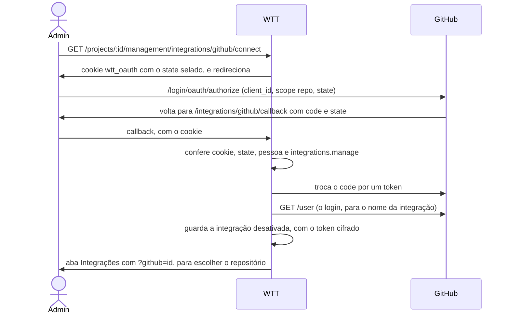

# GitHub

A integração com um repositório do GitHub: como conectar, o que a sincronização das issues com as tarefas faz campo a
campo e os limites dela. O que é comum às plataformas (o vínculo, a regra de conflito, os gatilhos, a espera) está em
[overview.md](overview.md).

## Conectar

O botão **Conectar com o GitHub** usa um **OAuth App**, cadastrado uma vez por servidor:

1. Em github.com/settings/developers, **New OAuth App**. *Homepage URL*: o `PUBLIC_URL` (`http://localhost:8080`).
   *Authorization callback URL*: `PUBLIC_URL/integrations/github/callback`.
2. Copie o **Client ID** e gere um **Client secret**. No `.env`: `GITHUB_CLIENT_ID`, `GITHUB_CLIENT_SECRET` e
   `PUBLIC_URL`. Reinicie o servidor.
3. Em Gestão › Integrações › **Nova integração** › GitHub › **Conectar com o GitHub**: autorize no GitHub, volte e
   escolha o repositório.

Sem as três variáveis, o botão avisa que a conexão não está configurada (`integration.github_oauth_not_configured`).
`GITHUB_URL` e `GITHUB_API_URL` apontam para um GitHub Enterprise ou para o fake. Ver
[configuração](../getting-started/configuration.md).



O `state` é sorteado na ida e selado (AES-GCM) no cookie `wtt_oauth`. O cookie é HttpOnly, SameSite=Lax, preso ao
caminho do callback e vale 10 minutos, para uma volta só. Na volta, a pessoa, a organização e a permissão são
conferidas de novo, porque podem ter mudado no meio do caminho. Um erro volta à aba como `?github_error=<código>`.
**Reconectar** faz a mesma ida com `?integration=<id>` e troca o token da integração que já existe. Ver
[segurança](../architecture/security.md).

### Pontos de atenção

- **Um OAuth App tem uma URL de retorno só.** Um app serve a um endereço do sistema: desenvolvimento e produção pedem
  dois apps.
- **O escopo é `repo`**, o único que dá acesso a repositório privado num OAuth App. Ele também permite escrita, e a
  sincronização a usa: muda título, corpo, etiquetas, responsáveis e estado das issues, e cria etiquetas, **com a conta
  de quem conectou**. Sem a sincronização ligada, só lê. Se isso for um problema, a saída é um GitHub App, de
  permissões mais finas.
- **Repositório de organização** que não aparece na lista: o dono da organização precisa aprovar o app, nas
  configurações dela, em acesso de aplicativos de terceiros.
- **A lista traz os 100 repositórios** mexidos há menos tempo. Os outros se digitam no campo.
- **A API aceita um token pessoal** no `POST` de integração (com leitura das issues), sem passar pela autorização.

## O que sincroniza

Com a caixa **Sincronizar as issues deste repositório com as tarefas** ligada, toda issue aberta vira uma tarefa, e
as duas ficam iguais. **Se os dois lados mudam o mesmo campo entre duas rodadas, vale o GitHub.**

| Campo | Regra |
|---|---|
| Título ↔ nome | O GitHub vence. Senão, a mudança da tarefa vai para a issue |
| Corpo ↔ descrição | Igual ao título |
| Etiquetas | Cada lado soma e tira o que fez. A etiqueta que o repositório não tem é criada antes (o GitHub a descartaria sem avisar). Renomear ou excluir uma etiqueta aqui mexe nas issues das tarefas que a têm |
| Estado | A tarefa Fechada fecha a issue como concluída, e reabrir reabre. A issue fechada fecha a tarefa, e a reaberta tira a tarefa de Fechada para backlog |
| Responsável | Pelo e-mail público (ver abaixo) |

Ficam de fora: projetos, milestone, comentários e pull requests. Prazo, prioridade, horas e os status Em progresso e
Aguardando fechamento ficam só aqui.

### Importação

- **Só issue aberta vira tarefa**: em backlog, sem prazo, ligada à issue. A tela mostra o ícone do GitHub e o número
  da issue na coluna Integração e o selo "GitHub #42" nos cartões.
- **Tarefa já ligada à mão** passa a ser sincronizada em vez de a issue virar outra tarefa (ver
  [ligar à mão](overview.md#ligar-à-mão)).
- **Tarefa criada aqui só vira issue se a pessoa pedir**: na etapa Integrações da Nova tarefa, ou no cartão
  **Publicar no GitHub** da página da tarefa. Ver [publicar](overview.md#publicar-uma-tarefa-numa-plataforma).
- **Issue apagada ou transferida** fica marcada como sumida (`gone`), e a tarefa fica como estava.
- **Excluir a tarefa** descarta a issue, que não volta a ser importada. Com a caixa **Apagar a issue no GitHub**
  marcada, a issue é apagada pelo GraphQL (`deleteIssue`), o único jeito de apagar uma issue, e só para quem é
  **admin do repositório**. Sem isso, ela é fechada como não planejada, com o aviso `issue_sync.remove_only_closed`.

### Responsável

A tarefa tem um responsável só, e a issue pode ter vários. A ligação é pelo **e-mail público** do usuário, no perfil
do GitHub:

- Um `login` só se liga a uma pessoa **do projeto** cujo e-mail é o público dele. O e-mail é único no sistema, e por
  isso a busca fica dentro da organização e do projeto: sem essa conferência, uma issue ligaria a tarefa a alguém de
  outra empresa.
- Do lado de cá para lá, o login é achado pela busca de usuários por e-mail, e só vale se o e-mail é de **um único**
  usuário.
- Só o login **ligado** é mexido. Os outros responsáveis da issue ficam como estão nos dois sentidos.
- Tirar o responsável no GitHub tira daqui, e o contrário também.
- Escolher aqui alguém sem usuário que se ache pelo e-mail não manda nada e deixa o aviso `issue_sync.no_login`.
- Quem publica o e-mail depois passa a ser reconhecido na rodada seguinte. O botão Sincronizar pergunta tudo de novo.

O cartão da integração conta quantas issues têm responsável sem correspondência (`sync_unmatched`). Nesse caso a
tarefa fica sem responsável, disponível para alguém pegar.

### As rodadas no GitHub

- **Incremental.** O GitHub filtra por data (`since`), então a rotina de fundo pede só as issues mexidas desde a última
  rodada, abertas e fechadas. O cursor é o relógio do GitHub no começo da listagem, menos 2 minutos.
- **Completa.** Na primeira vez, de hora em hora e em todo botão.
- **Paginação.** 100 issues por página, até 100 páginas (`integration.list_too_long`). A listagem para quando sobram
  menos de 25 requisições no limite, e a rodada sai como parcial.
- **Limite de requisições.** A rodada para, o que já fez fica feito, e a integração espera até o GitHub liberar
  (`Retry-After` ou `X-RateLimit-Reset`). Um token revogado também faz a rotina esperar, cada vez mais.
- **Sem redirecionamento.** O cliente não segue `301`: o `net/http` transformaria o `PATCH` em `GET` e daria "200"
  sem gravar nada, e uma issue transferida responde `301` justamente para dizer que mudou de endereço.

### Avisos do cartão da integração

- **O token não escreve no repositório** (ou ele está arquivado): as issues só vêm para cá, e as mudanças daqui não
  vão (`issue_sync.read_only`).
- **O GitHub ignorou uma mudança**: `200` sem gravar, o que ele faz com quem não tem permissão para etiquetas ou
  responsáveis (`issue_sync.push_discarded`). A mesma mudança não é repetida a cada rodada.
- **Limite de requisições**: a rotina espera o limite acabar.
- **O GitHub recusou a mudança** (`issue_sync.push_rejected`) ou não deixou criar a etiqueta
  (`issue_sync.label_refused`).

## Limites

- Num repositório **público**, quem abre uma issue cria uma tarefa. O Markdown é sanitizado ao exibir.
- A descrição de uma tarefa vai até 65.536 caracteres e uma etiqueta até 50, que são os limites do GitHub, para a
  sincronização não cortar o texto.
- O responsável pelo e-mail funciona para poucos, porque quase ninguém publica o e-mail no GitHub. Um campo "usuário
  do GitHub" na pessoa resolveria, e é um passo pequeno.
- Com a sincronização ligada, o repositório não troca. Ver [ligar e desligar](overview.md#ligar-e-desligar).

## Conferir sem o GitHub de verdade

`go run ./cmd/fakegithub -addr :8091` sobe o GitHub falso dos testes (`testutil.GitHub`). Ele atende o site, com a
autorização que já volta aceita, e a API no mesmo endereço, com issues de vários jeitos. Aponte o servidor para ele:

```bash
GITHUB_URL=http://localhost:8091
GITHUB_API_URL=http://localhost:8091
GITHUB_CLIENT_ID=test-client-id
GITHUB_CLIENT_SECRET=test-client-secret
```

O painel em `/_fake` mexe nas issues como se fosse outra pessoa no site do GitHub:

| Rota | O que faz |
|---|---|
| `GET /_fake/issues` | Lista as issues |
| `POST /_fake/issues` | Cria uma issue |
| `POST /_fake/issues/{n}` | Edita uma issue |
| `POST /_fake/users` | Cadastra um usuário com e-mail |
| `POST /_fake/push` | Tira ou devolve a escrita |
| `POST /_fake/admin` | Tira ou devolve o ser admin do repositório |
| `GET /_fake/requests` | Mostra o que o servidor pediu |
