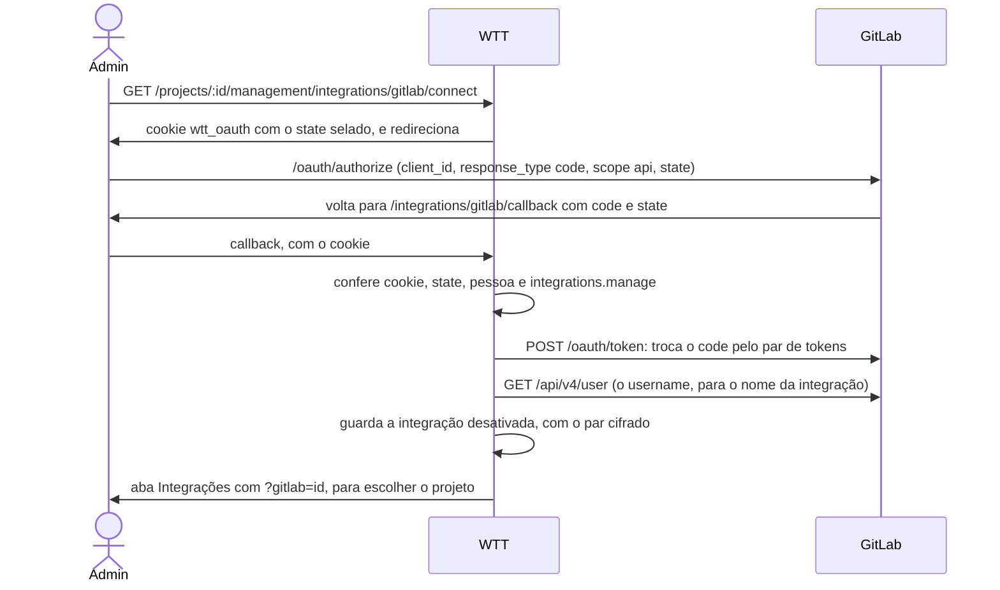
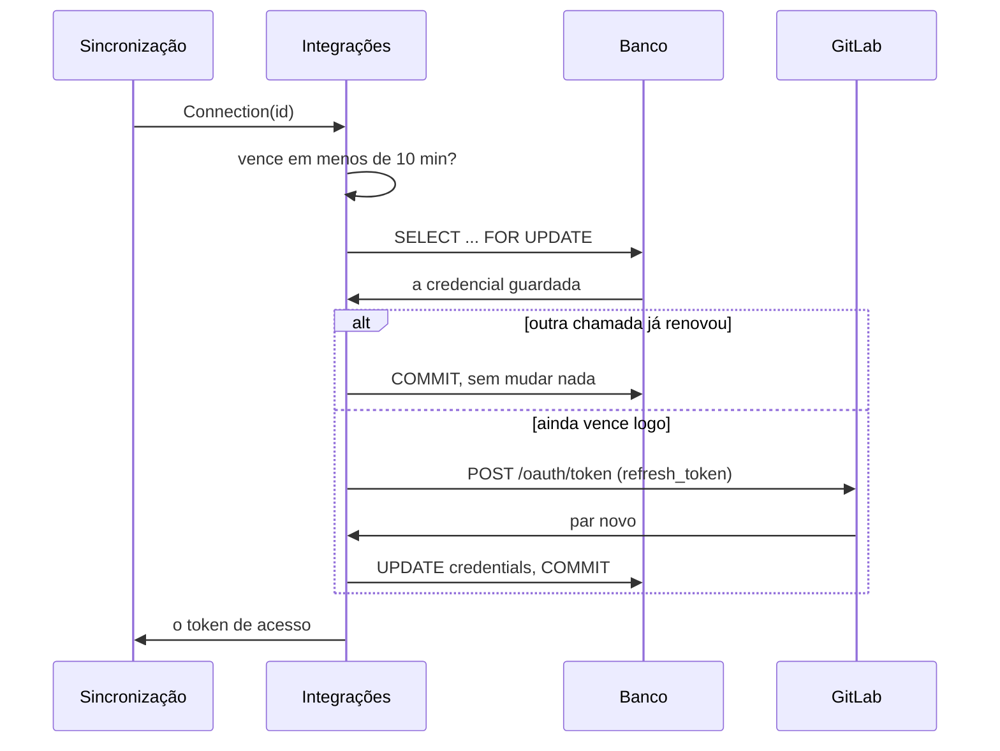

# GitLab

A integração com um projeto do gitlab.com: como conectar, o que a sincronização das issues com as tarefas faz campo a
campo e os limites dela. Ela é o mais parecida possível com a do [GitHub](github.md), e este arquivo diz onde ela
difere. O que é comum às plataformas (o vínculo, a regra de conflito, os gatilhos, a espera) está em
[overview.md](overview.md).

## Conectar

O botão **Conectar com o GitLab** usa um **app OAuth** do gitlab.com, cadastrado uma vez por servidor:

1. Em gitlab.com, **Preferências › Aplicações** (`gitlab.com/-/user_settings/applications`), **Adicionar nova
   aplicação**. *Redirect URI*: `PUBLIC_URL/integrations/gitlab/callback`. Marque **Confidencial** e o escopo
   **`api`**.
2. Copie o **Application ID** e o **Secret**. No `.env`: `GITLAB_CLIENT_ID`, `GITLAB_CLIENT_SECRET` e `PUBLIC_URL`.
   Reinicie o servidor.
3. Em Gestão › Integrações › **Nova integração** › GitLab › **Conectar com o GitLab**: autorize no GitLab, volte e
   escolha o projeto.

Sem as três variáveis, o botão avisa que a conexão não está configurada (`integration.gitlab_oauth_not_configured`).
`GITLAB_URL` e `GITLAB_API_URL` só apontam para o fake: um GitLab próprio de empresa não é oferecido. Ver
[configuração](../getting-started/configuration.md).



O vai e volta é o do GitHub, com o mesmo cookie e as mesmas conferências (ver [GitHub](github.md#conectar)). Um erro
volta à aba como `?gitlab_error=<código>`. **Reconectar** faz a mesma ida com `?integration=<id>` e troca o par da
integração que já existe. A conta nova que não enxerga o projeto escolhido é recusada, e o par antigo fica.

### O token que vence

Diferente do GitHub e do Trello, **o token de acesso do OAuth do GitLab vale 2 horas**, e renovar gira o par: o token
de renovação usado deixa de valer.

- A integração guarda o token de acesso, o de renovação e o vencimento, no mesmo JSON cifrado da coluna
  `credentials`. Não há coluna nova.
- Toda vez que o token sai do servidor para falar com o GitLab (a sincronização, a lista de projetos, a edição, os
  detalhes do item) e faltam menos de **10 minutos** para ele vencer, ele é renovado antes.
- A renovação **trava a linha da integração** (`SELECT ... FOR UPDATE`) e relê a credencial dentro da transação. Duas
  renovações nunca correm juntas, nem em dois processos (a troca de instância de um deploy). A que chega depois acha o
  par novo e não renova de novo.
- A edição da integração não regrava a credencial que leu, a menos que traga um token novo: senão poria o par velho
  por cima de uma renovação feita no meio.
- **O GitLab fora do ar** na hora da renovação: o token que ainda vale é usado, e a próxima chamada tenta de novo.
- **A autorização tirada** no GitLab (ou um token de renovação que já foi usado): o GitLab responde `invalid_grant`, o
  que vira `integration.invalid_token`. A rodada para, e o cartão pede **Reconectar**.



### Pontos de atenção

- **Um app tem os endereços de retorno que se cadastram nele**, um por linha: desenvolvimento e produção cabem no
  mesmo app.
- **O escopo é `api`**, que lê e escreve. A sincronização muda título, descrição, etiquetas, responsáveis e estado das
  issues, e cria etiquetas, **com a conta de quem conectou**. Sem a sincronização ligada, só lê.
- **A lista traz 100 projetos** de que a conta é membro, os mexidos há menos tempo primeiro. Os outros se digitam no
  campo, como `grupo/projeto` (com subgrupos) ou o endereço do projeto.
- **A API aceita um token pessoal** no `POST` de integração, com o escopo `api`, sem passar pela autorização. Ele não
  é renovado: vale até a data que a pessoa escolheu ao criá-lo.

## O que sincroniza

Com a caixa **Sincronizar as issues deste projeto com as tarefas** ligada, toda issue aberta vira uma tarefa, e as
duas ficam iguais. **Se os dois lados mudam o mesmo campo entre duas rodadas, vale o GitLab.** A regra campo a campo é
a do [GitHub](github.md#o-que-sincroniza), com estas diferenças:

| Assunto | No GitLab |
|---|---|
| Estado | O GitLab diz `opened`, que aqui é `open`. Fechar e reabrir é `state_event` (`close`, `reopen`). Não há o motivo do fechamento |
| O que é issue | Só `issue_type=issue`. Incidentes, casos de teste e tarefas filhas, que moram na mesma lista, ficam de fora (como os pull requests no GitHub) |
| Número | O `iid`, o número da issue dentro do projeto |
| Etiquetas | Vão separadas por vírgula. Uma que o projeto não tem é criada antes, como no GitHub |
| Prazo | O `due_date` não é lido nem escrito: o prazo fica só aqui, como no GitHub |
| Issue transferida | Continua no projeto antigo, fechada, com `moved_to_id`. Conta como sumida (`gone`), e não como fechada |

### Responsável

Pela **conta** da pessoa e, sem ela, pelo **e-mail público**, como no GitHub (ver
[contas das pessoas](overview.md#contas-das-pessoas)). Conectar a conta no perfil pede só o escopo `read_user`, e o
e-mail que fica guardado é o principal, que o `/user` dá ao dono do token. A tarefa importada de uma issue nasce só para
quem tem conta no GitLab. Há duas diferenças:

- O GitLab escreve o responsável pelo **id** do usuário (`assignee_ids`). O adapter acha o id pelo username antes de
  mandar. Um username que o GitLab não tem fica de fora, sem erro.
- O e-mail público só vem lendo o usuário (`GET /users/:id`). A busca por e-mail (`GET /users?search=`) também casa o
  nome e o username, então cada candidato tem o e-mail público conferido, e só vale se exatamente um o publica.

### Quem escreve e quem apaga

- **Pode escrever** quem tem nível **Planner** (15) ou acima no projeto, contando o que herda dos grupos acima dele
  (`GET /projects/:id/members/all/:user_id`). Guest só lê: as issues vêm para cá, e as mudanças daqui não vão
  (`issue_sync.read_only`). O projeto arquivado também é só leitura.
- **Guest que publica** uma tarefa abre a issue sem as etiquetas e sem o responsável, que o GitLab descarta.
- **Excluir a tarefa** com a caixa **Apagar a issue no GitLab** marcada apaga a issue só se a conta é **Owner** do
  projeto. Sem isso, ela é fechada, com o aviso `issue_sync.remove_only_closed`.
- **Projeto com as issues desligadas**: publicar responde `integration.issues_disabled`.

### As rodadas no GitLab

- **Incremental.** O GitLab filtra pela última mudança (`updated_after`, com `order_by=updated_at`), então a rotina de
  fundo pede só as issues mexidas desde a última rodada. O cursor é o relógio do GitLab (`Date`) no começo da
  listagem, menos 2 minutos. `GITLAB_SYNC_INTERVAL` vale sobre `SYNC_INTERVAL`.
- **Completa.** Na primeira vez, de hora em hora e em todo botão.
- **Paginação.** 100 issues por página (o `Link rel="next"`, do mesmo servidor), até 100 páginas
  (`integration.list_too_long`). A listagem para quando sobram menos de 25 requisições no limite.
- **Limite de requisições.** `429`, com `Retry-After` ou `RateLimit-Reset`: a rodada para, e a integração espera.
- **O projeto que sumiu** (ou que o token não enxerga mais) para a rodada inteira (`integration.gitlab_project_not_found`).

## Limites

- Só o **gitlab.com**. Um GitLab próprio de empresa pediria o endereço do servidor por integração e um app OAuth em
  cada servidor.
- Os textos têm os mesmos tetos do GitHub (65.536 caracteres na descrição, 50 numa etiqueta). Uma etiqueta com
  vírgula não se espelha bem, porque a API do GitLab recebe a lista separada por vírgulas.
- O responsável pelo e-mail tem o mesmo limite do GitHub: só funciona para quem publica o e-mail no perfil.
- Com a sincronização ligada, o projeto não troca. Ver [ligar e desligar](overview.md#ligar-e-desligar).

## Conferir sem o GitLab de verdade

`go run ./cmd/fakegitlab -addr :8093` (ou `make fake-gitlab`; `make fakes` sobe os três falsos) sobe o GitLab falso
dos testes (`testutil.GitLab`). Ele atende o OAuth na raiz, com a autorização que já volta aceita, a troca e a
renovação do token, e a API em `/api/v4`, com issues de vários jeitos. Aponte o servidor para ele:

```bash
GITLAB_URL=http://localhost:8093
GITLAB_API_URL=http://localhost:8093/api/v4
GITLAB_CLIENT_ID=gitlab-client-id
GITLAB_CLIENT_SECRET=gitlab-client-secret
```

O painel em `/_fake` mexe nas issues como se fosse outra pessoa no site do GitLab:

| Rota | O que faz |
|---|---|
| `GET /_fake/issues` | Lista as issues de `group/project` |
| `POST /_fake/issues` | Cria uma issue |
| `POST /_fake/issues/{iid}` | Edita uma issue |
| `POST /_fake/users` | Cadastra um usuário com e-mail público |
| `POST /_fake/access` | Muda o nível de acesso da conta (`{"level":30}`; 10 Guest, 15 Planner, 30 Developer, 50 Owner) |
| `POST /_fake/lifetime` | Quanto vale o token emitido daqui em diante (`{"seconds":60}`), para ver a renovação |
| `POST /_fake/revoke` | Revoga os tokens, como quem tira a autorização do app |
| `GET /_fake/requests` | Mostra o que o servidor pediu |
