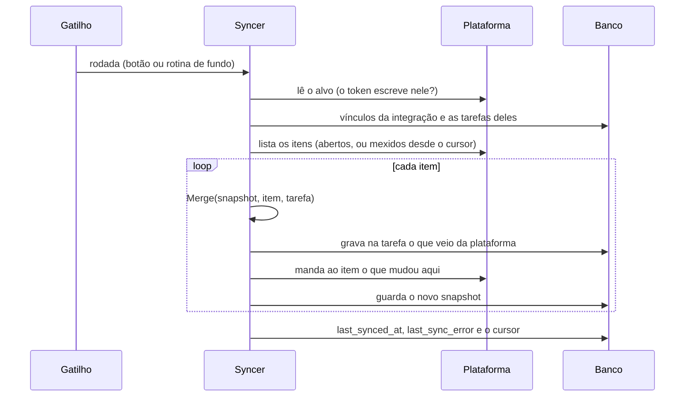
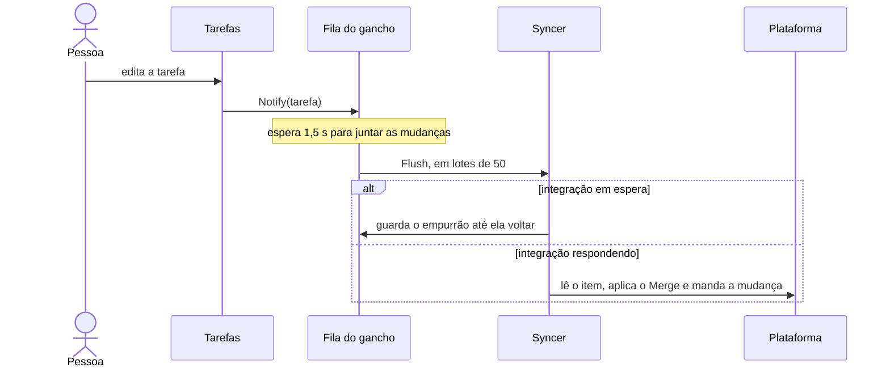
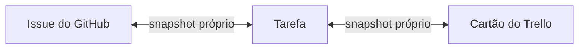

# Integrações

Como o sistema fala com o GitHub, o Trello e o GitLab: o modelo que as três integrações compartilham, a sincronização
dos itens (issues e cartões) com as tarefas e como acrescentar uma plataforma nova. O que é de cada uma fica em
[github.md](github.md), [trello.md](trello.md) e [gitlab.md](gitlab.md). O login pelo Clerk, que não é integração de
projeto, está em [clerk.md](clerk.md).

## Os tipos

Uma integração é de um **projeto** e aponta para um alvo na plataforma (um repositório, um quadro, um projeto do
GitLab). As tarefas do projeto se ligam aos itens desse alvo.

| `type` | Acesso | `metadata` | Sincroniza | Além do básico (`caps`) |
|---|---|---|---|---|
| `github` | Autorização no GitHub (**Conectar com o GitHub**). A API também aceita um token pessoal | `repo`: `dono/repositorio` ou o endereço | Sim | `assignee`, `server_since` |
| `trello` | Autorização no Trello (**Conectar com o Trello**). A API também aceita o token da API | `api_key` (interno), `board_id` (endereço, link curto ou id), `board_name` (escondido) | Sim | `deadline`, `auto_publish` |
| `gitlab` | Token com escopo `read_api` | `project_url`: `grupo/projeto` ou o endereço | Não | — (o tipo está "em breve") |

O básico da sincronização, que todo tipo com sincronização faz, é o nome, a descrição, as etiquetas e o estado
(aberto ou fechado).

## O modelo comum

Toda integração tem o mesmo corpo, seja qual for a plataforma. O que muda de uma para outra vai em `metadata`:

```json
{
  "type": "trello",
  "display_name": "Quadro do app",
  "token": "…",
  "metadata": { "api_key": "…", "board_id": "https://trello.com/b/AbC123xy/app" },
  "enabled": true
}
```

- **O token é o único segredo.** É cifrado com AES-GCM (`INTEGRATION_ENCRYPTION_KEY`) e nunca volta numa resposta:
  a resposta só diz `has_token`. Trocar a chave torna os tokens guardados ilegíveis
  (`integration.unreadable_credential`), e cada integração pede o token de novo na edição.
- **O `metadata` fica em claro** e volta nas respostas, então não é lugar de segredo. O adapter guarda só os campos
  que o tipo declara, já normalizados (`CheckMetadata`), e confere tudo que vai entrar numa URL da plataforma.
- **Criar valida na plataforma** antes de gravar (`Validate`). Editar só consulta a plataforma quando a conexão muda
  (um token novo ou outro alvo): renomear ou desativar não depende de o token ainda valer.
- **A integração conectada por autorização nasce desativada** e sem alvo, com o nome da plataforma e o login de quem
  autorizou (`GitHub · @login`). Ela é
  ativada quando a pessoa escolhe o repositório ou o quadro, numa lista que vem de
  `GET /api/integrations/:integrationId/repositories`. **Reconectar** (`?integration=<id>` na ida) troca o token de
  uma integração que já existe e o valida contra o alvo dela antes de valer.
- **Os detalhes do item** (título, estado, endereço) são buscados na hora, por
  `GET /api/tasks/:taskId/external-details?integration_id=`. Se a plataforma não responde, a resposta continua `200`,
  com `details` nulo e o motivo em `error`, e a tela mostra o motivo sem quebrar.
- **Quem pode o quê.** Criar, editar, excluir, listar os repositórios e o **Sincronizar agora** pedem
  `integrations.manage` no projeto. Ver as integrações é de qualquer pessoa do projeto. Ligar, sincronizar, publicar e
  desligar o item de uma tarefa é de quem vê a tarefa. Ver [permissões](../product/permissions.md).

As respostas de integração trazem também `sync_issues`, `last_synced_at`, `last_sync_error` (o código do último
aviso) e `sync_unmatched` (quantos itens têm responsável na plataforma sem ninguém daqui que corresponda).

### O `Descriptor`

Cada tipo se descreve num `Descriptor` (`internal/adapter/interface.go`). A tela desenha o formulário a partir dele
(as páginas de projeto o recebem em `window.BOOT.integration_types`). Os textos ficam no catálogo, em
`integration_types.<tipo>`. Só o nome da plataforma (`Label`) vem do código.

| Campo | O que diz |
|---|---|
| `Auth` | `"oauth"`: a tela mostra o botão Conectar e não tem campo de token. Vazio ou `"token"`: a pessoa cola um token |
| `Metadata` | Os campos do tipo. Cada um pode ser `Required`, `Summary` (o que identifica a conexão e o cartão mostra), `Internal` (a conexão o guarda, a tela não o mostra e a edição mantém o valor guardado), `Hidden` (a tela o preenche e não o mostra), ter um `Picker` (`select`, a lista fechada dos quadros, ou `datalist`, o campo com sugestões de repositório) e um `NameKey` (o campo com o nome legível do que se escolheu) |
| `ItemNumeric` | O id do item é um número (a issue). Num tipo assim, um id que não é número não é de item nenhum |
| `Sync` | O tipo implementa `IssueSyncer`. Só ele ganha a caixa da sincronização |
| `Caps` | O que a sincronização faz além do básico: `deadline` (o prazo da tarefa e a data de entrega do item se espelham), `assignee` (o responsável se liga pelo e-mail público), `server_since` (a plataforma filtra por data, então a rodada de fundo pode ser incremental), `auto_publish` (a tarefa criada aqui vira item sozinha) |
| `ComingSoon` | O tipo existe mas não se oferece: a tela o mostra desabilitado com o selo "Em breve", e o `POST` responde `400` `integration.type_coming_soon`. As integrações que já existem seguem valendo |
| `Configured` | Preenchido pela página: o servidor tem o app de autorização daquele tipo configurado |

## A sincronização

Com a caixa da sincronização ligada, **todo item aberto do alvo vira uma tarefa**, e as duas ficam iguais nos dois
sentidos. O código está em `internal/domain/issuesync`. O GitHub e o Trello usam o mesmo núcleo e mudam só no que
cada um declara em `caps`.

### Ligar e desligar

`PATCH /api/integrations/:integrationId` com `{"sync_issues": true}`. Para ligar, é preciso:

- um tipo com sincronização (`integration.sync_unsupported`);
- o alvo escolhido (`integration.sync_needs_repo`);
- a integração ativa (`integration.sync_needs_enabled`);
- um token guardado (`integration.no_credential`).

Com ela ligada **o alvo não troca** (`integration.sync_repo_locked`): é preciso desligar, trocar e ligar de novo.
Trocar o alvo com a sincronização desligada (`ResetSync`) esquece todos os vínculos daquela integração, inclusive os
feitos à mão, e o ponto de onde a rodada continuava.

Quem liga precisa de `integrations.manage`. Mas **qualquer pessoa do projeto que edita uma tarefa sincronizada
escreve na plataforma com a conta de quem conectou**.

### O vínculo e o snapshot

Cada item ligado tem uma linha em `issue_syncs`. Ela guarda a chave do item (o número da issue, o link curto do
cartão), o endereço, o estado e o **snapshot do último acordo** entre os dois lados. É contra o snapshot que se vê,
campo a campo, quem mudou o quê desde a última rodada.

| Estado | Quer dizer |
|---|---|
| `open`, `closed` | O item está aberto ou fechado na plataforma |
| `gone` | O item foi apagado, transferido ou levado para outro quadro. A tarefa fica como estava |
| `pending` | Ligado à mão e ainda não adotado (ver abaixo) |
| `task_id` nulo | Item **descartado**: a tarefa foi excluída ou desligada dele, e ele não volta a ser importado |

### A regra de conflito

A regra está em `merge.go`, sem banco nem rede. Ela lê três lados: o snapshot **B**, o item **R** na plataforma e a
tarefa **L** aqui.

- **Campo simples** (nome, descrição, prazo): se a plataforma mudou desde B, ela vence e a tarefa fica com o valor
  dela. Senão, se a tarefa mudou, a mudança vai para o item. Se ninguém mudou, nada acontece.
- **Etiquetas** não conflitam: o resultado é `(R ∪ (L∖B)) ∖ (B∖L)`. Parte do que a plataforma tem, soma o que a tarefa
  ganhou e tira o que a tarefa perdeu, e vai para os dois lados. Uma etiqueta que o alvo não tem é criada antes de o
  item recebê-la.
- **Estado.** A tarefa Fechada fecha o item, e reabrir a tarefa reabre o item. O item fechado fecha a tarefa. O item
  reaberto tira a tarefa de Fechada para backlog, e uma tarefa aberta (em progresso, aguardando fechamento) não muda.
- **Comparação.** Finais de linha do Windows e espaços nas pontas não contam como mudança. O título é cortado nos 255
  caracteres do nome da tarefa. O prazo é comparado ao segundo, em UTC.
- **Mudança descartada.** Quando a plataforma responde `200` sem gravar o que se mandou, a assinatura da tentativa fica
  guardada, e a mesma mudança não é repetida a cada rodada. Só uma mudança nova tenta de novo.

Prioridade, horas e os status Em progresso e Aguardando fechamento ficam só aqui, em todas as plataformas.

### Quando roda

| Gatilho | O que faz | Quem |
|---|---|---|
| **Sincronizar agora**, no cartão da integração | `POST /api/integrations/:integrationId/sync`: uma rodada completa | `integrations.manage` |
| **Sincronizar**, na Lista de tarefas e em Minhas tarefas | `POST /api/projects/:projectId/sync`: uma rodada completa em cada integração do projeto com a sincronização ligada, uma depois da outra, com os resumos somados | Qualquer pessoa do projeto |
| **Sincronizar**, no cartão do item na página da tarefa | `POST /api/tasks/:taskId/sync`: relê só aquele item (`?integration_id=`) ou todos os da tarefa | Quem vê a tarefa |
| **Gancho das tarefas** | Editar, mudar status ou etiquetas, pegar uma tarefa livre ou bater o ponto nela avisa o gancho, que espera 1,5 s para juntar as mudanças e empurra em lotes de 50 | Automático |
| **Rotina de fundo** | Olha cada integração ligada no intervalo do tipo dela | Automático |

O resumo de uma rodada é `{"created", "updated", "closed", "pushed", "unmapped", "errors", "partial"}`, e o da tarefa
traz também `problem`, o código do aviso que a plataforma deixou. `partial` diz que a rodada parou antes de olhar tudo.
Uma rodada sem diferença nenhuma não escreve nada na plataforma.

**A rotina de fundo.** Não há webhook: a plataforma não alcança o servidor. A rotina acorda no menor dos intervalos,
com um pequeno sorteio para espalhar as rodadas, e olha cada integração quando passou o intervalo do tipo dela. O
intervalo vem de `SYNC_INTERVAL` (o comum, `5m` por padrão), e `GITHUB_SYNC_INTERVAL` e `TRELLO_SYNC_INTERVAL` valem
sobre ele para a plataforma deles. `0` desliga a rotina (de todas ou só daquela plataforma), e os botões e o gancho
seguem valendo. A primeira rodada sai poucos segundos depois de o servidor subir. Ver
[configuração](../getting-started/configuration.md).

**Completa ou incremental.** A rodada completa lista todos os itens abertos e confere os ligados que não vieram na
lista (foram fechados, apagados ou transferidos). Um item fechado só é relido se a tarefa mudou desde o acordo. A
rodada incremental pede só os itens mexidos desde a última rodada, e só existe no tipo com `server_since` (o GitHub).
A rotina faz a completa na primeira vez e de hora em hora, e a incremental no meio. Os botões fazem sempre a completa.
Uma rodada manda mudanças a no máximo 100 itens, e o resto fica para a seguinte.





### Uma rodada por vez e a espera

- **Uma rodada por vez em cada integração.** Os botões respondem `409` `integration.sync_running` se já há uma, e o
  gancho e a publicação esperam a vez. A tarefa ligada a mais de um item tem também a vez dela, e é relida antes do
  Merge, para duas integrações não gravarem uma por cima da outra.
- **A espera.** Um erro que para a rodada inteira (o token recusado, a plataforma fora do ar, o limite de requisições,
  o alvo que sumiu) põe a integração em espera. O limite espera o tempo que a plataforma pedir. Os outros dobram a
  espera a cada falha, de 1 minuto até 1 hora.
- **A edição não se perde.** O empurrão de uma tarefa cuja integração está em espera fica guardado e volta à fila
  quando a espera acaba (a rotina de fundo o devolve). Um **Sincronizar** que dá certo, como o de depois de reconectar,
  acaba a espera na hora. Enquanto a integração está parada, o cartão do item na página da tarefa avisa, com o motivo.
- **A fila é da memória.** Um reinício a esquece, mas a rodada completa compara cada item com a tarefa e manda o que
  ficou.

### Os avisos

O cartão da integração mostra a última rodada, quantos itens têm responsável sem correspondência e o último aviso
(`last_sync_error`). Os avisos que não param a rodada, do mais grave para o mais leve:

| Código | Quer dizer |
|---|---|
| `issue_sync.read_only` | O token não escreve no alvo (ou o repositório está arquivado): os itens só vêm para cá, e as mudanças daqui não vão |
| `issue_sync.push_discarded` | A plataforma respondeu `200` sem gravar (sem permissão para etiquetas ou responsáveis) |
| `issue_sync.push_rejected` | A plataforma recusou a mudança (um título grande demais, uma etiqueta inválida) |
| `issue_sync.label_refused` | O token não pode criar etiquetas no alvo |
| `issue_sync.no_login` | O responsável escolhido aqui não tem usuário na plataforma que se ache pelo e-mail |

Os erros que param a rodada aparecem com o código deles, como `integration.invalid_token` ou
`integration.rate_limited`. A lista completa está em [erros](../api/errors.md).

## Uma tarefa em várias plataformas

Uma tarefa tem **no máximo um item por integração**, e um item serve a **uma tarefa só**. Então a mesma tarefa pode
estar ao mesmo tempo numa issue do GitHub e num cartão do Trello. O JSON da tarefa traz `links`, um por item
(`integration_id`, `integration`, `item_id`, `url`, `last_error`).



**A tarefa é o centro.** Cada item guarda o próprio snapshot do acordo com ela. Uma mudança num item chega à tarefa na
rodada dele, e da tarefa vai ao outro item pelo gancho, em poucos segundos. Fechar a issue fecha a tarefa e arquiva o
cartão, e reabrir faz o caminho de volta. Se os dois lados mudam o mesmo campo ao mesmo tempo, cada rodada dá a vez
à sua plataforma, a última ganha e o resultado converge. Uma etiqueta que o GitHub recusa trava aquele empurrão
inteiro (`issue_sync.push_rejected` no cartão dele).

### Ligar à mão

`POST /api/tasks/:taskId/link-external-item` (`{"integration_id", "external_item_id", "external_item_url"}`) cria um
vínculo `pending`. A primeira rodada em que o item está **aberto** o adota: a plataforma vence no nome e na
descrição, as etiquetas dos dois lados se somam e o responsável da tarefa fica como está. Um item já fechado não é
adotado. A rota responde `409` `task.already_linked` se a tarefa já tem item nesta integração, e `409`
`task.item_taken` se o item é de outra tarefa.

`DELETE` na mesma rota, com `?integration_id=` (obrigatório quando a tarefa tem mais de um item), solta a tarefa. O
vínculo que já tinha sido adotado vira item descartado. O que nunca foi adotado some. A tela não tem esse botão.

### Publicar uma tarefa numa plataforma

`POST /api/tasks/:taskId/publish` (`{"integration_id"}`) cria o item novo com o que a tarefa tem e a liga a ele:

- o nome e a descrição;
- as etiquetas, criadas no alvo se faltarem;
- o responsável, onde o tipo liga responsável;
- o prazo, onde o tipo tem data de entrega.

Daí em diante os dois ficam sincronizados. Pede a integração ativa, com a sincronização ligada e um token que escreve
no alvo. A resposta é `200` `{"task", "problem"}`. Os erros são:

- `409` `task.already_linked`: a tarefa já tem item **nesta** integração (nas outras ela pode ser publicada);
- `integration.sync_off`;
- `task.integration_other_project`;
- `issue_sync.publish_read_only`: sem escrita, a plataforma abriria o item sem as etiquetas e o responsável;
- `integration.issues_disabled` e `integration.trello_no_list`.

A tela chama a rota em dois lugares:

- **Nova tarefa.** Quando o projeto tem integração ativa, o modal ganha a etapa **Integrações**, com uma caixa por
  integração com a sincronização ligada. As caixas não se excluem: um clique só cria a tarefa aqui, no GitHub e no
  Trello. A caixa do **GitHub vem desmarcada**, e a tela publica a issue depois de criar a tarefa. A do **Trello vem
  marcada**, e é o servidor que posta o cartão sozinho (ver [Trello](trello.md)). Desmarcá-la manda `skip_publish`
  na criação. As integrações sem sincronização e o GitLab aparecem desativados, com o motivo.
- **Publicar no GitHub / no Trello**, na página da tarefa: um cartão para cada integração ativa, com a sincronização
  ligada, em que a tarefa ainda não está, só enquanto ela não está Fechada. É assim que uma issue que veio do GitHub
  vira cartão do Trello, e o contrário, sem a tarefa sair do lugar.

### Excluir a tarefa também nas plataformas

`DELETE /api/tasks/:taskId?remove_in=<integração>`, repetido (até 20), diz em quais integrações o item também sai. No
modal de exclusão é uma caixa por plataforma em que a tarefa está, **todas desmarcadas**.

- A tarefa sai primeiro, e depois cada plataforma, uma a uma. A falha numa não desfaz a exclusão nem trava a outra.
- A resposta é `200` `{"remote": [{"integration_id", "provider", "outcome", "problem"}]}`, com `outcome` igual a
  `deleted`, `archived`, `closed` ou `gone`.
- O GitHub **apaga** a issue, e só **fecha** como não planejada quando a conta não é admin do repositório
  (`issue_sync.remove_only_closed`). O Trello **arquiva** o cartão.
- Um token sem escrita responde `issue_sync.remove_read_only`.
- Sem `remove_in`, o item não é tocado: só vira descartado, e não volta a ser importado.

## Criar um tipo novo

1. Um arquivo em `internal/adapter` com o tipo que implementa `Integration`:
   - `Descriptor()`;
   - `CheckMetadata(raw)`: confere e normaliza o `metadata` sem falar com a plataforma;
   - `Validate(conn)`: consulta a plataforma para saber se a conexão funciona;
   - `FetchItemDetails(conn, itemID)`.

   Os três últimos recebem a `Connection`, com o token e o `metadata`. Dê ao tipo `BaseURL` e `Client` opcionais,
   para os testes o apontarem a um servidor fake.
2. Uma linha em `internal/adapter/registry.go`, no mapa e em `order` (a ordem da tela).
3. Os textos em `integration_types.<tipo>` nos dois catálogos (`about`, `token_hint`, `item_label`, os `fields`) e
   os erros novos com texto nos dois idiomas. Ver [erros](../api/errors.md).
4. As capacidades opcionais, cada uma uma interface:

   | Interface | Para quê |
   |---|---|
   | `RepositoryLister` | Listar o que a conexão enxerga, para a pessoa escolher |
   | `AccountLookup` | Dizer quem o token representa (a conexão por autorização usa) |
   | `IssueSyncer` | Ler e escrever os itens, para a sincronização (marque `Sync: true` e os `Caps`) |
   | `ItemNormalizer` | Aceitar o item escrito de outro jeito (o endereço no lugar do link curto) |
   | `ItemRemover` | Apagar ou arquivar o item da tarefa excluída. Sem ela, o item só é fechado |

5. Para conectar por autorização: `Auth: "oauth"`, um fluxo em `internal/domain/integration` e as rotas em
   `internal/routes/pages.go`, como as do GitHub e do Trello.

Nos testes, o transporte HTTP padrão recusa qualquer endereço que não seja da própria máquina. Cada plataforma tem um
servidor fake em `testutil`. Ver [o fluxo de desenvolvimento](../development/workflow.md).
