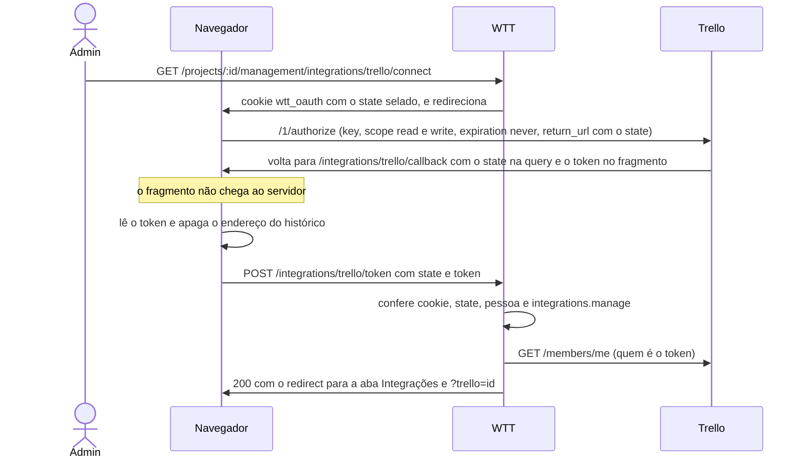

# Trello

A integração com um quadro do Trello: como conectar, o que a sincronização dos cartões com as tarefas faz campo a
campo, a postagem sozinha da tarefa nova e os limites. O que é comum às plataformas (o vínculo, a regra de conflito,
os gatilhos, a espera) está em [overview.md](overview.md).

## Conectar

O botão **Conectar com o Trello** usa a **chave de API** de um app do Trello, criada uma vez por servidor:

1. Em trello.com/power-ups/admin, crie um Power-Up (ele serve de app) e, na aba **API key**, gere a chave. Se o Trello
   recusar o endereço de retorno, acrescente o `PUBLIC_URL` (`http://localhost:1243`) em **Allowed origins**, na mesma
   aba.
2. No `.env`: `TRELLO_API_KEY`, só letras e dígitos, e `PUBLIC_URL`. `TRELLO_APP_NAME` muda o nome que a tela de
   autorização mostra (o padrão é "Working Time Tracker"). Reinicie o servidor.
3. Em Gestão › Integrações › **Nova integração** › Trello › **Conectar com o Trello**: autorize no Trello, volte e
   escolha o quadro. A lista traz os quadros abertos que a conta enxerga, com o espaço de trabalho de cada um.

Sem a chave ou o `PUBLIC_URL`, o botão avisa que a conexão não está configurada
(`integration.trello_oauth_not_configured`). `TRELLO_URL` e `TRELLO_API_URL` apontam para o fake. Ver
[configuração](../getting-started/configuration.md).

### O token no fragmento

A chave é pública, e o segredo é o **token** de cada pessoa. O Trello não tem o parâmetro `state` do OAuth, então o
nosso viaja na query do endereço de retorno. O token volta no **fragmento** da URL, que o navegador nunca manda ao
servidor. Quem o lê é a página de retorno.



A resposta de `POST /integrations/trello/token` é sempre `200` `{"redirect": "…"}`, com `?trello=<id>` ou
`?trello_error=<código>`. Quem clica em Negar volta sem token (`integration.trello_oauth_denied`).

### Pontos de atenção

- **O acesso é de leitura e escrita nos quadros, sem prazo.** Quem conectou o revoga na conta do Trello, e
  **Reconectar** troca por um token novo.
- **A chave do app fica guardada em cada integração**, no campo interno `api_key`, porque o token do Trello pertence à
  chave que o gerou. Trocar a chave no `.env` não quebra as integrações que já existem. Reconectar passa a usar a
  chave atual.
- **O token escreve com a conta de quem conectou.** Com a sincronização ligada, qualquer pessoa do projeto que edita
  uma tarefa sincronizada muda o cartão com essa conta.
- **Chave e token vão no cabeçalho** `Authorization`, nunca na URL.

## O que sincroniza

Com a caixa **Sincronizar os cartões deste quadro com as tarefas** ligada, **todo cartão aberto do quadro vira uma
tarefa**, e as duas ficam iguais. **Se os dois lados mudam o mesmo campo, vale o Trello.**

| Campo | Regra |
|---|---|
| Nome, descrição | O Trello vence. Senão, a mudança da tarefa vai para o cartão |
| Data de entrega ↔ prazo | Igual ao nome. A data é comparada ao segundo |
| Etiquetas | Cada lado soma e tira o que fez. A etiqueta do Trello só com cor aparece pelo nome da cor. A etiqueta daqui que o quadro não tem é criada nele antes, com uma cor tirada do nome (sempre a mesma para o mesmo nome) |
| Estado | O cartão **arquivado**, ou com a **data de entrega marcada como concluída**, fecha a tarefa. Fechar a tarefa arquiva o cartão e, se ele tem data de entrega, a marca como concluída. Reabrir a tarefa (backlog) desarquiva e desmarca |
| Data de criação | A tarefa importada nasce com a data em que o cartão foi criado, tirada do id dele. Só na importação: o Trello não deixa escolher a de um cartão novo |

**Ficam de fora:**

- As **listas**. Por enquanto um cartão é uma tarefa em qualquer lista.
- O **responsável**, porque o Trello não mostra o e-mail dos membros.
- Comentários, checklists e anexos.
- Prioridade, horas e os status Em progresso e Aguardando fechamento, que ficam só aqui.

### Importação e vínculo

- **Só cartão aberto vira tarefa**: em backlog, ligada ao cartão, com o selo "Trello" e o link curto.
- **O vínculo é pelo link curto** (o que vai na URL do cartão). Na tarefa ligada à mão, vale o link curto ou o endereço
  do cartão. Um id de 24 caracteres colado no vínculo não é reconhecido: use o link curto.
- **Tarefa já ligada à mão** passa a ser sincronizada em vez de o cartão virar outra tarefa (ver
  [ligar à mão](overview.md#ligar-à-mão)).
- **Cartão apagado ou levado para outro quadro** fica marcado como sumido (`gone`), e a tarefa fica como estava.
- **Excluir a tarefa** descarta o cartão, que não volta a ser importado. Com a caixa **Arquivar o cartão no Trello**
  marcada, o cartão é arquivado, não apagado: dá para restaurá-lo pelo Trello, e a data de entrega não muda.

## A tarefa criada aqui vira cartão sozinha

Num projeto com o Trello ativo e a sincronização ligada, **toda tarefa criada** (`POST /api/projects/:projectId/tasks`)
é postada como cartão na **primeira lista aberta do quadro**, com o nome, a descrição, as etiquetas (criadas no quadro
se faltarem) e o prazo como data de entrega. Daí em diante a tarefa e o cartão ficam sincronizados. No modal Nova
tarefa, a caixa do Trello já vem marcada.

- **Quem cria não espera o Trello.** A criação só avisa, e o worker da sincronização posta poucos segundos depois. A
  tarefa aparece com o selo "Trello" na lista seguinte.
- **É por integração.** A tarefa que o modal publica no GitHub também vira cartão. A que já tem um cartão deste quadro
  (ligado à mão) não ganha outro. Tarefas importadas de um cartão não voltam como cartão. O cartão sai na primeira
  integração do projeto que posta sozinha.
- **`skip_publish`.** A tarefa criada com `"skip_publish": ["<id da integração do Trello>"]` fica de fora. É o que o
  modal manda quando a pessoa desmarca o Trello, para criar uma tarefa só no GitHub. Um id que não é de nenhuma
  integração do projeto não casa com nada. Um que não é UUID, ou mais de 20 ids, responde `400`
  `task.integration_not_found`. A desmarcação vale também nas tentativas seguintes.
- **Se o Trello recusar por si**, a tarefa existe sem cartão e o cartão da integração mostra o aviso. É o caso de um
  quadro sem lista aberta (`integration.trello_no_list`) ou de um token que só observa.
- **Se o Trello estiver fora do ar ou pedir para esperar**, a tarefa fica esperando. A rotina de fundo ou o botão
  **Sincronizar** a tentam de novo, dez vezes no máximo.
- **A fila é da memória do servidor.** Um reinício esquece as tarefas que ainda esperavam, e
  `POST /api/tasks/:taskId/publish` as posta à mão. Ver [publicar](overview.md#publicar-uma-tarefa-numa-plataforma).

## As rodadas no Trello

O Trello não filtra os cartões por data, então **toda rodada olha o quadro inteiro**. Não há rodada incremental. É uma
chamada para os cartões abertos, mais uma por cartão ligado que saiu da lista desde o último acordo. O Trello também
não avisa quando um cartão muda: o que muda lá chega no próximo intervalo (`TRELLO_SYNC_INTERVAL`) ou no botão. O que
muda aqui vai em poucos segundos, pelo gancho.

- **Escrita.** O token escreve se a conta é membro do quadro, administradora ou comum. Um token que só observa traz
  os cartões e não escreve nada, e o cartão da integração avisa (`issue_sync.read_only`).
- **Limite de requisições.** O do Trello é de 100 requisições por 10 segundos por token. Quando ele recusa, a
  integração espera o `Retry-After` ou, sem ele, 15 segundos.
- **Sem redirecionamento.** O cliente não segue `301`, pelo mesmo motivo do GitHub: um `PUT` viraria `GET` e daria
  "200" sem gravar.

## Limites

- Uma descrição acima de 16.384 caracteres o Trello recusa, e a mudança fica só aqui.
- O nome de uma tarefa tem no máximo 255 caracteres. Um nome de cartão maior é cortado na importação.
- Com a sincronização ligada, o quadro não troca. Ver [ligar e desligar](overview.md#ligar-e-desligar).

## Conferir sem o Trello de verdade

`go run ./cmd/faketrello -addr :8092` sobe o Trello falso dos testes (`testutil.Trello`). Ele atende o site, com a
autorização que já volta aceita, e a API no mesmo endereço, com um quadro "App" de cartões de vários jeitos. Aponte o
servidor para ele:

```bash
TRELLO_URL=http://localhost:8092
TRELLO_API_URL=http://localhost:8092/1
TRELLO_API_KEY=0123456789abcdef0123456789abcdef
```

O painel em `/_fake` mexe nos cartões como se fosse outra pessoa no site do Trello:

| Rota | O que faz |
|---|---|
| `GET /_fake/cards` | Lista os cartões, os arquivados também |
| `POST /_fake/cards` | Cria um cartão (`name`, `desc`, `labels`, `due`, `dueComplete`, `closed`) |
| `POST /_fake/cards/{id}` | Edita um cartão |
| `POST /_fake/cards/{id}/delete` | Apaga um cartão |
| `POST /_fake/cards/{id}/move` | Leva um cartão para outro quadro |
| `POST /_fake/write` | Tira ou devolve a escrita no quadro |
| `POST /_fake/revoke` | Revoga um token |
| `POST /_fake/deny` | Faz a próxima autorização voltar sem token |
| `GET /_fake/requests` | Mostra o que o servidor pediu |
