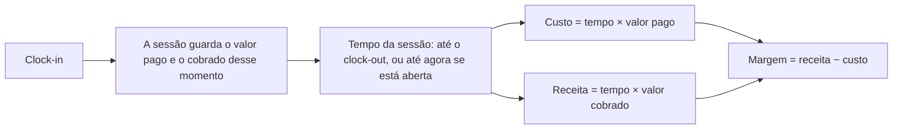

# Dinheiro

Como o tempo vira dinheiro: os clientes e os termos de cobrança, os dois valores por hora, a margem, a regra de pagamento
de cada pessoa, as contas a receber do modo solo e quem vê cada número. Quem pode mudar cada coisa está em
[permissions.md](permissions.md).

## Clientes

O cliente é quem contrata a organização. Só o nome é obrigatório; o país (que começa no da organização), o documento
fiscal, o contato, o e-mail e o telefone são opcionais. O documento é conferido pela regra do país do cliente: CNPJ no
Brasil, EIN nos EUA e texto livre de até 32 caracteres nos outros países (ver
[../development/i18n-and-countries.md](../development/i18n-and-countries.md)).

Só o dono cadastra, altera e exclui clientes (`customers.manage`). Um cliente com projetos não pode ser excluído
(`customer.has_projects`), nem um com recebíveis (`customer.has_receivables`: o dono os desfaz antes, na página
A receber do modo solo).

### Termos comerciais (modo solo)

Todo cliente tem um **modo de cobrança**, um ou outro, nunca os dois. A tela de Clientes só mostra o seletor e os
campos de cada modo na organização no **modo solo** (`organizations.solo`); a organização com equipe segue como era, e
todo cliente dela é por hora. A API traz os campos para todos (`GET /api/orgs/:orgId/customers`), e os valores são em
centavos, na moeda da organização.

| | Por hora (`hourly`, padrão) | Mensal (`monthly`) |
|---|---|---|
| O que é | As horas dos projetos vezes o valor cobrado de cada projeto | Um valor fixo por mês: o contrato |
| Só dele | `default_rate_cents`: o valor por hora que **preenche o campo** ao criar um projeto do cliente (opcional; vale o piso de 10,00) | `monthly_fee_cents` (obrigatório, maior que zero), `contract_start` (obrigatório) e `contract_end` (opcional, depois do início); `late_fee_bp` (multa, 200 = 2%), `late_interest_bp_month` (juros ao mês) e `grace_days` (tolerância depois do vencimento), que ficam num bloco recolhido na tela |
| Dos dois | `closing_day` (1 a 31, padrão 31: 31 é o último dia do mês, e o mês curto fecha no último dia dele) e `payment_days` (dias entre o fechamento e o vencimento, padrão 0) | |

- **Campo do outro modo é recusado** (`customer.field_hourly_only` e `customer.field_monthly_only`, com o campo), na
  tela (que só mostra os do modo escolhido) e no servidor. Trocar o modo apaga os campos do modo que saiu.
- **O mensal só vale no modo solo** (`customer.monthly_needs_solo`). Desligar o modo solo esconde as telas, e o
  cliente mensal segue guardado, como o documento do outro país.
- **O modo trava quando o cliente já tem projetos** (`409 customer.mode_locked`): a tela mostra o seletor desabilitado,
  com o motivo. Trocar o modo com projetos fica para depois (issue #25).
- **Teto dos termos.** O prazo e a tolerância vão até 365 dias, e a multa e os juros até 100% (10000 pontos-base), para
  um número absurdo não estourar uma data.

## Os dois valores por hora

| Valor | De quem | Onde fica | Regra |
|---|---|---|---|
| **Cobrado** | Do projeto: o que o cliente paga por hora | `projects.bill_rate_cents` | Obrigatório com cliente por hora; proibido sem cliente e com cliente mensal |
| **Pago** (o custo) | De cada pessoa em cada projeto: o que ela recebe por hora ali | `allocations.pay_rate_cents` | Obrigatório para estar no projeto |

- **Um projeto tem cliente e valor cobrado, ou é interno, sem os dois.** O cliente e o valor andam juntos
  (`PUT /api/projects/:projectId/billing`): sem valor com cliente por hora dá `project.bill_rate_required`, valor sem
  cliente dá `project.bill_rate_needs_customer`. O projeto interno não tem receita.
- **O cliente mensal não tem valor por hora.** O contrato é um valor por mês, então o projeto dele **não tem valor
  cobrado**, e informar um é recusado (`project.bill_rate_not_allowed`), na criação, em `PUT .../billing` e ao trocar o
  cliente do projeto (a regra segue o modo do cliente novo). As sessões desse projeto guardam `bill_rate_cents` nulo e
  o ponto funciona igual: as horas e o custo contam, e a receita vem do recebível mensal, não das horas.
- **O valor padrão do cliente por hora é uma cópia.** `default_rate_cents` só preenche o campo do valor cobrado ao
  criar um projeto (e ao trocar o cliente dele) nas telas; o projeto guarda o seu, e mudar um não muda o outro.
- **A mesma pessoa pode receber valores diferentes em projetos diferentes**: 20 num, 25 no outro.
- **Pisos e teto.** Os dois valores têm o piso de 10,00 por hora (`validate.MinRateCents`) e o teto de 1.000.000,00.
  Ninguém trabalha de graça, e todo cliente paga.
- **O dono não recebe por hora.** Entra nos projetos com valor pago zero, e o que ele tira do projeto é a margem. As
  sessões dele levam a marca `owner_hours`: o custo é zero, e o valor cobrado conta como receita.
- A **margem por hora** de uma pessoa num projeto é o valor cobrado menos o valor pago dela.

## Da sessão ao dinheiro



- **Mudar um valor só vale dali em diante.** Cada sessão guarda os valores do clock-in, então as sessões antigas não
  mudam.
- **Sem valor no projeto, não há ponto** (`work_session.no_rate`).
- **Arredondamento por sessão.** O valor de cada sessão é arredondado ao centavo, e os totais somam valores já
  arredondados, para a soma da tela bater com as linhas. Por isso o total da organização é a soma dos projetos.
- **Várias tarefas numa sessão** não multiplicam o dinheiro: a pessoa e o projeto contam a sessão uma vez só (ver
  [overview.md](overview.md#ponto)).

## Regra de pagamento

Cada pessoa pode ter uma **regra de pagamento**, que diz quando ela é paga. Só o dono define
(`PATCH /api/persons/:personId/payment`, `payments.manage`).

| Regra | Como é | Data do pagamento |
|---|---|---|
| **Mensal** | Um dia fixo do mês, de 1 a 31 | Esse dia. Num mês mais curto, o último dia |
| **Quinzenal** | Uma data de início, e daí períodos de 15 dias | O último dia de cada período |

O dia do pagamento é o **último dia do período**: o período fecha à meia-noite do fim desse dia, no fuso da
organização. Uma sessão que atravessa a virada conta em cada período só o trecho dela.

**Os períodos são calculados; a baixa é registrada.** O período corrente, os próximos e o histórico saem da regra e
das sessões, na hora (`internal/domain/payment`). O que fica gravado é só a **baixa** (tabela `payouts`): o dono marca
que pagou um período, a qualquer momento depois que ele começou, e a baixa guarda as horas e o valor calculados naquele
momento, o valor pago pelas horas (vem com o calculado e pode mudar) e um **bônus** opcional (zero quando não houve,
nunca negativo). O que a pessoa registra depois de uma baixa é o **restante** do período: volta para os pagamentos a
fazer, com o que já foi pago, e leva outra baixa, que cobre só ele. Por isso:

- trocar a regra recalcula onde os períodos passados caem; uma baixa antiga deixa de casar com os períodos novos, mas
  continua em Pagos recentemente com os números dela;
- excluir um projeto tira as sessões dele do histórico;
- quem não tem regra ainda tem as horas e o total **desde o início**, só sem períodos;
- o dono não é pago: não tem valor, não entra nas tabelas de Pagamentos nem em "sem regra".

**Onde aparece.**

- No **perfil** da pessoa: as horas e o valor do período corrente, o próximo pagamento e quantos dias faltam, o andamento
  contra a jornada, o total desde o início, o histórico dos períodos fechados (cada um com a baixa, "Pago em …", ou
  "Pendente") e as próximas datas (`GET /api/persons/:personId/payments`).
- Na página **Pagamentos** (`/orgs/:orgId/payments`, `GET /api/orgs/:orgId/payments`), só do dono: os cartões (o que
  pagar, atrasados incluídos, o que paga em 7 e 30 dias, as horas da equipe e quem está sem regra), **Próximos
  pagamentos** (os períodos sem baixa, o corrente de cada pessoa e os fechados dos últimos 60 dias, marcados Atrasado,
  e o restante dos que já tiveram baixa, com **Dar baixa**) e **Pagos recentemente** (as baixas dos últimos 30 dias,
  com o bônus, o restante que o período ganhou depois da baixa e **Desfazer**; `POST` e `DELETE /api/orgs/:orgId/payouts`). As tabelas seguem a data do pagamento, não as
  horas.

## Contas a receber (modo solo)

Na organização do **modo solo** (uma pessoa só), o dono acompanha o que cobra de cada cliente na página **A receber**
(`/orgs/:orgId/receivables`, `receivables.manage`, só o dono; `404` fora do modo solo). Cada conta a receber é um
**recebível**: um por cliente e período, com o valor que o dono confirmou e, depois, o que entrou. O sistema não emite
nota: o número dela é só uma anotação. As rotas estão em [../api/reference.md](../api/reference.md#contas-a-receber-modo-solo).

**Como o período fecha.** O cliente tem um `closing_day` (1 a 31; 31 é o último dia do mês, e um mês curto fecha no
último dia dele) e os `payment_days` entre o fechamento e o vencimento. O ciclo é a mesma conta da regra mensal de
pagamento da pessoa (`payment.PeriodAt`): o período vai do dia seguinte ao fechamento do mês anterior até o fechamento,
os dois dias inclusivos, e **fecha à meia-noite do fim do dia do fechamento, no fuso da organização**. O vencimento é o fim do
período mais os `payment_days`.

**O que o sistema propõe** (calculado na hora; nada é gravado até o dono confirmar):

| Modo do cliente | Períodos propostos | Valor proposto |
|---|---|---|
| **Por hora** | Os períodos **já fechados** com tempo nos projetos do cliente, ainda sem recebível. No máximo os 24 mais recentes | A soma das sessões de **todos os projetos do cliente**, cortadas no período e arredondadas ao centavo **por sessão**, pelo valor cobrado congelado nela (a mesma conta de [Da sessão ao dinheiro](#da-sessão-ao-dinheiro)). A sessão aberta conta até agora |
| **Mensal** | Do período do `contract_start` até o período corrente **e o seguinte**, parando no período que contém o `contract_end`, ainda sem recebível. No máximo os 60 mais recentes | A `monthly_fee_cents`. O primeiro mês parcial o dono corrige ao confirmar: não há pro-rata |

A proposta traz também o **valor por hora efetivo** (o valor dividido pelas horas). Abaixo de 10,00
(`validate.MinRateCents`) vira um **aviso** na tela, nunca um erro: no mensal, as horas só estão completas depois que o
período fecha.

**Confirmar** (`POST /receivables`) grava o recebível com as horas e o valor que o sistema calcula naquele momento
(`seconds`, `calculated_cents`), o valor que o dono confirmou (`amount_cents`, que ele pode ajustar), o vencimento, a
nota e a observação, e a moeda da organização (sem conversão). Uma hora registrada depois não reescreve o que foi
cobrado.

- **Por hora**: só depois que o período fechou (`409 receivable.period_open`).
- **Mensal**: a qualquer momento, inclusive adiantado (o período seguinte), mas só dentro do contrato.
- O período tem de ser um do ciclo do cliente (`400 receivable.not_a_period`) e confirma uma vez só
  (`409 receivable.already_confirmed`, garantido também pelo índice único em cliente e período).

**Receber** (`POST /receivables/:id/receive`) registra o dia (hoje, por padrão; depois de hoje é recusado) e o valor:

- **Por hora**: entra o valor confirmado; multa e juros são recusados.
- **Mensal**: o valor recebido é livre (maior que zero); a **multa** e os **juros** são zero ou mais e são partes
  informativas do valor recebido, então somados não passam dele.

**Multa e juros sugeridos** (`GET /receivables/:id/late-charges?on=`), só no mensal. Se a data passa de
`vencimento + grace_days`:

```
multa = valor × late_fee_bp / 10000
juros = valor × late_interest_bp_month / 10000 × diasAtraso / 30
```

Os dois são arredondados ao centavo (o meio centavo sobe). `diasAtraso` são os dias entre o **vencimento** e a data: a
tolerância adia a cobrança, mas não os dias que contam (passou da tolerância, os juros valem desde o vencimento). Antes
disso a sugestão é zero. Exemplo: 6.300,00 com 2% de multa e 1% ao mês, recebidos 10 dias depois do vencimento, são
126,00 de multa, 21,00 de juros e 6.447,00 no total. É só uma sugestão: o dono confirma ou muda os valores no modal de
receber.

**Atrasado** é derivado, não gravado: confirmado, sem recebimento e com hoje depois do vencimento.

**Desfazer.** `DELETE /receivables/:id/receive` desfaz o recebimento (a multa e os juros informados se vão com ele), e
`DELETE /receivables/:id` desfaz a confirmação, que volta a ser uma proposta. A confirmação com o recebimento registrado
não se desfaz (`409 receivable.already_received`): desfaça o recebimento antes. Editar (`PATCH`: valor, vencimento, nota
e observação) também só vale enquanto não foi recebido.

**A página.** Quatro cartões (a confirmar, em aberto, atrasado e recebido no mês) e três listas: **A confirmar**
(as propostas), **Em aberto** (confirmado e não recebido, com Receber, Editar e Desfazer confirmação) e **Recebidos**
(os 50 mais recentes, com Desfazer recebimento). "Em aberto" inclui o atrasado; "Recebido no mês" é a soma de
`received_cents` com `received_on` no mês do calendário da organização.

**Limites que valem saber.** Os períodos são calculados do cadastro do cliente de hoje, e "já cobrado" compara as
datas exatas do período. Por isso o cliente com recebíveis não troca o `closing_day` (`customer.closing_day_locked`;
mandar o dia que ele já tem passa): um dia novo geraria períodos por cima dos confirmados e as mesmas horas seriam
propostas de novo. Desfeitos os recebíveis, o dia muda. Pelo mesmo motivo, e porque a sessão não guarda o cliente (vale
o do projeto de hoje), o projeto com sessões não sai de um cliente que já tem recebíveis (`project.customer_locked`).
Receber um recebível cujo valor foi editado depois de a tela lê-lo é recusado (`receivable.changed`): o dono confere e
tenta de novo. Excluir o cliente com recebíveis é recusado (`customer.has_receivables`); apagar a organização leva tudo.

## Receita e Receita projetada (modo solo)

A tela inicial do [modo solo](overview.md#painéis) mostra duas contas de **datas diferentes**, e elas não se misturam. A
janela é de calendário no fuso da organização: Este mês, Mês passado ou Ano (de 1º de janeiro ao fim do mês corrente).

| | Receita | Receita projetada |
|---|---|---|
| O que é | O que **entrou**: o dinheiro que o dono marcou como recebido | O que se **espera** dos períodos de cobrança que terminam na janela, pagos ou não |
| A data que conta | O dia do recebimento (`received_on`) | O último dia do período (`period_end`) |
| Valor | A soma de `received_cents` (com a multa e os juros do mensal, que são partes dele) | O `amount_cents` do recebível, quando o período já foi confirmado; senão a proposta |

- **Uma cobrança de janeiro recebida em 5 de fevereiro é Receita de fevereiro** e projetada de janeiro. Desfazer o
  recebimento tira o valor da Receita e não mexe na projetada; desfazer a confirmação devolve o período a proposta, e
  a projetada passa a ser o calculado das horas (ou a mensalidade).
- **O confirmado vale mais que a proposta.** Se o dono ajustou o valor ao confirmar, é o ajustado que se espera, e as horas
  registradas depois da confirmação não o mexem. Cada período conta uma vez só: as propostas já excluem os períodos que
  têm recebível.
- **A proposta, na Receita projetada.** No cliente por hora ela traz também o **período em andamento**, com as horas até
  agora vezes o valor cobrado congelado nas sessões (no meio do mês, é o que se tem para receber até o fechamento). No
  mensal é a mensalidade do período do contrato, também o corrente. Os períodos do contrato mensal que terminam depois
  do fim do mês corrente (o seguinte, que se confirma adiantado) ficam para o mês deles.
- **Valor por hora efetivo** = Receita projetada ÷ horas da janela, ao centavo, ou um travessão sem horas. Abaixo do
  piso de 10,00 por hora é um aviso. O total divide pelas horas de **todos** os projetos, internos também; a linha de um
  cliente divide pelas horas dos projetos dele.
- **Limite que vale saber.** As horas são da janela de calendário e a projetada é dos períodos que **terminam** nela. Com
  `closing_day` 31 (o padrão) os dois coincidem; com outro dia de fechamento o mês tem horas de um período que só termina
  no mês seguinte, e o valor por hora efetivo do cliente é uma aproximação (chega a zero, com o aviso, num mês em que
  nenhum período dele termina).
- **Os tetos das propostas** (24 períodos fechados por cliente por hora e 60 por cliente mensal) não chegam a valer na
  tela: uma janela tem no máximo 12 períodos de cada cliente, sempre os mais recentes.

## Quem vê o quê

O dinheiro é um eixo à parte dos cargos: o admin gere gente e projetos, mas a cobrança e os pagamentos são do dono.

| Número | Dono | Admin | Administrador de projeto | Colaborador |
|---|---|---|---|---|
| Cliente e valor cobrado | ✔ | — | — | — |
| Receita e margem (projeto e organização) | ✔ | — | — | — |
| Custo do projeto e da organização | ✔ | ✔ | ✔ (seu projeto) | — |
| Valor pago dos colegas | ✔ | ✔ | ✔ (seu projeto) | — |
| O próprio valor pago e o que a sessão rendeu a ele | ✔ | ✔ | ✔ | ✔ |
| Regra e pagamentos de outra pessoa | ✔ | só as horas | — | — |
| Os próprios pagamentos | só as horas | ✔ | ✔ | ✔ |
| Contas a receber (modo solo) | ✔ | — | — | — |
| Receita, Receita projetada e valor por hora efetivo da tela inicial (modo solo) | ✔ | — | — | — |

Na prática, a API apaga o que quem chama não pode ver antes de responder. O valor cobrado, a receita e a margem saem
das sessões e da visão geral do projeto sem `billing.view`, e da visão geral da organização para quem não é o dono. O
valor pago dos colegas sai sem `rates.view` ou `rates.manage`. A regra de pagamento
(`payment`) de uma pessoa só vai para ela mesma e para o dono. A tabela completa, rota por rota, está em
[permissions.md](permissions.md).
