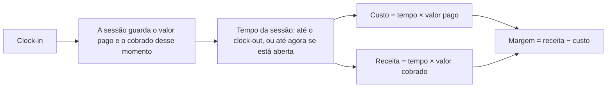

# Dinheiro

Como o tempo vira dinheiro: os clientes, os dois valores por hora, a margem, a regra de pagamento de cada pessoa e quem
vê cada número. Quem pode mudar cada coisa está em [permissions.md](permissions.md).

## Clientes

O cliente é quem contrata a organização. Só o nome é obrigatório; o país (que começa no da organização), o documento
fiscal, o contato, o e-mail e o telefone são opcionais. O documento é conferido pela regra do país do cliente: CNPJ no
Brasil, EIN nos EUA e texto livre de até 32 caracteres nos outros países (ver
[../development/i18n-and-countries.md](../development/i18n-and-countries.md)).

Só o dono cadastra, altera e exclui clientes (`customers.manage`). Um cliente com projetos não pode ser excluído
(`customer.has_projects`).

## Os dois valores por hora

| Valor | De quem | Onde fica | Regra |
|---|---|---|---|
| **Cobrado** | Do projeto: o que o cliente paga por hora | `projects.bill_rate_cents` | Obrigatório com cliente e proibido sem ele |
| **Pago** (o custo) | De cada pessoa em cada projeto: o que ela recebe por hora ali | `allocations.pay_rate_cents` | Obrigatório para estar no projeto |

- **Um projeto tem cliente e valor cobrado, ou é interno, sem os dois.** O cliente e o valor andam juntos
  (`PUT /api/projects/:projectId/billing`): sem valor com cliente dá `project.bill_rate_required`, valor sem cliente dá
  `project.bill_rate_needs_customer`. O projeto interno não tem receita.
- **A mesma pessoa pode receber valores diferentes em projetos diferentes**: 20 num, 25 no outro.
- **Pisos e teto.** Os dois valores têm o piso de 10,00 por hora (`validate.MinRateCents`) e o teto de 1.000.000,00.
  Ninguém trabalha de graça, e todo cliente paga.
- **O dono não recebe por hora.** Entra nos projetos com valor pago zero, e o que ele tira do projeto é a margem. As
  sessões dele levam a marca `owner_hours`: o custo é zero, e o valor cobrado conta como receita.
- A **margem por hora** de uma pessoa num projeto é o valor cobrado menos o valor pago dela.

## Da sessão ao dinheiro

- **Mudar um valor só vale dali em diante.** Cada sessão guarda os valores do clock-in, então as sessões antigas não
  mudam.
- **Sem valor no projeto, não há ponto** (`work_session.no_rate`).
- **Arredondamento por sessão.** O valor de cada sessão é arredondado ao centavo, e os totais somam valores já
  arredondados, para a soma da tela bater com as linhas. Por isso o total da organização é a soma dos projetos.
- **Várias tarefas numa sessão** não multiplicam o dinheiro: a pessoa e o projeto contam a sessão uma vez só (ver
  [overview.md](overview.md#ponto)).

## Regra de pagamento

Cada pessoa pode ter uma **regra de pagamento**, que diz quando ela é paga. Só o dono define
(`PATCH /api/persons/:personId/payment`, `payments.manage`).

| Regra | Como é | Data do pagamento |
|---|---|---|
| **Mensal** | Um dia fixo do mês, de 1 a 31 | Esse dia. Num mês mais curto, o último dia |
| **Quinzenal** | Uma data de início, e daí períodos de 15 dias | O último dia de cada período |

O dia do pagamento é o **último dia do período**: o período fecha à meia-noite do fim desse dia, no fuso da
organização. Uma sessão que atravessa a virada conta em cada período só o trecho dela.

**Tudo é calculado, nada é registrado.** Não há tabela de pagamentos nem marca de "pago": o período corrente, os próximos
e o histórico saem da regra e das sessões, na hora (`internal/domain/payment`). Por isso:

- trocar a regra recalcula onde os períodos passados caem;
- excluir um projeto tira as sessões dele do histórico;
- quem não tem regra ainda tem as horas e o total **desde o início**, só sem períodos;
- o dono aparece com horas e sem valor.

**Onde aparece.**

- No **perfil** da pessoa: as horas e o valor do período corrente, o próximo pagamento e quantos dias faltam, o andamento
  contra a jornada, o total desde o início, o histórico dos períodos fechados e as próximas datas
  (`GET /api/persons/:personId/payments`).
- Na página **Pagamentos** (`/orgs/:orgId/payments`, `GET /api/orgs/:orgId/payments`), só do dono: o que pagar nos
  períodos em andamento, o que fecha em 7 dias, as horas da equipe, as datas e quem está sem regra. A tabela segue a data
  do pagamento, não as horas.

## Quem vê o quê

O dinheiro é um eixo à parte dos cargos: o admin gere gente e projetos, mas a cobrança e os pagamentos são do dono.

| Número | Dono | Admin | Administrador de projeto | Colaborador |
|---|---|---|---|---|
| Cliente e valor cobrado | ✔ | — | — | — |
| Receita e margem (projeto e organização) | ✔ | — | — | — |
| Custo do projeto e da organização | ✔ | ✔ | ✔ (seu projeto) | — |
| Valor pago dos colegas | ✔ | ✔ | ✔ (seu projeto) | — |
| O próprio valor pago e o que a sessão rendeu a ele | ✔ | ✔ | ✔ | ✔ |
| Regra e pagamentos de outra pessoa | ✔ | só as horas | — | — |
| Os próprios pagamentos | só as horas | ✔ | ✔ | ✔ |

Na prática, a API apaga o que quem chama não pode ver antes de responder. O valor cobrado, a receita e a margem saem
das sessões e da visão geral do projeto sem `billing.view`, e da visão geral da organização para quem não é o dono. O
valor pago dos colegas sai sem `rates.view` ou `rates.manage`. A regra de pagamento
(`payment`) de uma pessoa só vai para ela mesma e para o dono. A tabela completa, rota por rota, está em
[permissions.md](permissions.md).
