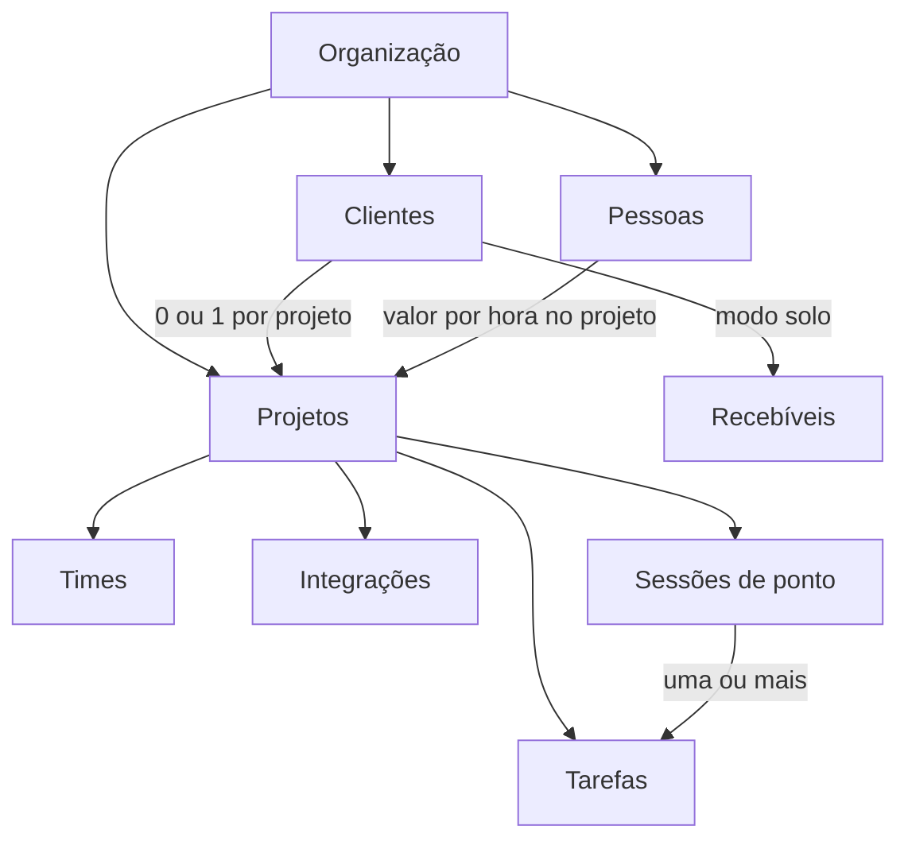
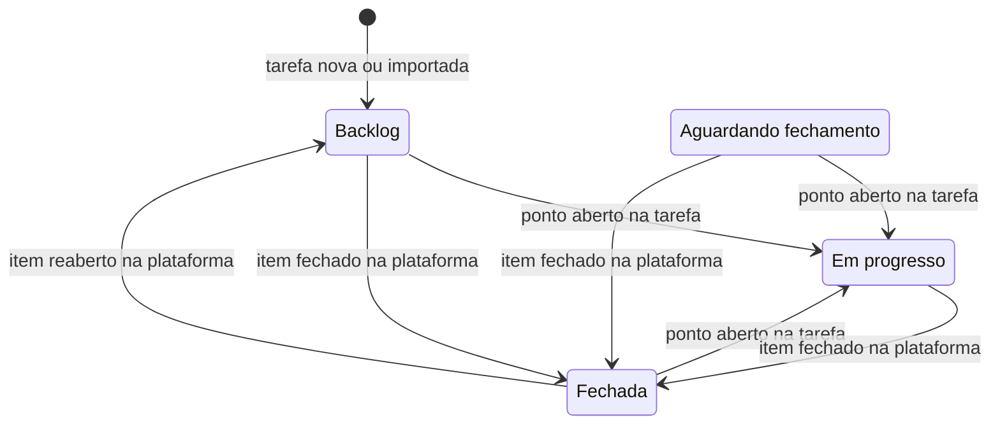

# Como o produto funciona

As regras do Working Time Tracker, área por área: a organização, os projetos e as pessoas, as tarefas, o ponto e os
painéis. Dinheiro e permissões têm arquivos próprios, [money.md](money.md) e [permissions.md](permissions.md). O passo a
passo para quem usa as telas está na ajuda do sistema (`/help`).

## Conceitos

A pessoa bate o ponto (**clock-in**) numa tarefa e encerra (**clock-out**) quando para. O sistema soma o tempo por
tarefa, por pessoa e por projeto, e transforma esse tempo em custo e receita.

| Conceito | O que é |
|---|---|
| Organização | A empresa, ou a pessoa que trabalha sozinha (modo solo). Cada pessoa pertence a uma só, e o e-mail é único no sistema |
| Cliente | Quem contrata a organização. Um projeto tem um cliente ou é interno. É cobrado por hora ou, no modo solo, por contrato mensal; a cobrança mora no cliente, e o projeto só soma um acréscimo ([money.md](money.md#a-cobrança-mora-no-cliente)) |
| Projeto | Onde o trabalho acontece. Tem tarefas, times, integrações e as pessoas que trabalham nele |
| Pessoa no projeto | Quem tem **valor por hora** no projeto (a alocação). Não existe outro jeito de estar num projeto |
| Time | Só agrupa pessoas dentro de um projeto, para achá-las. Não dá permissão nem autoridade |
| Tarefa | O que se faz. É sempre de um projeto e pode estar ligada a uma issue do GitHub ou do GitLab, ou a um cartão do Trello |
| Sessão de ponto | Um intervalo de trabalho de uma pessoa num projeto, com uma ou mais tarefas |
| Cargo | Dono, admin, administrador de projeto ou colaborador. Ver [permissions.md](permissions.md) |
| Recebível | Uma conta a receber de um cliente por período, que o dono confirma e depois dá como recebida. Só no [modo solo](#modo-solo); as regras estão em [money.md](money.md#contas-a-receber-modo-solo) |

## Organização

**Cadastro.** O cadastro tem duas etapas: primeiro a organização (nome, país, o nome da pessoa e, para quem trabalha
sozinho, o [modo solo](#modo-solo)), depois o acesso
(e-mail e senha de 8 a 72 caracteres). Quem cria a organização é o **dono**: tem o papel `admin` e a marca `is_owner`,
e só existe um por organização. Com o Clerk ligado, também dá para entrar e cadastrar pelo Google (ver
[../integrations/clerk.md](../integrations/clerk.md)).

**Boas-vindas.** No primeiro acesso, só o dono vê um modal em quatro etapas: os dados da organização (com a moeda e o
fuso), o primeiro cliente, o primeiro convite e onde ajustar cada coisa. As três primeiras podem ficar para depois.
No [modo solo](#modo-solo) são três etapas, sem o convite.
Fechar o modal de qualquer jeito o encerra para sempre. A data fica em `persons.onboarded_at`, gravada por
`POST /api/auth/onboarding/complete`, e `GET /api/auth/me` diz se falta (`needs_onboarding`). Quem entra por convite não
vê as boas-vindas.

**Perfil.** Resumo, descrição, contato (site, e-mail e LinkedIn), dados jurídicos (razão social, documento fiscal e
duas linhas de endereço), regime de trabalho (remoto, híbrido ou presencial), fuso e moeda. Todos os membros leem em
Configurações (`/orgs/:orgId/about`); só o dono edita. A moeda só muda como os valores aparecem: não há conversão.

**País.** A organização tem um país (`BR` ou `US`). Ele decide o documento fiscal (CNPJ ou EIN), as máscaras e os textos
do endereço. Na criação, define também a moeda e o fuso de partida (BRL e `America/Sao_Paulo`, ou USD e
`America/New_York`). Trocar o país depois não muda a moeda nem o fuso e não apaga o documento do outro país. O
**cliente** tem um país próprio, qualquer código ISO: no Brasil e nos EUA o documento é conferido, nos outros é texto
livre de até 32 caracteres. Os detalhes e como adicionar um país estão em
[../development/i18n-and-countries.md](../development/i18n-and-countries.md).

**Excluir.** Só o dono exclui a organização, e só depois que ela não tiver mais projetos. A exclusão apaga as pessoas,
os clientes, os recebíveis e os convites.

### Modo solo

Para quem atua sozinho (freelancer, PJ), a organização tem o **modo solo** (`organizations.solo`, `false` por padrão). A
tela o chama de **Trabalho sozinho(a)**, com uma dica. A organização é uma pessoa só: o que é de equipe some, e entra o
que é de quem cobra os próprios clientes (o **A receber**, que tem as suas regras).

- **Onde se escolhe.** Na etapa 1 do cadastro e na página de retorno do Clerk (a que pede o nome da organização), que
  criam a organização já no modo (`solo` no corpo de `POST /api/auth/signup` e de `POST /api/auth/clerk/signup`), e em
  Configurações, na edição da organização, que só o dono abre (`PATCH /api/orgs/:orgId`, `solo`). O modo vai no
  `GET /api/auth/me` como `organization_solo`, e é dele que as telas leem.
- **Ligar** pede exatamente **uma pessoa** na organização e **nenhum convite pendente** (um convite já aceito ou vencido não conta):
  senão `409 organization.solo_needs_single_person`, e a tela mostra o erro embaixo do check. No cadastro a conta sempre
  cabe. **Desligar sempre vale** e **esconde, não apaga**: os clientes mensais e os recebíveis ficam guardados, e o menu
  de equipe volta na mesma sessão.
- **Convidar** (da organização e do projeto) responde `409 organization.solo_no_invites`: uma organização de uma pessoa
  só não tem a quem convidar, e é isso que mantém a regra de ligar verdadeira enquanto o modo está ligado.
- **O que some.**

| Onde | No modo solo |
|---|---|
| Menu | Perde **Colaboradores** e **Pagamentos**, e ganha **A receber** (`/orgs/:orgId/receivables`, só quando a pessoa pode gerenciar os recebíveis, a permissão `receivables.manage`) |
| Páginas | `/orgs/:orgId/people`, `/orgs/:orgId/people/:personId` e `/orgs/:orgId/payments` respondem `404` |
| Projeto | Somem as abas **Colaboradores** e **Times** (a aba é uma só, dentro e fora da Gestão): `/projects/:projectId/collaborators`, `/projects/:projectId/management/teams` e o caminho antigo `/projects/:projectId/teams` respondem `404`, e a barra de abas e o aviso de valor por hora não a oferecem |
| Tela inicial | Perde a **Visão geral** da organização (com o cartão **Trabalhando agora**, o custo e a margem) e o bloco da **Equipe**, e ganha a [visão geral do solo](#painéis): horas, Receita, Receita projetada e a tabela por cliente. O **Seu painel** fica |
| Boas-vindas | Três etapas: organização, primeiro cliente e fim. Sem o convite, e sem o link para Colaboradores no fim |
| Modal Editar colaborador | Sem jornada semanal nem regra de pagamento: uma pessoa só, que é o dono e não é paga |
| Configurações | Sem **Regime de trabalho** e sem **Moeda**, na edição, no cartão "Como trabalhamos" e nas boas-vindas: a moeda segue o país (trocar o país na edição leva a moeda dele). Os campos voltam ao desmarcar o modo no formulário |
| Novo projeto | Com um cliente escolhido, o rádio **Cobrança: Por hora / Contrato mensal**. O modo e o contrato continuam no cliente e valem para todos os projetos dele: com o cliente ainda sem projetos, escolher o outro modo grava os termos no cliente (`PATCH /api/customers/:id`) antes de criar o projeto, e o contrato mensal se preenche ali mesmo; com projetos, o outro modo fica desabilitado, com o motivo. A lista de clientes mostra o modo de cada um, e a Gestão › Configurações do projeto mostra a cobrança, só para ler |
| Lista de tarefas | Uma lista só, **Tarefas**, com todas as tarefas do projeto, sem a coluna nem o filtro de responsável; "Atribuir a mim" fica nas que não têm responsável. A tarefa nova é sua (o modal não pergunta o responsável), e na página da tarefa não há "Outra pessoa" |
| Visão geral do projeto | Sem pessoas, times, quem está trabalhando, filtro e coluna de pessoa, nem custo e margem (o dono não tem custo); a receita fica. No projeto de um cliente mensal com estimativa de horas, o cartão **Estimativa do cliente** mostra as horas do período do contrato contra ela, com as deste projeto ([money.md](money.md#horas-estimadas-do-contrato-mensal)) |
| Outras telas | Sem o cargo ao lado do nome, sem a contagem de pessoas nos cartões de projeto, sem cargo e jornada no perfil, e a ajuda sem as seções de equipe (convites, colaboradores, pagamentos, cargos). Os textos que falam de "o time" ou de "alguém" têm uma versão do solo |

A API de pessoas e de pagamentos (`/api/orgs/:orgId/persons`, `/payments`, ...) não muda: o modo esconde telas e fecha os
convites, e não apaga nem recusa o que já existe. Uma organização com equipe (`solo = false`) continua exatamente igual.

## Projetos e pessoas

**Projeto.** Tem nome, descrição, duração da sprint (de 1 a 90 dias; 14 por padrão, e a tela oferece 7, 14 ou 30), uma
daily opcional (horário) e uma weekly opcional (dia e horário). Com cliente, pode ter também uma reunião semanal com
ele (dia e horário); tirar o cliente apaga essa reunião. Esses horários são de cada projeto, não da organização.

- Quem cria: o dono e os admins. O admin só cria projeto interno; projeto com cliente (e o acréscimo dele) é do dono. A
  cobrança é a do cliente: o formulário a mostra, só para leitura, e pede só o acréscimo do projeto.
- Quem vê: o dono e os admins veem todos. Os outros veem só os projetos em que estão, e qualquer rota de outro projeto
  responde `404` (ver [permissions.md](permissions.md#quem-vê-quais-projetos)).
- Excluir um projeto apaga os times, as alocações, as tarefas, as sessões e as integrações dele.

**Entrar no projeto.** Estar no projeto é ter **valor por hora** nele (a `Allocation`). O valor é obrigatório e é o que
libera o ponto. Ao pôr alguém no projeto, escolhe-se também o **grupo** de permissões: as telas oferecem Colaborador e
Administrador de projeto (os grupos estão em [permissions.md](permissions.md#grupos-do-projeto)). O dono entra sozinho, com
valor zero, no projeto que cria ou em que bate o ponto.

**Times.** Só quem já está no projeto entra num time (`team.no_rate`). Times servem para organizar a lista de pessoas.

**Tirar do projeto.** Apaga a alocação e os times da pessoa de uma vez e encerra o ponto que ela tinha aberto no
projeto. As tarefas e as horas dela ficam. Não há como apagar só o valor.

**Jornada semanal.** As horas por semana combinadas com a pessoa. É da pessoa e vale na organização inteira. O dono e
os admins definem; a pessoa lê no perfil, e o painel dela compara a semana com a jornada.

**Convites.** Valem 7 dias, servem uma vez e podem estar presos a um e-mail (aí só esse e-mail os aceita). O banco
guarda só o hash do token. Há dois caminhos:

| Convite | Quem faz | O que leva |
|---|---|---|
| Da organização (`/orgs/:orgId/invites`) | O dono e os admins (`people.manage`). Convidar um admin é só do dono | O papel. Com e-mail e o Clerk ligado, sai por e-mail; sem isso, é um link para copiar |
| Do projeto (`/projects/:projectId/invites`) | Quem tem `collaborators.manage` no projeto | E-mail obrigatório, papel de membro, e o valor por hora, o time e o grupo. Ao aceitar, a pessoa já entra no projeto com eles |

Um e-mail que já tem conta é recusado (`auth.account_exists`). Com o Clerk ligado, convidar o mesmo e-mail de novo
substitui o convite anterior. Os convites pendentes podem ser revogados. Numa organização no [modo solo](#modo-solo) os
dois caminhos respondem `409 organization.solo_no_invites`.

## Tarefas

**Campos.** Nome, descrição em Markdown (até 65.536 caracteres, o limite de uma issue do GitHub; sem imagens), status,
prioridade, etiquetas, responsável e prazo. Sem prazo informado, a tarefa nasce com 7 dias.

**Status.** Toda tarefa nasce em backlog. À mão, qualquer pessoa do projeto muda o status para qualquer outro. Alguns
eventos o mudam sozinhos:

Abrir o ponto numa tarefa (clock-in, ou entrar numa sessão aberta) a põe em progresso, de qualquer status. Parar não a
tira de lá: pausar não é terminar. As transições da plataforma só valem para tarefas ligadas a um item com a
sincronização ligada (ver [../integrations/overview.md](../integrations/overview.md)).

**Prioridade.** Urgente, alta, média, baixa ou sem prioridade (o padrão).

**Etiquetas.** São de cada projeto e só têm nome (até 50 caracteres). Quem tem `labels.manage` cria, renomeia e exclui;
os outros escolhem entre as que existem.

**Responsável.** É opcional. A tarefa sem responsável fica disponível para o time e passa a ser de quem:

- **bater o ponto** nela (ou a puser na sessão aberta);
- **pegar** a tarefa (`POST /api/tasks/:taskId/claim`), que não abre ponto nem muda o status. Se duas pessoas pegam
  juntas, só uma leva, e a outra recebe `409 task.already_assigned`.

Escolher outra pessoa como responsável só vale para quem está no projeto (`task.assignee_not_in_team`); para si mesmo,
sempre vale.

**Listas.**

- **Lista de tarefas**: duas listas, as **sem responsável** (para o time pegar) e as **com responsável** de outras
  pessoas. Busca e filtros por prazo, prioridade, status e etiqueta valem para as duas e ficam na URL. O filtro por
  responsável só existe na segunda.
- **Minhas tarefas**: as tarefas de que a pessoa é responsável, uma lista por status.

**Editar.** O nome e a descrição vão por `PATCH /api/tasks/:taskId`. Os detalhes (status, prioridade, responsável, prazo
e etiquetas) vão por `PATCH /api/tasks/:taskId/attributes`. A tela só manda o responsável e o prazo quando a pessoa os
mudou, para não desfazer uma tarefa que alguém acabou de pegar nem cortar a hora de um prazo vindo do Trello.

**Excluir.** Qualquer pessoa do projeto exclui uma tarefa. A tarefa sai das sessões, mas as sessões e as horas ficam. Se
ela está numa plataforma, o modal oferece apagar ou arquivar o item lá também (ver
[../integrations/overview.md](../integrations/overview.md)).

## Ponto

**Clock-in.** Abre uma sessão no projeto da tarefa. Cada pessoa tem no máximo uma sessão aberta **em cada projeto**, e
as de projetos diferentes correm ao mesmo tempo ([Decisão 27](../architecture/decisions.md)). O ponto é recusado
quando:

- a pessoa não tem valor por hora no projeto (`work_session.no_rate`);
- ela já tem uma sessão aberta neste projeto (`work_session.already_open`): a tarefa entra nela com "Adicionar à
  sessão". O índice único parcial `one_open_session_per_project` garante isso no banco, inclusive com dois pedidos ao
  mesmo tempo.

A sessão guarda os valores por hora do momento do clock-in (ver [money.md](money.md)). Se a tarefa não tinha
responsável, passa a ser de quem bateu o ponto, e ela vai para em progresso.

**Clock-out.** Encerra a sessão aberta do projeto da rota; as dos outros projetos continuam. Sem sessão aberta nesse
projeto, é `work_session.not_open`.

**Várias tarefas numa sessão.** A sessão começa por uma tarefa e pode ganhar outras, cada uma com o intervalo em que
esteve nela (`WorkSessionTask`):

- numa sessão aberta, a tarefa entra agora, vai para em progresso e, se não tinha responsável, vira de quem está com o
  ponto;
- numa sessão encerrada, entra do começo ao fim, sem mudar o status;
- a mesma tarefa pode entrar de novo, desde que os intervalos não se sobreponham (`work_session.task_overlap`);
- a sessão nunca fica sem tarefa (`work_session.last_task`);
- só quem bateu o ponto, o dono e os admins mexem nas tarefas de uma sessão, aberta ou encerrada.

**Como o tempo conta.** Cada tarefa conta o tempo cheio do seu intervalo, mesmo em paralelo com outra. O projeto e o
dinheiro contam a sessão uma vez só. Duas sessões da mesma pessoa ao mesmo tempo, em projetos diferentes, valem cada
uma o valor do próprio projeto, e cada projeto conta o tempo inteiro da sua; os totais que juntam projetos (as horas
do cliente, o dia e a semana da pessoa, o período de pagamento, a organização e o Início do modo solo) contam o tempo
sobreposto uma vez só. Exemplo: o A das 12h às 15h a 20,00/h e o B das 12h às 16h a 30,00/h dão 3 × 20 + 4 × 30 e 4
horas no total. Editar o começo e o fim de uma sessão ainda não existe.

**O balão das sessões.** As sessões abertas ficam numa pilha de cartões no canto da tela, um por projeto, com o nome
do projeto e o cronômetro. Dentro de um projeto aparece só o cartão dele, com uma linha "+N em outros projetos" que
abre os outros; o painel do timer do projeto mostra só a sessão dele.

**Quem vê as sessões.** Cada pessoa vê as próprias. Quem tem alguma permissão no projeto vê as de todos.

## Painéis

**Início da organização** (`/orgs/:orgId`):

- **Seu painel**, para todos: as horas de hoje e da semana (de segunda a domingo, contra a jornada, se houver), as
  tarefas abertas (com as atrasadas e as que vencem na semana) e as concluídas, a lista das suas tarefas de todos os
  projetos e a semana em barras, com as horas por projeto. Só o que é da própria pessoa, sem dinheiro nem colegas. É
  medido no fuso do navegador (`GET /api/orgs/:orgId/me/overview?tz=` e `GET /api/orgs/:orgId/me/tasks`). A tarefa não
  guarda quando foi fechada, então "concluídas" é o total.
- **Visão geral**, para o dono e os admins: todos os projetos somados, em 7 dias, 30 dias ou tudo, com as suas horas, as
  da equipe e o custo. A receita e a margem só vão para o dono. A sessão que atravessa a borda da janela conta só o
  trecho de dentro, e cada sessão é arredondada ao centavo, então o total da organização é a soma dos projetos.
- **Equipe**, para o dono e os admins: quem está com o ponto aberto agora e em que tarefa. Não existe no
  [modo solo](#modo-solo), nem o cartão Trabalhando agora da visão geral.
- **Visão geral do modo solo**, só para o dono, **no lugar** da Visão geral e da Equipe acima (a organização com equipe
  não muda). Uma janela de calendário no fuso da organização, escolhida num seletor: **Este mês** (padrão), **Mês
  passado** e **Ano** (de 1º de janeiro ao fim do mês corrente, para conter sempre o mês). Quatro cartões e uma tabela
  (`GET /api/orgs/:orgId/solo/overview?window=month|last_month|year`, `404` fora do modo solo e `403` para quem não é o
  dono):
  - **Horas**: o tempo trabalhado na janela, de todas as sessões (as dos projetos internos também). A sessão que
    atravessa a borda da janela conta só o trecho de dentro, e a aberta conta até agora.
  - **Receita**: o que **entrou** na janela, a soma de `received_cents` dos recebíveis com `received_on` dentro dela.
  - **Receita projetada**: o que se **espera** dos períodos de cobrança que **terminam** na janela. As duas contas têm
    regras próprias em [money.md](money.md#receita-e-receita-projetada-modo-solo).
  - **Valor por hora efetivo**: a Receita projetada dividida pelas horas da janela, ou um travessão sem horas. Abaixo do
    piso de valor por hora (`validate.MinRateCents`, 10,00) o cartão vira um aviso, que não é um erro.
  - **Por cliente**: Cliente, Tipo (por hora ou mensal), Horas, Receita, Projetada e Valor por hora efetivo, em ordem de
    nome, nunca por horas ou por valor (o sistema não ranqueia). Entra o cliente que tem horas, recebimento ou valor
    projetado na janela; as horas de um cliente mensal são as das sessões dos projetos dele (o dono bate ponto neles
    também). Uma linha **Sem cliente (internos)** traz só as horas dos projetos sem cliente. Sem nada na janela, a tabela
    dá lugar a um estado vazio. A tela não leva a páginas de equipe, que respondem `404` no solo.
  - **Estimativa**, uma coluna que só aparece quando algum cliente mensal tem
    [horas estimadas](money.md#horas-estimadas-do-contrato-mensal): "18h de 40h · 45%", com uma barra, das horas do
    período do contrato (o em andamento em Este mês, o anterior em Mês passado; nada em Ano). Quando o contrato não fecha
    no último dia, o período aparece embaixo, porque ele não é a janela da coluna Horas. A linha de um cliente mensal com
    estimativa entra na tabela mesmo sem nada mais na janela.

**Quem trabalha agora.** Para o dono e os admins, a Lista de tarefas marca se o responsável está com o ponto aberto, e a
aba Colaboradores do projeto mostra em que tarefa cada um está. Os dois leem `GET /api/orgs/:orgId/working-now`, que
não leva tempo nem dinheiro, e se atualizam a cada 30 segundos.

**Nenhuma tela ranqueia pessoas por horas.** Os painéis mostram quem trabalha agora e em quê, e nunca ordenam nem
comparam pessoas pelo tempo. Comparar horas sugere que quem trabalhou mais merece mais reconhecimento, e o valor
entregue nem sempre vem das horas. O bloco antigo de horas por pessoa ficou guardado sem uso
(`web/templates/partials/team_hours.gohtml`).

**Início do projeto** (`/projects/:projectId/overview`): o mesmo para todos. Tem o cronômetro com as tarefas em
andamento, as suas tarefas no projeto, o seu tempo de hoje e da semana e as suas sessões, com filtros por data e tarefa.

**Gestão do projeto** (`/projects/:projectId/management/...`): a área de quem cuida do projeto. Aparece para quem tem
alguma permissão nele, e cada aba pede a permissão do que mostra.

| Aba | O que tem |
|---|---|
| Visão geral | Pessoas, times, idade do projeto, integrações, atividade de 7 e 30 dias, quem está com o ponto aberto, tarefas atrasadas e as sessões de todos, com filtros e totais. O cliente, o valor cobrado, a receita e a margem só vão com `billing.view` |
| Colaboradores | Pôr e tirar pessoas, valor por hora, grupo e times. Não existe no [modo solo](#modo-solo) |
| Integrações | GitHub, GitLab e Trello (ver [../integrations/overview.md](../integrations/overview.md)) |
| Configurações | Os dados do projeto e, com `billing.view`, o cliente, a cobrança dele, o acréscimo do projeto e o valor cobrado |

**Perfil.** O perfil da própria pessoa (`/profile`) e o de um colaborador (`/orgs/:orgId/people/:personId`, só para o
dono e os admins) mostram a jornada, as horas por projeto, o período corrente e o histórico de pagamentos. O que cada
um vê do dinheiro está em [money.md](money.md#quem-vê-o-quê).

**A receber** (`/orgs/:orgId/receivables`, só o dono e só no modo solo): o que cobrar de cada cliente. Os cartões
(a confirmar, em aberto, atrasado e recebido no mês) e as listas A confirmar, Em aberto e Recebidos. As regras estão em
[money.md](money.md#contas-a-receber-modo-solo).

## Integrações

Uma tarefa pode estar ligada a uma issue do GitHub, a uma do GitLab e a um cartão do Trello ao mesmo tempo, sincronizados nos dois
sentidos. Ver [../integrations/overview.md](../integrations/overview.md).

## Ajuda

`/help` é uma página só com o passo a passo do primeiro uso, o que cada tela faz e as dúvidas comuns, em português e em
inglês (catálogos `help.*`). É **pública**: dá para mandar o link a quem ainda não tem conta. `/ajuda` redireciona para
ela, e cada trecho tem endereço próprio (`/help#new-project`).
