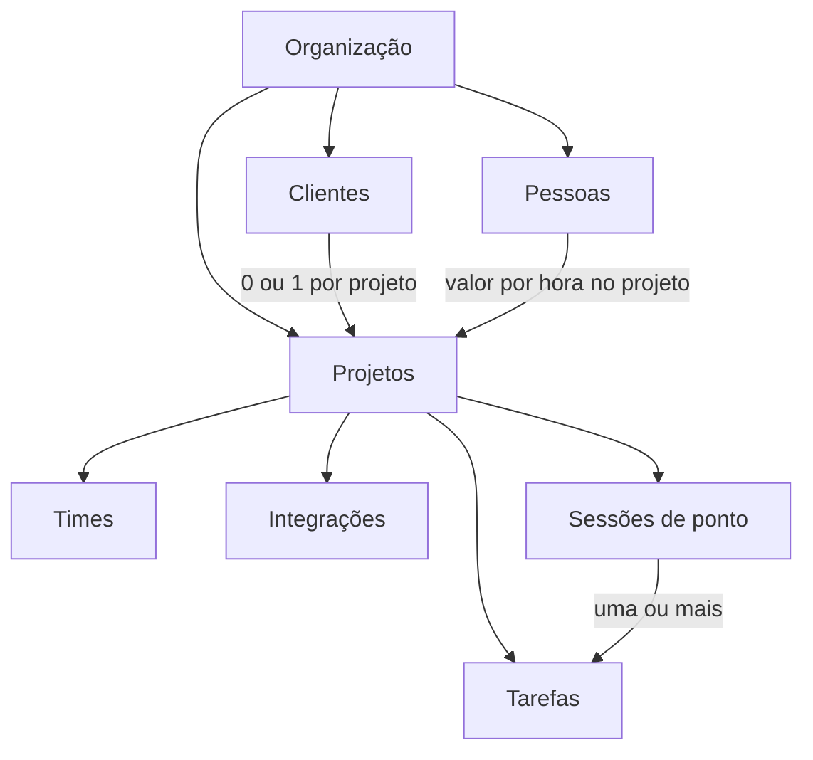
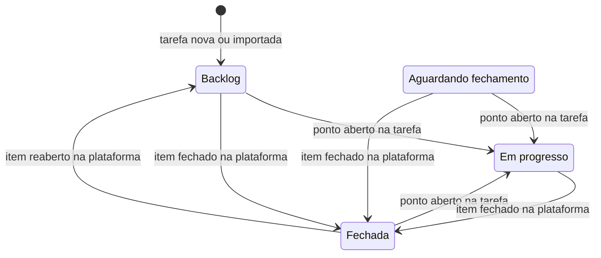

# Como o produto funciona

As regras do Working Time Tracker, área por área: a organização, os projetos e as pessoas, as tarefas, o ponto e os
painéis. Dinheiro e permissões têm arquivos próprios, [money.md](money.md) e [permissions.md](permissions.md). O passo a
passo para quem usa as telas está na ajuda do sistema (`/help`).

## Conceitos

A pessoa bate o ponto (**clock-in**) numa tarefa e encerra (**clock-out**) quando para. O sistema soma o tempo por
tarefa, por pessoa e por projeto, e transforma esse tempo em custo e receita.

| Conceito | O que é |
|---|---|
| Organização | A empresa. Cada pessoa pertence a uma só, e o e-mail é único no sistema |
| Cliente | Quem contrata a organização. Um projeto tem um cliente ou é interno |
| Projeto | Onde o trabalho acontece. Tem tarefas, times, integrações e as pessoas que trabalham nele |
| Pessoa no projeto | Quem tem **valor por hora** no projeto (a alocação). Não existe outro jeito de estar num projeto |
| Time | Só agrupa pessoas dentro de um projeto, para achá-las. Não dá permissão nem autoridade |
| Tarefa | O que se faz. É sempre de um projeto e pode estar ligada a uma issue do GitHub ou a um cartão do Trello |
| Sessão de ponto | Um intervalo de trabalho de uma pessoa num projeto, com uma ou mais tarefas |
| Cargo | Dono, admin, administrador de projeto ou colaborador. Ver [permissions.md](permissions.md) |

## Organização

**Cadastro.** O cadastro tem duas etapas: primeiro a organização (nome, país e o nome da pessoa), depois o acesso
(e-mail e senha de 8 a 72 caracteres). Quem cria a organização é o **dono**: tem o papel `admin` e a marca `is_owner`,
e só existe um por organização. Com o Clerk ligado, também dá para entrar e cadastrar pelo Google (ver
[../integrations/clerk.md](../integrations/clerk.md)).

**Boas-vindas.** No primeiro acesso, só o dono vê um modal em quatro etapas: os dados da organização (com a moeda e o
fuso), o primeiro cliente, o primeiro convite e onde ajustar cada coisa. As três primeiras podem ficar para depois.
Fechar o modal de qualquer jeito o encerra para sempre. A data fica em `persons.onboarded_at`, gravada por
`POST /api/auth/onboarding/complete`, e `GET /api/auth/me` diz se falta (`needs_onboarding`). Quem entra por convite não
vê as boas-vindas.

**Perfil.** Resumo, descrição, contato (site, e-mail e LinkedIn), dados jurídicos (razão social, documento fiscal e
duas linhas de endereço), regime de trabalho (remoto, híbrido ou presencial), fuso e moeda. Todos os membros leem em
Configurações (`/orgs/:orgId/about`); só o dono edita. A moeda só muda como os valores aparecem: não há conversão.

**País.** A organização tem um país (`BR` ou `US`). Ele decide o documento fiscal (CNPJ ou EIN), as máscaras e os textos
do endereço. Na criação, define também a moeda e o fuso de partida (BRL e `America/Sao_Paulo`, ou USD e
`America/New_York`). Trocar o país depois não muda a moeda nem o fuso e não apaga o documento do outro país. O
**cliente** tem um país próprio, qualquer código ISO: no Brasil e nos EUA o documento é conferido, nos outros é texto
livre de até 32 caracteres. Os detalhes e como adicionar um país estão em
[../development/i18n-and-countries.md](../development/i18n-and-countries.md).

**Excluir.** Só o dono exclui a organização, e só depois que ela não tiver mais projetos. A exclusão apaga as pessoas,
os clientes e os convites.

## Projetos e pessoas

**Projeto.** Tem nome, descrição, duração da sprint (de 1 a 90 dias; 14 por padrão, e a tela oferece 7, 14 ou 30), uma
daily opcional (horário) e uma weekly opcional (dia e horário). Com cliente, pode ter também uma reunião semanal com
ele (dia e horário); tirar o cliente apaga essa reunião. Esses horários são de cada projeto, não da organização.

- Quem cria: o dono e os admins. O admin só cria projeto interno; projeto com cliente e valor cobrado é do dono.
- Quem vê: o dono e os admins veem todos. Os outros veem só os projetos em que estão, e qualquer rota de outro projeto
  responde `404` (ver [permissions.md](permissions.md#quem-vê-quais-projetos)).
- Excluir um projeto apaga os times, as alocações, as tarefas, as sessões e as integrações dele.

**Entrar no projeto.** Estar no projeto é ter **valor por hora** nele (a `Allocation`). O valor é obrigatório e é o que
libera o ponto. Ao pôr alguém no projeto, escolhe-se também o **grupo** de permissões: as telas oferecem Colaborador e
Administrador de projeto (os grupos estão em [permissions.md](permissions.md#grupos-do-projeto)). O dono entra sozinho, com
valor zero, no projeto que cria ou em que bate o ponto.

**Times.** Só quem já está no projeto entra num time (`team.no_rate`). Times servem para organizar a lista de pessoas.

**Tirar do projeto.** Apaga a alocação e os times da pessoa de uma vez e encerra o ponto que ela tinha aberto no
projeto. As tarefas e as horas dela ficam. Não há como apagar só o valor.

**Jornada semanal.** As horas por semana combinadas com a pessoa. É da pessoa e vale na organização inteira. O dono e
os admins definem; a pessoa lê no perfil, e o painel dela compara a semana com a jornada.

**Convites.** Valem 7 dias, servem uma vez e podem estar presos a um e-mail (aí só esse e-mail os aceita). O banco
guarda só o hash do token. Há dois caminhos:

| Convite | Quem faz | O que leva |
|---|---|---|
| Da organização (`/orgs/:orgId/invites`) | O dono e os admins (`people.manage`). Convidar um admin é só do dono | O papel. Com e-mail e o Clerk ligado, sai por e-mail; sem isso, é um link para copiar |
| Do projeto (`/projects/:projectId/invites`) | Quem tem `collaborators.manage` no projeto | E-mail obrigatório, papel de membro, e o valor por hora, o time e o grupo. Ao aceitar, a pessoa já entra no projeto com eles |

Um e-mail que já tem conta é recusado (`auth.account_exists`). Com o Clerk ligado, convidar o mesmo e-mail de novo
substitui o convite anterior. Os convites pendentes podem ser revogados.

## Tarefas

**Campos.** Nome, descrição em Markdown (até 65.536 caracteres, o limite de uma issue do GitHub; sem imagens), status,
prioridade, etiquetas, responsável e prazo. Sem prazo informado, a tarefa nasce com 7 dias.

**Status.** Toda tarefa nasce em backlog. À mão, qualquer pessoa do projeto muda o status para qualquer outro. Alguns
eventos o mudam sozinhos:

Abrir o ponto numa tarefa (clock-in, ou entrar numa sessão aberta) a põe em progresso, de qualquer status. Parar não a
tira de lá: pausar não é terminar. As transições da plataforma só valem para tarefas ligadas a um item com a
sincronização ligada (ver [../integrations/overview.md](../integrations/overview.md)).

**Prioridade.** Urgente, alta, média, baixa ou sem prioridade (o padrão).

**Etiquetas.** São de cada projeto e só têm nome (até 50 caracteres). Quem tem `labels.manage` cria, renomeia e exclui;
os outros escolhem entre as que existem.

**Responsável.** É opcional. A tarefa sem responsável fica disponível para o time e passa a ser de quem:

- **bater o ponto** nela (ou a puser na sessão aberta);
- **pegar** a tarefa (`POST /api/tasks/:taskId/claim`), que não abre ponto nem muda o status. Se duas pessoas pegam
  juntas, só uma leva, e a outra recebe `409 task.already_assigned`.

Escolher outra pessoa como responsável só vale para quem está no projeto (`task.assignee_not_in_team`); para si mesmo,
sempre vale.

**Listas.**

- **Lista de tarefas**: duas listas, as **sem responsável** (para o time pegar) e as **com responsável** de outras
  pessoas. Busca e filtros por prazo, prioridade, status e etiqueta valem para as duas e ficam na URL. O filtro por
  responsável só existe na segunda.
- **Minhas tarefas**: as tarefas de que a pessoa é responsável, uma lista por status.

**Editar.** O nome e a descrição vão por `PATCH /api/tasks/:taskId`. Os detalhes (status, prioridade, responsável, prazo
e etiquetas) vão por `PATCH /api/tasks/:taskId/attributes`. A tela só manda o responsável e o prazo quando a pessoa os
mudou, para não desfazer uma tarefa que alguém acabou de pegar nem cortar a hora de um prazo vindo do Trello.

**Excluir.** Qualquer pessoa do projeto exclui uma tarefa. A tarefa sai das sessões, mas as sessões e as horas ficam. Se
ela está numa plataforma, o modal oferece apagar ou arquivar o item lá também (ver
[../integrations/overview.md](../integrations/overview.md)).

## Ponto

**Clock-in.** Abre uma sessão no projeto da tarefa. O ponto é recusado quando:

- a pessoa não tem valor por hora no projeto (`work_session.no_rate`);
- ela já tem uma sessão aberta, em qualquer projeto (`work_session.already_open`). O índice único parcial
  `one_active_session` garante isso no banco, inclusive com dois pedidos ao mesmo tempo.

A sessão guarda os valores por hora do momento do clock-in (ver [money.md](money.md)). Se a tarefa não tinha
responsável, passa a ser de quem bateu o ponto, e ela vai para em progresso.

**Clock-out.** Encerra a sessão aberta. Só vale pela rota do projeto da sessão (`work_session.open_in_other_project`).

**Várias tarefas numa sessão.** A sessão começa por uma tarefa e pode ganhar outras, cada uma com o intervalo em que
esteve nela (`WorkSessionTask`):

- numa sessão aberta, a tarefa entra agora, vai para em progresso e, se não tinha responsável, vira de quem está com o
  ponto;
- numa sessão encerrada, entra do começo ao fim, sem mudar o status;
- a mesma tarefa pode entrar de novo, desde que os intervalos não se sobreponham (`work_session.task_overlap`);
- a sessão nunca fica sem tarefa (`work_session.last_task`);
- só quem bateu o ponto, o dono e os admins mexem nas tarefas de uma sessão, aberta ou encerrada.

**Como o tempo conta.** Cada tarefa conta o tempo cheio do seu intervalo, mesmo em paralelo com outra. A pessoa, o
projeto e o dinheiro contam a sessão uma vez só. Editar o começo e o fim de uma sessão ainda não existe.

**Quem vê as sessões.** Cada pessoa vê as próprias. Quem tem alguma permissão no projeto vê as de todos.

## Painéis

**Início da organização** (`/orgs/:orgId`):

- **Seu painel**, para todos: as horas de hoje e da semana (de segunda a domingo, contra a jornada, se houver), as
  tarefas abertas (com as atrasadas e as que vencem na semana) e as concluídas, a lista das suas tarefas de todos os
  projetos e a semana em barras, com as horas por projeto. Só o que é da própria pessoa, sem dinheiro nem colegas. É
  medido no fuso do navegador (`GET /api/orgs/:orgId/me/overview?tz=` e `GET /api/orgs/:orgId/me/tasks`). A tarefa não
  guarda quando foi fechada, então "concluídas" é o total.
- **Visão geral**, para o dono e os admins: todos os projetos somados, em 7 dias, 30 dias ou tudo, com as suas horas, as
  da equipe e o custo. A receita e a margem só vão para o dono. A sessão que atravessa a borda da janela conta só o
  trecho de dentro, e cada sessão é arredondada ao centavo, então o total da organização é a soma dos projetos.
- **Equipe**, para o dono e os admins: quem está com o ponto aberto agora e em que tarefa.

**Quem trabalha agora.** Para o dono e os admins, a Lista de tarefas marca se o responsável está com o ponto aberto, e a
aba Colaboradores do projeto mostra em que tarefa cada um está. Os dois leem `GET /api/orgs/:orgId/working-now`, que
não leva tempo nem dinheiro, e se atualizam a cada 30 segundos.

**Nenhuma tela ranqueia pessoas por horas.** Os painéis mostram quem trabalha agora e em quê, e nunca ordenam nem
comparam pessoas pelo tempo. Comparar horas sugere que quem trabalhou mais merece mais reconhecimento, e o valor
entregue nem sempre vem das horas. O bloco antigo de horas por pessoa ficou guardado sem uso
(`web/templates/partials/team_hours.gohtml`).

**Início do projeto** (`/projects/:projectId/overview`): o mesmo para todos. Tem o cronômetro com as tarefas em
andamento, as suas tarefas no projeto, o seu tempo de hoje e da semana e as suas sessões, com filtros por data e tarefa.

**Gestão do projeto** (`/projects/:projectId/management/...`): a área de quem cuida do projeto. Aparece para quem tem
alguma permissão nele, e cada aba pede a permissão do que mostra.

| Aba | O que tem |
|---|---|
| Visão geral | Pessoas, times, idade do projeto, integrações, atividade de 7 e 30 dias, quem está com o ponto aberto, tarefas atrasadas e as sessões de todos, com filtros e totais. O cliente, o valor cobrado, a receita e a margem só vão com `billing.view` |
| Colaboradores | Pôr e tirar pessoas, valor por hora, grupo e times |
| Integrações | GitHub e Trello (ver [../integrations/overview.md](../integrations/overview.md)) |
| Configurações | Os dados do projeto e, com `billing.view`, o cliente e o valor cobrado |

**Perfil.** O perfil da própria pessoa (`/profile`) e o de um colaborador (`/orgs/:orgId/people/:personId`, só para o
dono e os admins) mostram a jornada, as horas por projeto, o período corrente e o histórico de pagamentos. O que cada
um vê do dinheiro está em [money.md](money.md#quem-vê-o-quê).

## Integrações

Uma tarefa pode estar ligada a uma issue do GitHub e a um cartão do Trello ao mesmo tempo, sincronizados nos dois
sentidos. Ver [../integrations/overview.md](../integrations/overview.md).

## Ajuda

`/help` é uma página só com o passo a passo do primeiro uso, o que cada tela faz e as dúvidas comuns, em português e em
inglês (catálogos `help.*`). É **pública**: dá para mandar o link a quem ainda não tem conta. `/ajuda` redireciona para
ela, e cada trecho tem endereço próprio (`/help#new-project`).
